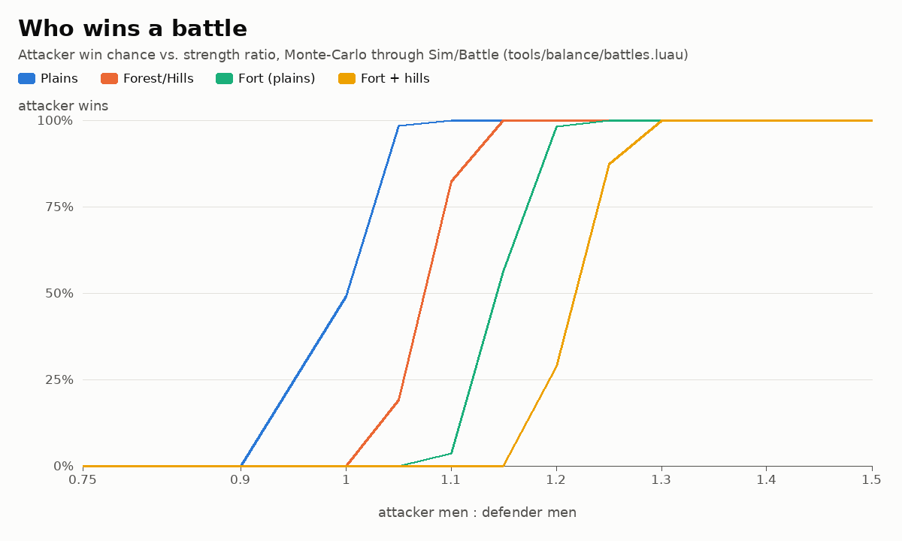
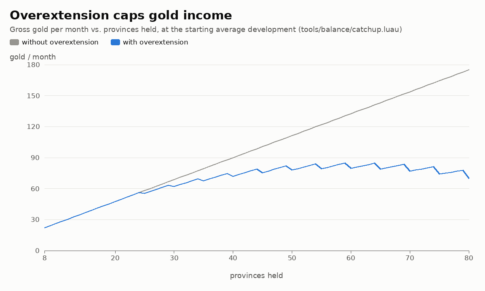
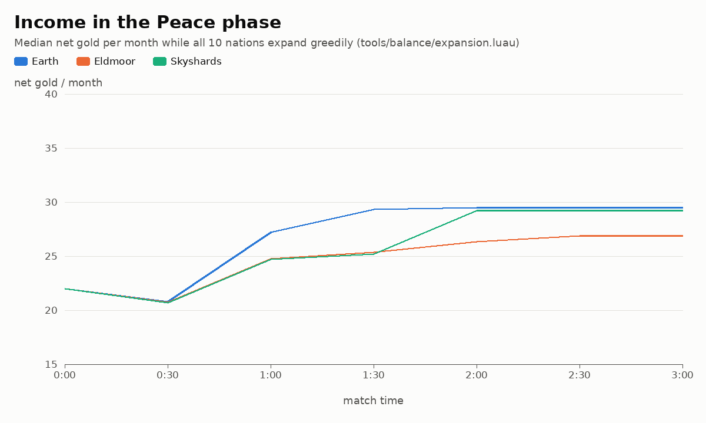
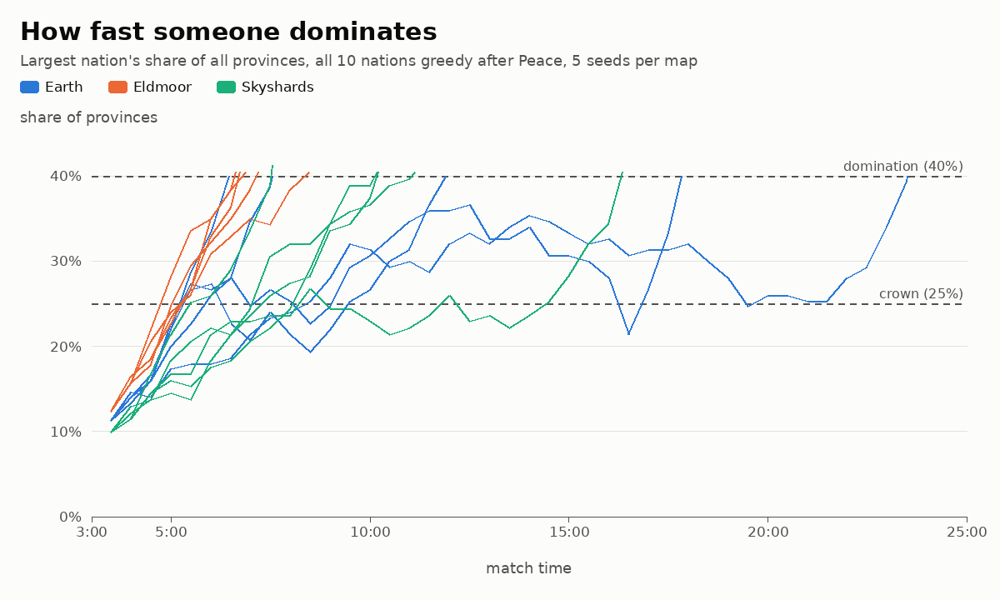

# How conquering works

The complete math of the current rules, read from the code (`src/shared/Sim/`, `src/shared/Config.luau`), and the numbers a designer needs to tune them. `docs/DESIGN.md` is the spec; this document says what the code actually does with it and what that means in a match.

Every number below comes from `Config.luau` as of this document or from one of the scripts in `tools/balance/`. The scripts call the real Sim modules, so after a Config change you rerun them and the numbers follow.

| Script | What it produces |
| --- | --- |
| `lune run tools/balance/maps` | Map facts: provinces, mountains, neutral land, garrisons (section 1) |
| `lune run tools/balance/battles` | Monte-Carlo battles through `Sim/Battle`: win chance and losses vs strength ratio; writes `tools/balance/data/battles.csv` (section 5) |
| `lune run tools/balance/conquest` | Time and cost to take a neutral province, through `Sim/Tick` (section 7) |
| `lune run tools/balance/catchup` | Overextension by size, where the thresholds sit, break-even ratios; writes `data/catchup.csv` (section 9) |
| `lune run tools/balance/expansion` | Whole matches with a greedy planner: Peace income, best-case domination, free-for-all; writes `data/expansion_*.csv` (sections 10–12). About 3 minutes (`MAP=earth` for one map). `SET="Siege.TicksPerDevelopment=20"` runs a what-if (section 14) |
| `lune run tools/harness/tournament` | Bot-only matches (Normal bots, 20 seeds × 3 maps, about 65 s): match length, wars, conquests, leader changes, Primordial powers used, army totals at 15:00 and 25:00 (section 15), wins per start slot against the fair share (section 17: use 200 seeds per map, about 12 min each), wins per race, regiments recruited per troop type and the troop mix (sections 18 and 19). Takes `SET="…"` too, and `RACES=shuffle` deals the map's races out to the nations at random every match |
| `lune run tools/balance/troops` | Troop matchups through `Sim/Battle`: how many attackers of one troop type beat a defender of another, and what each troop gives per gold of upkeep (section 18) |
| `python3 tools/balance/charts.py` | The four charts in `docs/images/balance_*.png`, from the CSVs (Pillow; matplotlib isn't installed) |

`tools/balance/Planner.luau` is the greedy player used by `expansion`. It is **not** the bot AI: it sends ordinary commands through `Sim/Commands`, so it obeys every rule, and it plays close to the fastest possible expansion. It never defends on purpose (armies standing in their own provinces still fight), so its matches are faster and bloodier than real ones. The bot tournament is the other bracket: Normal bots defend, keep a reserve and only attack at 1.3× strength, so their matches are slower than real players'. A real match sits between the two.

Time: 1 tick = 1 second = 1 game day. A month is 10 ticks. Peace is 0:00–3:00, War 3:00–20:00, Cataclysm 20:00–25:00.

## 0. The balance pass (what changed)

This document was first written before bots existed; its sections 13 and 14 listed rule problems and recommended Config changes. The balance pass fixed the rule problems, added two rules the first bot soak asked for, and applied the Config values below. All numbers in sections 1–12 are rerun under the new rules.

| Change | Before | After | Why (section) |
| --- | --- | --- | --- |
| Rival besiegers at peace | both stand still forever | the first besieger keeps the siege; the other waits and takes over (from zero) when it leaves | 13.1 |
| Shares (crown, domination, alliance) | % of all provinces | % of the **ownable** provinces (mountains don't count) | 13.2 |
| Retreats | teleport to the nearest owned province | walk there at normal speed; no orders, no fighting, no blocking or besieging on the way (🏳 on the token) | 13.3 |
| Interrupted siege | progress reset at once | progress kept for `Siege.GraceTicks` = 10 s | 13.4 |
| Armies in one province | any number of tokens | a nation's standing armies in one province merge (the lowest id stays) | 15 |
| Bot Primordial powers | never used | Meteor on the biggest army of a nation at war with the bot, not immune | 15 |
| `Army.UpkeepPerRegiment` | 0.5 | **1.5** | late-game army explosion (15), rush (12) |
| `Win.DominationShare` | 0.4 of all | **0.5** of ownable | 12 |
| `Win.AllianceShare` | 0.55 of all | **0.65** of ownable | 15 |
| `Battle.UnderdogBonus` | 0.2 | **0.5** | 14 |
| `Battle.CoalitionBonus` | 0.1 | **0.3** | 14 |
| `Diplomacy.CoalitionThreshold` | 0.25 of all | **0.2** of ownable | 14 |
| `StartManpower` | 5000 | **3000** | 14 |
| `Siege.TicksPerDevelopment` | 10 | 10 (kept) | 14: measured, but it halves bot wars |

**Match length, before → after:**

| Measure | Before | After |
| --- | --- | --- |
| Greedy free-for-all (planner, catch-up on, 15 games): median end | 8:29 | **25:00** (score win) |
| …games past 15:00 / reaching 25:00 | 3 / 0 of 15 | **12 / 8 of 15** (earliest end 11:31) |
| Greedy, catch-up off (same 15 seeds): median end | 8:40 | 14:29 |
| Best case, one greedy nation against nine frozen ones: fastest domination per map | 4:18–5:12 | 5:04–5:30 |
| Bot tournament (60 matches): median end | 25:00 | 25:00 |
| …ended before 25:00 (all by alliance victory) | 4 of 60 (21:05–23:40) | 10 of 60 (15:41–24:54) |
| …provinces taken from nations per match (Earth / Eldmoor / Skyshards) | 57.8 / 45.2 / 53.7 | 55.7 / 50.1 / 41.7 |
| …men in all armies at 25:00 (median, per map) | 484k–652k | **167k–216k** |
| …biggest nation's men at 25:00 | 156k–185k | **39k–54k** |

## 1. The maps

`tools/balance/maps.luau`:

| Map | Provinces (all) | Mountains | Ownable | Start-owned | Neutral | Neutral dev 1/2/3/4/5 | Neutral garrisons (men: count) | Provinces for crown (20%) / domination (50%) | Forest+hills share of land |
| --- | --- | --- | --- | --- | --- | --- | --- | --- | --- |
| Earth | 150 | 11 | 139 | 80 | 59 | 22/28/9/0/0 | 1000: 54, 2000: 5 | 28 / 70 | 52% |
| Eldmoor | 147 | 11 | 136 | 80 | 56 | 13/21/9/13/0 | 1000: 41, 2000: 2, 3000: 13 | 28 / 68 | 51% |
| Skyshards | 131 | 11 | 120 | 80 | 40 | 0/20/10/10/0 | 1000: 20, 2000: 10, 3000: 10 | 24 / 60 | 42% |

Every nation starts with 8 provinces and 17 development. (Rows updated after the start-position pass, section 17; the other sections were measured on the maps before it, with 146 Eldmoor provinces.) The crown, domination and alliance thresholds count only the **ownable** provinces: mountains can never be owned, so they don't count (before the balance pass, 40% of all provinces was really 43–44% of the land a nation could hold).

## 2. Economy

`Sim/Economy.luau`. Paid every 10 ticks (ticks 10, 20, 30, …), to every living nation.

| Flow | Per month |
| --- | --- |
| Gold from a province | development × 1, ×1.5 with a farm |
| Manpower from a province | development × 100, ×1.5 with barracks |
| Capital bonus | +5 gold, only while the nation holds its own capital |
| Overextension | gross gold (provinces + capital) × `CatchUp.overextension(provinces)` (section 9) |
| Upkeep | 1.5 gold per 1,000 men in the field (fractional: a 2,400-man army costs 3.6) |

Net gold = gross gold × overextension − upkeep. Gold can go negative (debt); nothing can be bought until it is positive again. Manpower has no cap and no upkeep.

**A starting nation** earns 17 + 5 = **22 gold and 1,700 manpower a month**, and starts with 100 gold and 3,000 manpower. Doing nothing, it holds 100 + 18 × 22 = **496 gold and 33,600 manpower at 3:00**. That buys 33 regiments, but 33 regiments cost 49.5 gold a month to keep, more than twice a starting income: **upkeep, not manpower, is what limits an army now**. A nation can keep about income ÷ 1.5 regiments (15 at the start, 50 on 75 gold a month) and has to stop recruiting, or run into debt, past that. Overextension cuts gold, so it also cuts the army a big nation can keep.

## 3. Costs and payback

Payback is in months (10 s). "Gold-equivalent" counts 100 manpower as 1 gold, the price ratio of a regiment (10 gold + 1,000 manpower).

| Purchase | Cost | Gain per month | Payback, gold only | Payback, gold-equivalent |
| --- | --- | --- | --- | --- |
| Develop 1 → 2 | 30 | +1 gold, +100 manpower | 30 months (5:00) | 15 months (2:30) |
| Develop 2 → 3 | 60 | +1 gold, +100 manpower | 60 months (10:00) | 30 months (5:00) |
| Develop 3 → 4 | 90 | +1 gold, +100 manpower | 90 months (15:00) | 45 months (7:30) |
| Develop 4 → 5 | 120 | +1 gold, +100 manpower | 120 months (20:00) | 60 months (10:00) |
| Farm on dev d | 50 | +0.5 d gold | 100 / d months (dev 2: 8:20, dev 4: 4:10) | same |
| Barracks on dev d | 40 | +50 d manpower | never in gold | 80 / d months (dev 2: 6:40, dev 4: 3:20) |
| Fort | 60 | none | never | — (defence: section 5; siege ×2: section 6) |
| Regiment | 10 gold + 1,000 manpower | −1.5 gold upkeep | — | upkeep over the 22 minutes of War + Cataclysm: 198 gold, 19.8× its price |
| Neutral province, dev d | ~330–1,400 men lost (section 7) | +d gold, +100 d manpower | | 0.7–14 months |

Develop also adds 5 score per level. In a 25-minute match (150 months) only level 1 → 2 and 2 → 3 pay back in gold before the end, and anything bought after ~10:00 only pays back as score. Taking land is by far the best investment: a neutral province pays back its losses in under 6 months in most cases.

## 4. Movement

`Sim/Movement.luau`, `Sim/Pathing.luau`. An army moves along a breadth-first path (fewest provinces, not fastest) through land it may enter: its own, allied, neutral, and enemy land at war. Never mountains, never land of a nation it is at peace with.

Entering a province takes the ticks of **that province's** terrain: **5 s for plains, 8 s for forest and hills.** An order given before a tick starts counting that tick, so one plains step arrives 5 ticks after the order. Crossing 3 plains provinces takes 15 s; 3 hill provinces, 24 s. Armies in battle don't move, and an army whose way closes (peace, an ally leaving) stops where it is.

After moving, a nation's armies that stand still in the same province (no route, not fighting, not retreating) **merge into one** (the lowest army id keeps the men). There is no split command: to besiege several provinces at once, recruit or send separate armies.

## 5. Battles

`Sim/Battle.luau`, tick step 3. When hostile armies share a province they fight `Rounds` = 3 rounds, one per tick, starting on the tick they meet (movement runs first, so an army fights on its arrival tick).

**Sides.** Defenders are the province owner and its allies if any of them is there; in neutral land, the garrison; otherwise the lowest-numbered army's side. Attackers are every army hostile to the defenders. Nations at peace sharing a province don't fight. Retreating armies take no part.

**Each round**, at the same time:

```text
attacker losses = 0.15 × defender men × defender modifier
defender losses = 0.15 × attacker men × attacker modifier
modifier = max(0.1, 1 + roll + terrain + fort + catch-up)
```

Losses are spread over a side's armies in proportion to their size and rounded to whole men. A battle stops early if a side reaches 0.

| Modifier | Who | Value |
| --- | --- | --- |
| Roll | each side, drawn once per battle, uniform | −0.10 … +0.10 |
| Terrain | defender in forest or hills | +0.25 |
| Fort | defender, if the province owner (or an ally) defends | +0.50 (not neutral garrisons) |
| Underdog | defending side containing an underdog (section 9) | +0.50 |
| Coalition | a nation's side fighting a crowned nation (section 9) | +0.30 |

**After round 3** the side with more men wins (a tie goes to the defender). Every loser army **retreats on foot**: it gets the shortest route (fewest steps, over land it may enter) to the nearest province its owner holds and walks it at normal speed. While retreating it takes no orders, doesn't fight, doesn't block a siege and doesn't besiege; it is an ordinary army again when it arrives (or when its way closes). With no way home, or under 500 men, it is destroyed. Winner armies under 500 men are destroyed too. Neutral garrisons never retreat, so a beaten garrison is always gone. Each winning nation gets +1 battle won (+2 score).

**Why the bonuses matter less than they look.** With equal modifiers m, the sum of both armies shrinks by (1 − 0.15 m) each round and their difference grows by (1 + 0.15 m): after 3 rounds the sum is ×0.614 and the difference ×1.521. So on plains **the larger army wins** unless the rolls flip a near-even fight, and a modifier only moves the break-even point a little, because the defender's bonus only applies to the kills of a shrinking army. The exact break-even ratio (attacker men per defender man to win half the time, `tools/balance/catchup.luau`, matching the Monte-Carlo to 0.001):

| Situation | Defender modifier | Break-even attacker : defender |
| --- | --- | --- |
| Plains | 1.00 | 1.000 |
| Forest/hills | 1.25 | 1.074 |
| Fort | 1.50 | 1.146 |
| Fort + hills | 1.75 | 1.217 |
| Plains, underdog defends | 1.50 | 1.146 |
| Forest/hills, underdog defends | 1.75 | 1.217 |
| Plains, coalition attacks the leader (attacker 1.30) | 1.00 | 0.919 |
| Plains, the leader attacks the coalition (defender 1.30) | 1.30 | 1.088 |
| Fort + hills, underdog defends against the leader | 2.55 | 1.436 |

A +25% terrain bonus is worth 7% more men, a +50% fort (or the underdog bonus) 15%, the +30% coalition bonus 8%. The ±10% roll moves the outcome by about ±3% of the ratio, so **battles are close to deterministic**: from 5% above break-even the attacker always wins.



Win chance and losses, 2,000 battles per row against a 3,000-man defender (`tools/balance/battles.luau`, full tables with all ratios and the catch-up cases in its output). Losses are the share of each side's men gone afterwards.

| Ratio | Plains: win / att. loss / def. loss | Forest/hills | Fort (= underdog on plains) | Fort + hills |
| --- | --- | --- | --- | --- |
| 0.90 | 0% / 44% / 34% | 0% / 55% / 32% | 0% / 66% / 31% | 0% / 77% / 29% |
| 1.00 | 49% / 39% / 39% | 0% / 48% / 37% | 0% / 58% / 35% | 0% / 68% / 34% |
| 1.10 | 100% / 34% / 43% | 82% / 43% / 42% | 4% / 52% / 40% | 0% / 61% / 38% |
| 1.25 | 100% / 30% / 50% | 100% / 37% / 48% | 100% / 44% / 47% | 87% / 52% / 45% |
| 1.50 | 100% / 23% / 61% | 100% / 29% / 59% | 100% / 35% / 58% | 100% / 41% / 57% |
| 2.00 | 100% / 16% / 91% | 100% / 20% / 88% | 100% / 24% / 85% | 100% / 28% / 83% |

Where defence bonuses really bite is **losses**: at 1.25 : 1 the attacker wins everywhere, but loses 30% of its men on plains and 52% against a fort in the hills. A losing army typically keeps 40–65% of its men and walks home, so one battle rarely destroys anything; at 2 : 1 the defender's remnant falls under 500 men (and is destroyed) only 25–55% of the time.

## 6. Sieges

`Sim/Siege.luau`, tick step 4. An army besieges when it stands still in a neutral province or one whose owner it is at war with, is not in battle, and nothing blocks it. Blockers: a neutral garrison, any army of the owner or its allies, or a battle there. Progress is +1 per tick; at the requirement the province flips at once (the owner changes, buildings and development stay). Army size doesn't matter: one regiment besieges as fast as forty. Retreating armies neither besiege nor block.

**One siege per province.** Whoever started it keeps it while one of its armies (or an ally's) stands there; a besieger at peace with it waits instead of blocking (no deadlock, no fight in Peace), and starts its own siege from zero once the first one is gone. When two arrive on the same tick, the lower army id starts first.

**Grace period.** An interrupted siege (a battle, a defending army walking in, the besieger stepping out) keeps its progress for `Siege.GraceTicks` = 10 s, then resets; a besieger that comes back or wins the battle in time carries on where it stopped. Peace with the owner, or the province changing hands, ends the siege at once. A Shield pauses it without the grace clock running.

Required ticks = 10 × development, ×2 with a fort, ×3 for a capital:

| Development | Plain | Fort | Capital | Fort + capital |
| --- | --- | --- | --- | --- |
| 1 | 10 s | 20 s | 30 s | 60 s |
| 2 | 20 s | 40 s | 60 s | 120 s |
| 3 | 30 s | 60 s | 90 s | 180 s |
| 4 | 40 s | 80 s | 120 s | 240 s |
| 5 | 50 s | 100 s | 150 s | 300 s |

Siege progress starts on the arrival tick (or the tick a battle there ends), so from the order an undefended province next door flips after **move + required − 1** ticks, and a defended one after **move + required + 1** (the 3-round battle adds 2, and with the grace period the battle no longer costs the progress made before it).

## 7. Neutral garrisons and the cost of a neutral province

Neutral land (not mountains) starts with a garrison of `NeutralGarrison` = 1,000 men unless the map sets more (section 1). Garrisons never move, never grow back, never get a fort bonus (the fort rule needs an owner), but do get the forest/hills +25%. They fight anyone, in Peace too.

From an owned province next door, through the real tick loop (`tools/balance/conquest.luau`, 40 rolls per row). The smallest force that always wins is 1 regiment more than the garrison (an equal force wins half the time and a 10% smaller one never):

| Garrison | Terrain | Regiments sent | Men lost | Loss cost | Time to flip, dev 1 / 2 / 3 / 4 / 5 | Payback, dev 1 / 2 / 4 |
| --- | --- | --- | --- | --- | --- | --- |
| 1,000 | Plains | 2 | 329 | 3.3 gold + 329 manpower | 16 / 26 / 36 / 46 / 56 s | 3.3 / 1.6 / 0.8 months |
| 1,000 | Forest/hills | 2 | 413 | 4.1 + 413 | 19 / 29 / 39 / 49 / 59 s | 4.1 / 2.1 / 1.0 |
| 2,000 | Plains | 3 | 719 | 7.2 + 719 | same | 7.2 / 3.6 / 1.8 |
| 2,000 | Forest/hills | 3 | 902 | 9.0 + 902 | same + 3 s | 9.0 / 4.5 / 2.3 |
| 3,000 | Plains | 4 | 1,109 | 11.1 + 1,109 | same | 11.1 / 5.5 / 2.8 |
| 3,000 | Forest/hills | 4 | 1,391 | 13.9 + 1,391 | same + 3 s | 13.9 / 7.0 / 3.5 |

Sending one regiment more barely lowers losses (329 → 269 men against 1,000 on plains), because the garrison's kills depend on its own size. The time to flip is the move plus 10 s per development plus 1 s: development, not the garrison, sets the time. The army is free again right after, so an army of 2 regiments can take a dev-2 plains neutral every ~26 s plus travel. (The loss cost leaves out upkeep: 2 regiments cost 3 gold a month while they march.)

## 8. Peace and tributes

`Sim/Diplomacy.luau`. War needs a shared border (straits count) and no truce; allies on both sides join. A peace offer lasts 30 s and may carry a tribute of 0, 50 or 100 gold, paid by the proposer to the accepter when it is accepted. Peace ends that whole war for everyone in it, and every pair of former enemies gets a 3-minute truce. No land changes hands: what was sieged stays sieged, and sieges still running between them end.

A 100-gold tribute is 4.5 months of a starting nation's income, or 10 regiments' price. It can't buy back land, so it is only worth paying to stop a war you are losing.

## 9. Catch-up

`Sim/CatchUp.luau`, hooked into `Economy.monthlyIncome` (one line) and `Battle.bonus`.

- **Overextension:** gold multiplier = 1 − 0.05 × floor((provinces − 20) / 5), never below 0. 21–24 provinces: ×1.00; 25–29: ×0.95; 30–34: ×0.90; 60: ×0.60. It cuts gross gold (provinces + capital) before upkeep. Manpower is not cut. With upkeep at 1.5, gold sets the army a nation can keep (section 2), so overextension now caps the leader's army too: at 60 provinces it can keep about 53 regiments instead of 88.
- **Underdog:** among living nations, a nation is an underdog if it is not the largest and it plus every nation at or below its province count make 3 or fewer. So the 3 smallest are underdogs, a tie at the cut-off leaves the whole tie out, nobody is one while all are level (the start of every match), and there are never more than 3. Their side gets +0.50 combat modifier **when defending in a battle**: not when attacking, not against sieges. An ally fighting beside an underdog on defence shares it.
- **Coalition:** every living nation with at least 20% of the **ownable** provinces wears the crown (normally one; two or more crowned nations are possible). Any side with a nation on it gets +0.30 when the other side has a crowned nation, attacking or defending. Neutral garrisons and Rebels don't get it. The client draws 👑 over the crowned nation's capital (over its first province if the capital is lost). Bots join a war against a crowned leader that is already at war.
- Eliminated nations are ignored by all three.



How much they bite (`tools/balance/catchup.luau`):

| Provinces | Gold multiplier | Gross gold / month without → with (average dev) |
| --- | --- | --- |
| 20 | 1.00 | 47.5 → 47.5 |
| 25 | 0.95 | 58.1 → 55.2 |
| 30 | 0.90 | 68.8 → 61.9 |
| 40 | 0.80 | 90.0 → 72.0 |
| 50 | 0.70 | 111.2 → 77.9 |
| 60 | 0.60 | 132.5 → 79.5 |
| 70 | 0.50 | 153.8 → 76.9 |

| Map | Crown at | Gold multiplier at the crown | Domination at | Gold multiplier at domination |
| --- | --- | --- | --- | --- |
| Earth | 28 provinces | 0.95 | 70 | 0.50 |
| Eldmoor | 27 | 0.95 | 66 | 0.55 |
| Skyshards | 24 | 1.00 | 60 | 0.60 |

Gross gold stops growing at about 55–60 provinces (~80 gold a month), well before domination now. In battle the underdog +0.50 is worth 15% more men and the coalition +0.30 is worth 8% (section 5).

## 10. Income growth in Peace

`tools/balance/expansion.luau`, part 1: all 10 nations run the greedy planner from 0:00 (expand into the best development-per-second neutral target they can beat, recruit on demand, spend spare gold on the best-yield improvement). Net gold is after upkeep for the armies the planner keeps.

| Time | Earth: provinces / net gold (median) | Eldmoor | Skyshards |
| --- | --- | --- | --- |
| 0:00 | 8 / 22.0 | 8 / 22.0 | 8 / 22.0 |
| 0:30 | 8.5 / 15.8 | 8 / 16.0 | 8 / 16.1 |
| 1:00 | 12 / 19.9 | 10.5 / 18.8 | 11 / 19.1 |
| 2:00 | 13.5 / 21.9 | 11.5 / 21.3 | 12 / 23.1 |
| 3:00 | 13.5 / 21.9 | 12 / 22.1 | 12 / 23.1 |



- A nation grows from 8 to **12–13.5 provinces** in Peace, as before; its gross income grows by about a third, but the armies it keeps for expanding eat most of that (net 22–23 gold at 3:00), and its manpower income grows from 1,700 to 2,800–2,950.
- **Neutral land runs out by 2:00–2:30** on every map (none left at 3:00), so the last 30–60 s of Peace are for building and recruiting. Doubling siege time would stretch the expansion to the end of Peace (section 14), but it halves the bots' conquests in the War.
- Start positions are uneven on Earth and Eldmoor: at 3:00 the best nation holds 16 (Earth) or 18 (Eldmoor) provinces and the worst 12 or 9. Skyshards is perfectly symmetric (12 each).

## 11. After Peace: snowball and the best case

`expansion.luau`, part 2: from the 3:00 state above, one nation keeps playing greedily and declares war on every neighbour, the other nine freeze (no commands, armies stay where they stood). Each of the 10 nations is tried as the aggressor. This is the fastest a nation can conquer against opponents who don't react: a **best case**, not a forecast.

| Map | Variant | Crown (20%) median / best | 50% domination median / best | Provinces at 4:00 | Net gold at 4:00 | Regiments at 4:00 |
| --- | --- | --- | --- | --- | --- | --- |
| Earth | real rules | 3:57 / 3:47 | **5:30 / 5:04** | 29.5 | 7.4 | 31.0 |
| Earth | catch-up off | 3:57 / 3:47 | 5:24 / 4:49 | 30 | 11.6 | 31.0 |
| Earth | opponents' armies removed | 3:53 / 3:42 | 4:59 / 4:36 | 33.5 | 11.3 | 35.0 |
| Eldmoor | real rules | 4:01 / 3:37 | **5:34 / 5:14** | 26 | 9.8 | 30.8 |
| Eldmoor | catch-up off | 4:01 / 3:37 | 5:27 / 5:14 | 26 | 11.3 | 31.9 |
| Eldmoor | opponents' armies removed | 3:57 / 3:31 | 5:01 / 4:38 | 29 | 8.0 | 34.6 |
| Skyshards | real rules | 4:04 / 4:02 | **5:38 / 5:30** | 21 | 11.9 | 30.3 |
| Skyshards | catch-up off | 4:04 / 4:02 | 5:32 / 5:29 | 21 | 12.1 | 30.3 |
| Skyshards | opponents' armies removed | 4:11 / 4:06 | 5:26 / 5:12 | 20 | 31.6 | 15.6 |

- **Best-case domination (now 50% of the ownable land): 5:04 on Earth, 5:14 on Eldmoor, 5:30 on Skyshards** (fastest slot, real rules; it was 4:18–5:12 for 40% of all provinces). Against frozen opponents nothing can stop a rush: movement and siege time are still the only limits, and the conqueror starts the War with ~30 regiments.
- What changed is the cost of keeping that army: at 4:00 the conqueror nets only 7–12 gold a month after upkeep, and most of its income goes to upkeep. Against opponents who fight back (section 12) that is what stops it.

## 12. Can a 25-minute match end early?

`expansion.luau`, part 3: from the same 3:00 state, all 10 nations keep playing greedily and attack every neighbour. Five seeds per map (only the battle rolls differ), with catch-up on and off.



| Map | Catch-up on: result (5 seeds) | Catch-up off |
| --- | --- | --- |
| Earth | 16:10, 17:18, score ×3 | 8:41, 9:33, 10:03, 10:25, 22:59 |
| Eldmoor | 11:31, 11:47, 16:36, 21:47, score | 10:58, 14:29, 14:29, 18:02, 19:08 |
| Skyshards | 14:45, score ×4 | 8:44, 9:46, 14:52, 15:45, 17:32 |

- With catch-up on, **8 of 15 greedy free-for-alls reach the score win at 25:00 and 12 of 15 last past 15:00**; the earliest ends at 11:31. Before the balance pass all 15 ended by domination, at a median 8:29.
- Catch-up now matters: the same seeds without it end at a median 14:29. Upkeep makes overextension cut armies, not just gold, and the coalition +30% is enough to beat a leader at 0.92 : 1.
- Shares rise and fall: in many long games the leader reaches 35–45% around 10:00 and is pushed back to 25–35% by 15:00 (the chart).

**Verdict:** a match against greedy, aggressive players now usually runs deep into the War or reaches the Cataclysm, and a rush against passive opponents still needs 5+ minutes of War. Against bots matches almost always reach 25:00 (section 15).

## 13. Things the numbers exposed (status after the balance pass)

1. **Two rival besiegers blocked each other for good in Peace.** Fixed: the first besieger keeps the siege, a later one at peace with it waits and takes over from zero when the first leaves (section 6). Bots no longer need their "smaller side gives way" workaround: a bot whose rival holds the siege gives way, and bots still don't march on a province a rival stands in. Tests: `tests/war.spec.luau`.
2. **Domination counted mountains.** Fixed: the crown, domination and alliance victory count ownable provinces only, on the server (`CatchUp.counts`, `Victory`), in bots and on the client's crown (`CatchUp.ownableCount`).
3. **Retreats teleported.** Fixed: beaten armies walk home at normal speed and can't be ordered, can't fight and don't block or besiege on the way; the token shows 🏳 and slides like any moving army, and the army sheet says where it is going. Harness scenario `retreat`.
4. **A siege reset when interrupted.** Fixed: 10 s grace (`Siege.GraceTicks`).
5. **Overextension only cuts gold.** Decided: kept as it is. With upkeep at 1.5 gold per regiment, gold is what limits an army (section 2), so the gold cut already shrinks the leader's army; cutting manpower too would add a second rule for little.
6. **Additive combat modifiers are weak.** Decided: kept additive (simple, and "+50%" on a modifier reads naturally); the catch-up bonuses were raised instead (+50% underdog, +30% coalition), so their effect in men (15% and 8%) is now big enough to matter.

New observations from the bot tournament:

7. **Late-game armies exploded** (one nation over 150,000 men at 25:00, 100+ tokens): gold income grows with development, and at 0.5 gold upkeep a nation could keep 2 regiments per gold of income. Fixed with `UpkeepPerRegiment` 1.5 and the merge rule (section 15).
8. **Manpower piles up.** Bots bank hundreds of thousands of manpower by the Cataclysm (over 200,000 each in a soak at the old upkeep) because gold, not manpower, limits recruiting. Harmless now (upkeep caps armies), but manpower barely matters after the first minutes. A manpower cap (EU4 style) would make it matter again; not done.
9. **Start positions:** Eldmoor's Frostmarch and Elderwood and Earth's Amazon win 7–9 of 20 bot matches each and Ironholds, Sunscorch, Tigris and Niger almost never; Skyshards is closer (Umbra 7, every other slot 0–3). Fixed (section 17): one cause was the bots' planning order (it followed nation ids), the rest was the maps.

## 14. The recommended Config changes, measured

The first version of this document recommended five Config changes without applying them. The balance pass measured them with both brackets (greedy planner and bots), under the fixed rules. The first four rows still had a hard army cap that was tried and dropped (see below):

| Change | Greedy FFA (median end, 15 games) | Bots (provinces taken from nations per match, Earth / Eldmoor / Skyshards) | Applied |
| --- | --- | --- | --- |
| None (fixed rules, old Config) | 8:42 | 37 / 34 / 29 | — |
| All five (siege 20, underdog 0.5, coalition 0.3, crown 0.2, start manpower 3000) | 11:28 | 18 / 21 / 10 | — |
| All five + domination 50% | 16:56 | same | — |
| Four (siege kept at 10) + domination 50% | 14:43 | 31 / 32 / 24 | — |
| Four + domination 50% + upkeep 1.5 (no cap) + alliance 65% | **25:00** | **56 / 50 / 42** | **yes** |
| Upkeep 1.5 alone | 12:03 | — | — |

- **Siege time 20 was not applied.** It slows the greedy rush (8:42 → 11:28 with the others), but it halves the bots' wars (37 → 18 provinces taken per match on Earth, 29 → 10 on Skyshards): the 1 player + 9 bots match would turn static. A 15 s siege was in between on both counts.
- **Domination at 50%** is the strongest lever that leaves bots alone (they never get near it): "own half the world" is also easy to explain. The alliance victory went from 55% to 65% so three allies need clearly more than one dominant nation.
- **Upkeep 1.5** fixed the late-game army explosion and slowed the rush the most. A hard army cap (5 + 1.5 regiments per province) was tried first: it capped armies just as well but cut the bots' wars by 40%, because every nation sat at the same cap and nobody reached the 1.3× attack ratio. Upkeep scales with income instead, so rich nations still out-arm poor ones, and the cap was dropped.

## 15. The bot tournament

`lune run tools/harness/tournament` (20 seeds × 3 maps, Normal bots, the real Sim). It found what the planner can't: a static War, and armies that grew without limit.

| Map | Before: ended early / taken from nations / leader changes / men at 15:00 → 25:00 (all, biggest nation) / tokens stacked at 25:00 | After |
| --- | --- | --- |
| Earth | 1 of 20 / 57.8 / 3.4 / 138k → 600k (179k) / 71 | 4 of 20 / 55.7 / 3.1 / 149k → 167k (39k) / 0 |
| Eldmoor | 1 of 20 / 45.2 / 1.9 / 169k → 484k (156k) / 62 | 5 of 20 / 50.1 / 2.5 / 143k → 181k (51k) / 0 |
| Skyshards | 2 of 20 / 53.7 / 2.7 / 182k → 652k (185k) / 77 | 1 of 20 / 41.7 / 2.8 / 121k → 216k (54k) / 0 |

- Every early end is an alliance victory: before 21:05–23:40, now 15:41–24:54. Nobody dominates bots; the leader holds 25–31 provinces at 25:00 (the crown appears in most matches now that it sits at 20%).
- Armies at 15:00 are about the same; at 25:00 there are a third as many men and the biggest nation holds 39k–54k instead of 156k–185k, so a 3,000-man Rebels or a Meteor (−50% of one army) matters again. Bots now use Meteor about 22–25 times per match (all nations together).
- Standing armies sharing a province with another of the same owner: 62–77 tokens at 25:00 before, none now (the merge rule). Army counts at 25:00 fell from 102–125 to 31–40.
- No slot wins most matches on any map (most: 7–9 of 20).

## 16. Bot difficulties

`lune run tools/harness/tournament 20 all A/B` plays mixed matches: half the nations on difficulty A, half on B, swapped every seed so each start position plays both (20 seeds × 3 maps = 60 matches, 300 nations per side). `Player` stands in for players: nations marked as players and planned by the Normal bot every 3 s, so Easy's and Hard's player rules apply to them.

| Matchup (A / B) | Wins A / B | Avg final provinces A / B | Ended with no land A / B | A took from B before 8:00 / whole match |
| --- | --- | --- | --- | --- |
| Hard / Normal | 56% / 44% | 13.7 / 12.3 | 73 / 89 | 485 / 1010 |
| Easy / Normal | 31% / 69% | 12.0 / 13.9 | 72 / 52 | 309 / 686 |
| Easy / Player | 24% / 76% | 10.1 / 15.9 | 87 / 28 | **3** / 369 |
| Hard / Player | 38% / 62% | 12.7 / 13.3 | 56 / 55 | 195 / 636 |

- Hard beats Normal and Easy loses to it, as the spec says.
- Easy leaves players alone early: 0 wars declared on players before 8:00, and 3 provinces taken from them (armies already marching on a neutral province a player took first). Until 8:00 an Easy bot doesn't march into a player's land or use a power on one even in a war the player started; it only defends. Before that rule it took 24 provinces from players before 8:00 in 30 matches.
- Hard is the hardest on players: they end with 13.3 provinces against Hard and 15.9 against Easy, and twice as many of them lose all their land (55 against 28). Hard wins fewer matches against players than against Normal bots because every Hard bot goes after the leading player instead of the easiest land; that's the point of Hard.
- `Config.Bots.BotsPlanningPerTick` (2) caps how often bots really plan: with 9 bots each plans about every 4.5 s, so Hard's 2 s and Normal's 3 s only show with fewer bots. Raising the cap costs server time; it wasn't needed for the ranking above.

## 17. Start positions (per-map balance)

The Phase 5 task "per-map balance from win rate by start position". `lune run tools/harness/tournament 200 <map>` plays 200 bot matches (Normal) per map and prints each slot's wins and its **share**: wins over the fair share (all wins, alliance co-winners included, divided by 10). The goal: on every map no slot above about 2× and none (almost) never winning.

**How noisy is it?** A slot's win count at 200 seeds moves by about ±5 (±0.2×) from one batch of seeds to the next, and 20 seeds (the old tournament default) can't tell a 2× slot from a fair one. Skyshards is perfectly symmetric, so its "after" spread is pure noise: **0.65×–1.16× is what a fair map looks like at 200 seeds**. Everything below was measured on the same 200 seeds before and after.

**What was wrong**

1. **A bot habit, not the map: the planning order followed nation ids.** `Bot.step` lets two bots plan per tick, and at match start they lined up by id, so the same pairs always planned at the same moment relative to the monthly payday. On Skyshards slots 9 and 10 planned their first expansion right after the first payday, recruited a fourth regiment first, and so took their Heartstone Approach at 1:01 instead of 1:41 (the others' 3,000-man stacks couldn't beat its 2,000 garrison straight after a drift isle). They then had 13 provinces at 3:00 against 11.5 for their neighbours, and every bot attacks its weakest neighbour: Umbra declared war on Aurora 88 times in 100 matches, Verdance on Rime 91 times, and on a perfectly symmetric map Umbra won 42 matches and Rime 2. **Fix:** the first planning order is shuffled from the bots' rng each match (`Bot.step`, test in `tests/bot.spec.luau`). The same order bias was also hiding in the Earth and Eldmoor numbers.
2. **Eldmoor: walled-in kingdoms.** Ironholds and Sunscorch had no way into the Crownlands and 1–2 neutral provinces of their own, so they had the fewest provinces at 3:00 (9 and 10, against 14–16) and were every neighbour's first war at 3:03 (eliminated in 89–90% of matches). Frostmarch, the only kingdom with a Dragonspine gap to itself, took the rich Crownlands and won 63% of matches.
3. **Earth: safe backyards beat the crowded middle.** Amazon (South America) and Mekong (South-East Asia and Oceania) held about 15 provinces nobody else could reach and never lost them; Amazon's only neighbour was Niger, across the Dakar–Natal lane, and it declared war on Niger 85 times in 100 matches. Niger and Tigris had the least neutral land (11.5 provinces at 3:00, against 14–16) and several such neighbours; Ganges sat between Mekong and Yangtze, which both attacked it.

**What changed** (generator only, details in `docs/MAPS.md`; every nation still starts with 8 provinces and 17 development)

| Map | Change | Why |
| --- | --- | --- |
| All | Bots' first planning order random per match (`Bot.step`) | Fixed order favoured the same slots every match |
| Eldmoor | Four one-province passes through the Dragonspine (Wyrmcoast, Ironholds, Sunscorch, Saltmarsh) | Every mainland kingdom gets its own door to the Crownlands |
| Eldmoor | Elderwood's capital moves south (Silverglade) | Its start territory no longer touches Ironholds; the north forest starts neutral |
| Eldmoor | An eighth Isle of Mists province (Oakshire) | Mistborn starts on its island, not on a foothold against Ironholds |
| Eldmoor | 2,000-man garrisons on Highcairn and Duskshade | Ironholds' two open flanks hold out longer |
| Earth | Dakar–Natal lane removed | Amazon's only target was Niger |
| Earth | Oman and Mauretania added; Westralia and Araucania merged into Outback and Patagonia | Free land moves from Mekong's and Amazon's backyards to Tigris and Niger |
| Earth | 2,000-man garrisons on Ob, Yenisei, the Horn, Abyssinia and Madagascar | Volga's and Zambezi's quiet backyards fill more slowly |

Garrisons were the weakest lever and a cliff: 2,000 men on all of Oceania barely slowed Mekong, 3,000 turned it from 2.6× into 0.1× (its armies spent Peace on the outback while Ganges ate it). Moving land between backyards and the middle, and giving walled-in nations a way out, changed the most.

**Earth** (fair share 22.3 wins before, 27.6 after: more alliance victories, 11 → 37)

| Slot | Nation (capital) | Before: wins (share) | Bot fix only, 100 seeds | After: wins (share) | Avg final provinces before → after |
| --- | --- | --- | --- | --- | --- |
| 1 | Rhine (Rhineland) | 8 (0.36×) | 5 (0.47×) | **34 (1.23×)** | 9.4 → 13.4 |
| 2 | Volga (Muscovy) | 34 (1.52×) | 13 (1.23×) | **48 (1.74×)** | 16.9 → 15.5 |
| 3 | Tigris (Mesopotamia) | 4 (0.18×) | 4 (0.38×) | **26 (0.94×)** | 5.9 → 9.6 |
| 4 | Ganges (Ganges Plain) | 10 (0.45×) | 1 (0.09×) | **43 (1.56×)** | 9.1 → 14.9 |
| 5 | Yangtze (Yangtze Valley) | 9 (0.40×) | 5 (0.47×) | **9 (0.33×)** | 14.9 → 12.0 |
| 6 | Mekong (Mekong) | 57 (2.56×) | 23 (2.17×) | **22 (0.80×)** | 23.0 → 16.7 |
| 7 | Niger (Niger Bend) | 0 (0.00×) | 1 (0.09×) | **21 (0.76×)** | 2.0 → 9.2 |
| 8 | Zambezi (Zambezi) | 34 (1.52×) | 14 (1.32×) | **47 (1.70×)** | 19.9 → 16.6 |
| 9 | Mississippi (Mississippi) | 11 (0.49×) | 10 (0.94×) | **12 (0.43×)** | 15.8 → 15.3 |
| 10 | Amazon (Amazonia) | 56 (2.51×) | 30 (2.83×) | **14 (0.51×)** | 21.9 → 15.7 |

**Eldmoor** (fair share 31.8 before, 25.8 after: alliance victories 59 → 29)

| Slot | Nation (capital) | Before: wins (share) | Bot fix only, 100 seeds | After: wins (share) | Avg final provinces before → after |
| --- | --- | --- | --- | --- | --- |
| 1 | Mistborn (Oakstead) | 67 (2.11×) | 36 (2.43×) | **30 (1.16×)** | 21.7 → 15.7 |
| 2 | Saltmarsh (Thornthicket) | 22 (0.69×) | 9 (0.61×) | **20 (0.78×)** | 15.0 → 10.3 |
| 3 | Ironholds (Stoneridge) | 0 (0.00×) | 0 (0.00×) | **17 (0.66×)** | 1.1 → 10.3 |
| 4 | Frostmarch (Hoarreach) | 125 (3.93×) | 44 (2.97×) | **37 (1.43×)** | 22.5 → 12.4 |
| 5 | Greenvale (Stoneheath) | 0 (0.00×) | 3 (0.20×) | **17 (0.66×)** | 4.3 → 9.8 |
| 6 | Elderwood (Silvershade → Silverglade) | 71 (2.23×) | 36 (2.43×) | **27 (1.05×)** | 24.2 → 19.6 |
| 7 | Wyrmcoast (Clovershire) | 11 (0.35×) | 5 (0.34×) | **39 (1.51×)** | 14.7 → 16.4 |
| 8 | Sunscorch (Dunehaven) | 0 (0.00×) | 0 (0.00×) | **28 (1.09×)** | 0.8 → 12.5 |
| 9 | Ashen Dominion (Scorchoasis) | 17 (0.53×) | 10 (0.68×) | **22 (0.85×)** | 10.5 → 12.6 |
| 10 | Corsairs (Moonroot) | 5 (0.16×) | 5 (0.34×) | **21 (0.81×)** | 16.0 → 16.3 |

**Skyshards** (map unchanged; fair share 21.2 before, 21.6 after)

| Slot | Nation | Before: wins (share) | Bot fix only, 100 seeds | After: wins (share) | Avg final provinces before → after |
| --- | --- | --- | --- | --- | --- |
| 1 | Aurora | 9 (0.42×) | 14 (1.27×) | **24 (1.11×)** | 7.3 → 12.3 |
| 2 | Zephyr | 28 (1.32×) | 11 (1.00×) | **20 (0.93×)** | 13.6 → 12.0 |
| 3 | Nimbus | 17 (0.80×) | 5 (0.45×) | **14 (0.65×)** | 10.8 → 11.3 |
| 4 | Tempest | 17 (0.80×) | 13 (1.18×) | **22 (1.02×)** | 12.2 → 11.8 |
| 5 | Halo | 22 (1.04×) | 12 (1.09×) | **24 (1.11×)** | 12.1 → 12.8 |
| 6 | Solace | 16 (0.75×) | 13 (1.18×) | **25 (1.16×)** | 10.7 → 11.4 |
| 7 | Ember | 22 (1.04×) | 12 (1.09×) | **21 (0.97×)** | 14.3 → 12.2 |
| 8 | Rime | 2 (0.09×) | 9 (0.82×) | **22 (1.02×)** | 6.8 → 12.6 |
| 9 | Verdance | 37 (1.75×) | 13 (1.18×) | **21 (0.97×)** | 15.5 → 11.5 |
| 10 | Umbra | 42 (1.98×) | 8 (0.73×) | **23 (1.06×)** | 16.5 → 12.2 |

**Result:** Earth 0.33×–1.74× (was 0×–2.56×), Eldmoor 0.66×–1.51× (was 0×–3.93×), Skyshards 0.65×–1.16× (was 0.09×–1.98×). Other match numbers barely moved: matches still end at 25:00 in 80–96% of games, wars per match 9.6–10.6, provinces taken from nations per match 40 / 49 / 37 (Earth / Eldmoor / Skyshards; Earth was 48: fewer easy victims).

**Still to watch**

- **Yangtze (0.33×)** is Earth's weakest slot. Once Mekong lost its extra Oceania province, Mekong became Yangtze's "weakest neighbour", and Yangtze declares war on it about 75 times in 100 matches; the war through hills, jungle and sea lanes goes nowhere while Ganges and Volga attack Yangtze. Cutting Bengal–Sichuan (what-if) only moved it to 0.44×, within noise, so it was left alone. A bot that weighed terrain and straits when picking its war target would help here; the spec says "weakest neighbour", so that is a design question, not a map fix.
- **Mississippi (0.43×)** now fights Amazon, its only neighbour in the Americas.
- Player behaviour differs from bots: once real matches run, use the "win rate by start position" analytics event (`docs/LAUNCH.md`) and redo this with the same levers.

## 18. Races and troops

Phase 4 gave every nation one of four races and the regiment seven troop types (`docs/DESIGN.md` "Races" and "Troops"). Two questions for the bot tournament: does any race win far more often than its share, and do bots recruit every troop type? Rules: `Sim/Races.luau`, `Sim/Troops.luau`; tests: `tests/races.spec.luau`. The planner and sections 1–14 still use infantry only, the old regiment at the old price: `Army.RegimentGold`, `RegimentManpower` and `UpkeepPerRegiment` are now `Config.Troops.Infantry.gold`, `.manpower` and `.upkeep`.

**How it was measured.** `lune run tools/harness/tournament 100 <map>` on each map, twice for every tuning step:

- **Map races:** every nation keeps its race from the map data, so a race's result includes the start positions it was given. This is what players get.
- **Races shuffled** (`RACES=shuffle`): every match deals the map's races out to the ten nations at random, so start positions average out and only the race is left.

A race's **share** is its wins over its fair share: all wins (alliance co-winners included) × its nations / 10, so 1.00× is fair. It is noisy. With 2–3 nations per race, one race's share on one map moves by about ±0.15 between batches of 100 seeds, and by up to ±0.3 for a two-nation race: Skyshards' ten shards are identical, yet its Dwarves got 0.97× on the first hundred seeds and 1.40× on the second. The three maps together move by about ±0.08. The final numbers use 200 seeds per map and mode (`FIRST_SEED=101` plays the second hundred in a second process).

**Troop matchups** (`lune run tools/balance/troops`: an attacking stack of one type against 3,000 defending men of another on plains, with the random ±10% switched off; each number is how many attackers it takes per defender, so below 1 the attacker's troop is the better fighter)

| Attacker \ defender | Infantry | Archers | Cavalry | Knights | Rangers | Berserkers | Ironguard |
| --- | --- | --- | --- | --- | --- | --- | --- |
| Infantry | 1.00 | 1.15 | 1.00 | 1.07 | 1.22 | 0.93 | 1.29 |
| Archers | 1.08 | 1.24 | 1.08 | 1.16 | 1.32 | 1.00 | 1.40 |
| Cavalry | 0.87 | 1.00 | 0.87 | 0.94 | 1.06 | 0.81 | 1.12 |
| Knights | 0.78 | 0.89 | 0.78 | 0.84 | 0.95 | 0.72 | 1.00 |
| Rangers | 0.93 | 1.07 | 0.93 | 1.00 | 1.14 | 0.86 | 1.20 |
| Berserkers | 0.82 | 0.94 | 0.82 | 0.88 | 1.00 | 0.76 | 1.06 |
| Ironguard | 0.87 | 1.00 | 0.87 | 0.94 | 1.06 | 0.81 | 1.12 |

| Troop | Gold | Manpower | Upkeep | Attack | Defence | Attacking infantry: worth per gold of upkeep | Defending against infantry: worth per gold of upkeep |
| --- | --- | --- | --- | --- | --- | --- | --- |
| Infantry | 10 | 1,000 | 1.5 | 1.00 | 1.00 | 1.00 | 1.00 |
| Archers | 15 | 1,000 | 2 | 0.75 | 1.50 | 0.69 | 0.86 |
| Cavalry | 25 | 1,000 | 3 | 1.50 | 1.00 | 0.57 | 0.50 |
| Knights | 35 | 1,000 | 4 | 2.00 | 1.25 | 0.48 | 0.40 |
| Rangers | 20 | 1,000 | 2.5 | 1.25 | 1.75 | 0.64 | 0.73 |
| Berserkers | 12 | 750 | 1.5 | 1.75 | 0.75 | 1.22 | 0.93 |
| Ironguard | 25 | 1,000 | 2 | 1.50 | 2.00 | 0.86 | 0.97 |

What the matchups say:

- **Men are the hit points as well as the damage**, and the side with more men left wins, so a regiment is worth roughly its men whatever its type. Upkeep is what limits armies (section 15), and per gold of upkeep infantry is the best defender and, after Berserkers, the best attacker. Every other troop trades quantity for quality: better per regiment at its job, worse per gold.
- **Archers** are the defenders: infantry needs 1.15 men per archer to take a province from them, and archers need 1.08 men per infantry to take one.
- **Berserkers** are the one troop that beats infantry per gold in attack (attack 1.75 at infantry's upkeep), and the worst defenders.
- **Ironguard** are close to infantry per gold in battle, and their sieges run 1.5× as fast. A siege is an army standing still for minutes, so that is worth more than the table shows.
- **Cavalry and Knights** cost the most per man (upkeep 3 and 4); what they buy is speed (3 s per plains province instead of 5) and, for Knights, the strongest regiment.

**What was wrong** (step by step; the numbers are in the step table below)

1. **Bots bought too many dear troops** (step 0, the spec's numbers). The first troop logic raised archers at every threat and bought cavalry or the elite in every war it could pay for. Upkeep per man rose, so the same gold kept fewer men: 122–137k men in all armies at 25:00 against 179–236k before races, and only 34–42% of the regiments recruited were infantry. **Fix:** archers only while they are under 30% of the bot's men (`Bots.ArcherShare`), cavalry and the elite only while those are under 30% (`Bots.AttackShare`). Armies came back to 145–158k at 25:00 with 60–63% infantry.
2. **Gold is the binding resource, manpower is not.** The median nation banks 260–280k manpower by 15:00 and 560–580k by 25:00, against about 165 gold (its upkeep reserve). So the Orcs' +20% manpower does nothing for a bot after the first minutes, while the Humans' +10% gold is about +10% army. Raising the Orcs' bonus to +50% (step 2) was tried and dropped; the Orcs are carried by the Berserkers instead (upkeep 2 → 1.5).
3. **Defence doesn't win matches.** The Dwarves were the weakest race until Ironguard became worth buying: +40% defending in hills (step 2) moved them nowhere (0.85× → 0.81× shuffled), while a cheaper Ironguard (25 gold, upkeep 2, attack 1.5) with 1.5× sieges (step 3) took them to 1.08×.
4. **Elves at home in forests.** With +20% in forest battles (step 2) the Elves won 1.31× with map races and 1.63× on Eldmoor, where both Elven kingdoms are wildwoods, against 0.98× shuffled. At +10% their forest homes stay an advantage (1.38× on Eldmoor, see Still to watch), and shuffled they are fair.
5. **Bots and the elite.** A bot at war now buys its elite before cavalry when the elite costs no more upkeep than cavalry (Rangers, Berserkers, Ironguard), otherwise whichever of the two it has fewer men of (the Humans: Knights or cavalry). Before, every race split its attack share about evenly between cavalry and its elite, though for the Elves, Orcs and Dwarves the elite is the better buy.
6. **Start positions per race.** The first draft gave Eldmoor's Orcs Frostmarch and Wyrmcoast, its two strongest kingdoms (section 17), and its Dwarves Ironholds, the weakest; on Earth the Humans held Yangtze and Niger, two of the weakest starts, and the Dwarves Zambezi, one of the strongest. Step 2 spread strong and weak starts over the races (Earth: Yangtze and Zambezi swapped; Eldmoor: Frostmarch to the Humans, Wyrmcoast to the Dwarves, Ashen Dominion and the Corsairs to the Orcs), and the final step swapped Greenvale and the Corsairs: on the same 100 seeds Eldmoor's Humans went from 0.61× to 0.79× (0.93× over 200 seeds). The tables are in `docs/MAPS.md`.

**Tuning steps** (shares on all three maps together; 100 seeds per map, the final row 200)

| Step | What changed | Map races: Humans / Elves / Orcs / Dwarves | Lowest–highest race per map, map races (Earth / Eldmoor / Skyshards) | Shuffled: Humans / Elves / Orcs / Dwarves | Men at 25:00 (Earth / Eldmoor / Skyshards) |
| --- | --- | --- | --- | --- | --- |
| 0 | The spec's numbers, the first bot troop rules, the first map races | 0.92 / 1.20 / 0.98 / 0.87 | 0.67–1.36 / 0.67–1.28 / 0.58–1.36 | 1.14 / 1.07 / 0.91 / 0.80 | 130k / 126k / 125k |
| 1 | Bots: archers under 30% of their men, cavalry and the elite under 30% | – | – | 1.08 / 1.13 / 0.89 / 0.85 | 158k / 145k / 158k (shuffled) |
| 2 | Map races spread over strong and weak starts; Berserkers' upkeep 1.5, Ironguard's 2.5; Elves +20%, Orcs +50%, Dwarves +40% | 1.06 / 1.31 / 0.89 / 0.63 | 0.77–1.27 / 0.53–1.63 / 0.59–1.42 | 1.17 / 0.98 / 0.97 / 0.81 | 144k / 142k / 163k |
| 3 | Orcs +20% and Dwarves +25% again, Elves +10%, Humans +5%; Berserkers attack 2.0; Ironguard 25 gold, upkeep 2, attack 1.5, sieges 1.5×; bots buy the elite before cavalry when it costs no more upkeep | 0.82 / 1.12 / 1.14 / 0.96 | 0.76–1.11 / 0.60–1.28 / 0.83–1.29 | 0.81 / 0.98 / 1.19 / 1.08 | 148k / 148k / 161k |
| 4 | Humans +10% again, Berserkers attack 1.75 again | 0.92 / 1.08 / 1.02 / 0.99 | 0.88–1.23 / 0.61–1.48 / 0.79–1.30 | 0.91 / 0.97 / 1.14 / 1.01 | 148k / 153k / 186k |
| **Final** | Eldmoor: Greenvale to the Orcs, the Corsairs to the Humans (200 seeds) | **1.00 / 1.10 / 0.92 / 0.96** | **0.87–1.15 / 0.89–1.38 / 0.77–1.20** | **0.85 / 0.95 / 1.16 / 1.10** | 154k / 144k / 184k |

Final numbers (`Config.Troops`, `Config.Races`): the spec's, except Berserkers' upkeep 1.5 (was 2), Ironguard 25 gold (30), upkeep 2 (3), attack 1.5 (1.25) and sieges 1.5× (1.25×), and the Elves' forest bonus +10% (+25%).

**Result** (wins and share; before = step 0: the spec's numbers, the first bot rules and the first map races, 100 seeds per map; after = final, 200 seeds per map)

**Earth**

| Race | Nations | Before: map races | Before: races shuffled | After: map races | After: races shuffled |
| --- | --- | --- | --- | --- | --- |
| Humans | 3 | 27 (0.67×) | 40 (0.94×) | 78 (0.92×) | 57 (0.73×) |
| Elves | 3 | 55 (1.36×) | 48 (1.13×) | 97 (1.15×) | 76 (0.97×) |
| Orcs | 2 | 20 (0.74×) | 29 (1.02×) | 58 (1.03×) | 66 (1.26×) |
| Dwarves | 2 | 33 (1.22×) | 25 (0.88×) | 49 (0.87×) | 63 (1.20×) |

**Eldmoor**

| Race | Nations | Before: map races | Before: races shuffled | After: map races | After: races shuffled |
| --- | --- | --- | --- | --- | --- |
| Humans | 3 | 39 (0.79×) | 51 (1.16×) | 77 (0.93×) | 70 (0.85×) |
| Elves | 2 | 40 (1.22×) | 23 (0.79×) | 76 (1.38×) | 48 (0.87×) |
| Orcs | 3 | 63 (1.28×) | 46 (1.05×) | 74 (0.89×) | 104 (1.26×) |
| Dwarves | 2 | 22 (0.67×) | 26 (0.89×) | 49 (0.89×) | 53 (0.96×) |

**Skyshards**

| Race | Nations | Before: map races | Before: races shuffled | After: map races | After: races shuffled |
| --- | --- | --- | --- | --- | --- |
| Humans | 3 | 53 (1.36×) | 54 (1.32×) | 75 (1.20×) | 64 (1.01×) |
| Elves | 3 | 42 (1.08×) | 50 (1.23×) | 52 (0.83×) | 65 (1.03×) |
| Orcs | 2 | 15 (0.58×) | 15 (0.55×) | 32 (0.77×) | 33 (0.78×) |
| Dwarves | 2 | 20 (0.77×) | 17 (0.62×) | 49 (1.18×) | 49 (1.16×) |

**All three maps**

| Race | Before: map races | Before: races shuffled | After: map races | After: races shuffled |
| --- | --- | --- | --- | --- |
| Humans | 0.92× | 1.14× | 1.00× | 0.85× |
| Elves | 1.20× | 1.07× | 1.10× | 0.95× |
| Orcs | 0.98× | 0.91× | 0.92× | 1.16× |
| Dwarves | 0.87× | 0.80× | 0.96× | 1.10× |

- With the map's races (what players get) the four races are between 0.92× and 1.10× on all maps together, and per map between 0.77× (Orcs, Skyshards) and 1.38× (Elves, Eldmoor); before tuning it was 0.58×–1.36× per map. Shuffled, 0.85×–1.16× together.
- For scale: start positions alone spread 0.33×–1.74× on Earth, and 0.65×–1.16× on the symmetric Skyshards, at 200 seeds (section 17).

**Troops bots recruit** (regiments per match, all nations together, map races, 200 seeds)

| Map | Infantry | Archers | Cavalry | Knights | Rangers | Berserkers | Ironguard |
| --- | --- | --- | --- | --- | --- | --- | --- |
| Earth | 509 (63%) | 192 (24%) | 16 (2%) | 14 (2%) | 48 (6%) | 22 (3%) | 13 (2%) |
| Eldmoor | 550 (61%) | 234 (26%) | 19 (2%) | 17 (2%) | 31 (3%) | 30 (3%) | 17 (2%) |
| Skyshards | 620 (60%) | 267 (26%) | 26 (3%) | 23 (2%) | 44 (4%) | 30 (3%) | 30 (3%) |

Every troop type is recruited on every map. Infantry stays the base (about 60% of the men in the field at 25:00), archers come from defending (16–24% of the men at 25:00), and each elite makes up 2–10% of the men at 25:00. Among bots only the Humans buy cavalry: every other race's elite costs no more upkeep and fights better.

**Match feel, before races → now** (map races, 200 seeds; before: the same tournament without races or troop types, 100 seeds)

| Map | Ended before 25:00 (alliance victory) | Wars per match | Provinces taken from nations per match | Men at 15:00 | Men at 25:00 | Biggest nation at 25:00 |
| --- | --- | --- | --- | --- | --- | --- |
| Earth | 19% → 21% | 9.6 → 9.9 | 40.4 → 44.8 | 139k → 129k | 188k → 154k | 45k → 34k |
| Eldmoor | 19% → 19% | 10.5 → 11.0 | 49.7 → 53.1 | 154k → 138k | 179k → 144k | 42k → 32k |
| Skyshards | 5% → 2% | 9.4 → 9.4 | 36.2 → 35.1 | 123k → 114k | 236k → 184k | 54k → 42k |

Matches flow as before: as many wars, about as many alliance victories (the rest end on score at 25:00), and a few more provinces change hands. Armies at 25:00 are about a fifth smaller, because archers, cavalry and the elites cost more upkeep per man than infantry, so a 3,000-man Rebels or a Meteor weighs a little more.

**Still to watch**

- **Elves on Eldmoor: 1.38× with the map's races, 0.87× shuffled.** Both Elven kingdoms are wildwoods, and in forests Elves fight better and march as fast as on plains, which is what the spec asks for. If players find the Elven kingdoms the easy pick, lower `Races.Elves.forestBonus` (0.1; the spec had 0.25) first.
- **Shuffled, the Humans are the weakest race (0.85×) and the Orcs (1.16×) and Dwarves (1.10×) the strongest**; with the map's races all four are fair. The next levers are the Knights' upkeep (4: bots buy few), the Berserkers' upkeep (1.5) and the Ironguard's siege speed (1.5×).
- **The Orcs' passive is weak by construction:** manpower never runs out for bots after the first minutes. If players turn out to be short of manpower (they recruit in bursts and lose armies), it matters more for them; if not, a different passive for the Orcs is a design question.
- **Cavalry is the Humans' troop in practice** (see above). Players may still buy it for speed.
- Player behaviour differs from bots. Once real matches run, compare wins by race from the `match_win` event (its start nation gives the race through the map data, `docs/LAUNCH.md`) and redo this with the same levers, `Config.Races` and `Config.Troops`.

## 19. A cast of peoples for every map

Every map now has its own five peoples, two nations each (`docs/DESIGN.md` "Races", `docs/MAPS.md`): human civilisations on Earth (Kingdom, Empire, Nomads, Republic, Clans), the four classic races and the Lizardfolk on Eldmoor, sci-fi peoples on Skyshards (Marines, Robots, Insectoids, Crystal folk, Energy beings). Each takes one passive of seven kinds and one elite; the three shared troops keep their numbers (Skyshards calls them troopers, gunners and hover bikes). Section 18's Humans, Elves, Orcs and Dwarves keep their numbers on Eldmoor.

**How it was measured.** `lune run tools/harness/tournament 200 <map>` on each map with the map's races (what players get), seeds 1–200. A race's share is its wins over its fair share (section 18); with two nations per race it moves by about ±0.2 between batches of 200 seeds.

**First pass** (`Config.Races` and `Config.Troops` as they are; map races, 200 seeds per map)

| Map | Race: wins (share) |
| --- | --- |
| Earth | Kingdom 45 (0.80×) · Empire 77 (1.37×) · Nomads 64 (1.13×) · Republic 62 (1.10×) · Clans 34 (0.60×) |
| Eldmoor | Humans 69 (1.25×) · Elves 78 (1.42×) · Orcs 48 (0.87×) · Dwarves 45 (0.82×) · Lizardfolk 35 (0.64×) |
| Skyshards | Marines 35 (0.74×) · Robots 50 (1.06×) · Insectoids 37 (0.79×) · Crystal folk 52 (1.11×) · Energy beings 61 (1.30×) |

**A what-if on the next 200 seeds** (201–400; `SET=`, not applied): Kingdom +15% gold, Empire +5% attack, Pikemen attack 1.5, Elves +5% in forests, Lizardfolk +15% attack and Raptor riders' upkeep 2, Marines +15% gold, Hive warriors' defence 1, Energy beings 15% faster.

| Map | Race: wins (share) |
| --- | --- |
| Earth | Kingdom 72 (1.32×) · Empire 60 (1.10×) · Nomads 62 (1.14×) · Republic 51 (0.94×) · Clans 27 (0.50×) |
| Eldmoor | Humans 81 (1.43×) · Elves 60 (1.06×) · Orcs 47 (0.83×) · Dwarves 58 (1.02×) · Lizardfolk 37 (0.65×) |
| Skyshards | Marines 0.93× · Robots 1.14× · Insectoids 0.75× · Crystal folk 1.27× · Energy beings 0.91× |

**Start positions, both batches together** (400 seeds): Earth from Yangtze 0.40× and Tigris 0.70× to Volga 1.61× and Zambezi 1.55×; Eldmoor from Ironholds 0.52× and Saltmarsh 0.54× to Frostmarch 1.67×. The Clans hold Earth's two weakest starts (Tigris, Yangtze) and the Lizardfolk two of Eldmoor's three weakest (Saltmarsh, Sunscorch), and neither moved when their passive or elite got stronger: their low share is mostly where they start. Skyshards' ten shards are the same, so its numbers are the races alone: the Insectoids (Manpower, like the Orcs: section 18's "manpower never runs out for bots") are the weakest there.

**Troops bots recruit** (regiments per match, first pass): every troop is recruited on its map.

| Map | Shared roles | Elites |
| --- | --- | --- |
| Earth | Infantry 533 (62%), Archers 197 (23%), Cavalry 9 (1%) | Legionaries 38, Crossbowmen 32, Horse archers 21, Pikemen 16, Knights 8 |
| Eldmoor | Infantry 571 (62%), Archers 240 (26%), Cavalry 15 (2%) | Rangers 32, Ironguard 19, Berserkers 19, Raptor riders 15, Knights 14 |
| Skyshards | Troopers 647 (59%), Gunners 286 (26%), Hover bikes 16 (1%) | Drones 37, Hive warriors 36, Storm wisps 34, Golems 27, Mechs 11 |

**Match feel** (first pass): matches end at 25:00 in 80–92% of games as before (alliance victories 41 / 37 / 17 of 200), 9.7–10.9 wars per match, 37–54 provinces taken from nations per match, 144k–181k men in all armies at 25:00.

**Still to do**

- Spread the start positions over the peoples (one strong and one weak start each) before tuning their numbers: the Clans and the Lizardfolk first.
- The Manpower passive (Orcs, Insectoids) does little for bots (section 18); their elites carry them.
- The Elves' two wildwoods are strong starts (1.42× with +10% in forests, 1.06× with +5%).

### Five troops per race (stage 1b)

Every race now recruits five troops, one per role: a line troop, a ranged troop, a fast troop, an elite and a special with one trick (`docs/DESIGN.md` "Troops" has the rosters). Earth's five human cultures share Infantry, Archers, Cavalry and Catapults and keep their own elite; on Eldmoor and Skyshards every race's five are its own. The specials' tricks are small hooks in `Sim/Troops.luau`: siege speed (Catapults, Sappers, Artillery: 2×), +50% in battles in a terrain (Treants and Resonators in forest, Trolls and Crawlers in hills), pathfinding (Swamp stalkers, Burrowers: forest and hills at plains speed) and more combat strength against garrisons and Rebels (Battlemages +30%, Ion storms +40%). Ironguard and Legionaries lost their faster sieges (the Dwarves' Sappers and Earth's Catapults have them now). `lune run tools/balance/rosters` prints every troop's strength per gold of upkeep against Infantry and each race's army as bots raise it.

**Bots by role.** Bots pick troops by role, never by name (`Sim/Bot.luau` `pickTroop`, `Config.Bots`): the line troop is the base, a threatened province raises the ranged troop (`RangedShare` 30%, was `ArcherShare`), and at war a bot that can pay buys its special while it is under 10% of its men (`SpecialShare`), then its elite (up to 20%, `EliteShare`) and its fast troop (up to 10%, `FastShare`), the one furthest below its share first. The first draft bought the fast troop before the elite: fast troops are the dearest per man, and elites, the races' signature, made up 1–3% of what bots raised.

**How it was measured.** As above: `lune run tools/harness/tournament 100 <map>` and `FIRST_SEED=101 lune run tools/harness/tournament 100 <map>` on each map (seeds 1–200, map races), added up. A two-nation race's share moves by about ±0.2 between batches of 200 seeds.

**Tuning steps** (map races; shares on seeds 1–200 per map unless noted; each step keeps the ones before)

| Step | What changed | Earth: Kingdom / Empire / Nomads / Republic / Clans | Eldmoor: Humans / Elves / Orcs / Dwarves / Lizardfolk | Skyshards: Marines / Robots / Insectoids / Crystal folk / Energy beings |
| --- | --- | --- | --- | --- |
| 0 | The rosters as first drawn; bots bought the special, then the fast troop, then the elite (20 seeds only) | 0.83 / 1.04 / 0.83 / 2.08 / 0.21 | 1.45 / 1.05 / 0.66 / 0.66 / 1.18 | 0.42 / 0.62 / 2.71 / 0.00 / 1.25 |
| 1 | Bots: the elite and the fast troop by share (`EliteShare` 20%, `FastShare` 10%, the one furthest below first); Swarmlings 9 gold and upkeep 1.4 (8, 1.3), Hive warriors upkeep 1.75 (1.5); Shardlings attack 1.0 (0.9), Golems 1.5 (1.25); Mechs 35 gold, upkeep 3.5 (40, 4); Pikemen attack 1.5 (1.25) | 0.95 / 1.33 / 1.03 / 1.12 / 0.58 | 1.25 / 1.43 / 0.63 / 0.76 / 0.92 | 0.67 / 0.56 / 2.24 / 0.54 / 0.99 |
| 2 | Empire +5% attacking (10%); Clans +40% defending hills, Pikemen 14 gold, upkeep 1.5, attack 1.6; Elves +5% in forests (10%); Grunts defence 1.0 (0.9), Spear throwers 1.4 (1.25); Axemen upkeep 1.5 (1.6), Ironguard attack 1.75 (1.5); Swarmlings upkeep 1.5, Acid spitters and Burrowers 2 (1.75), Hive warriors 16 gold, upkeep 2.25; Shardlings 10 gold, Prism casters attack 0.8 (0.75), Resonators 18 gold (20); Juggernauts 30 gold, upkeep 3 (35, 3.5); Drones and Artillery upkeep 2 (2.25) | 1.09 / 1.09 / 1.24 / 1.04 / 0.54 | 1.23 / 1.23 / 0.65 / 0.89 / 1.01 | 0.68 / 0.84 / 1.66 / 0.70 / 1.11 |
| 3 | The Clans' step 2 undone (it moved nothing; Pikemen 15 gold, upkeep 1.75, attack 1.5); Berserkers attack 2.0 (1.75), Trolls upkeep 2.25 (2.5), Battlemages +40% (50%); Swarmlings and Acid spitters 1,000 manpower (750); Marines +15% gold (10%); Crystal folk +15% in forests (10%), Golems 22 gold (25), Resonators upkeep 2 | 0.99 / 1.34 / 1.15 / 1.05 / 0.48 | 1.27 / 1.17 / 0.80 / 0.86 / 0.90 | 1.22 / 0.74 / 0.66 / 1.09 / 1.30 |
| 4 | Acid spitters 750 manpower again; Ion storms +40% (50%), Battlemages +30%; Laserbots attack 0.85 (0.8), Crawlers 18 gold (20); Marines +12% gold (Earth unchanged: seeds 201–400) | 1.03 / 0.96 / 1.47 / 1.01 / 0.53 | 1.26 / 1.16 / 0.80 / 0.87 / 0.90 | 0.97 / 0.82 / 0.67 / 1.15 / 1.39 |
| 5 | Swift races 15% faster (Nomads, Energy beings: 20%); Swarmlings upkeep 1.4, Hive warriors 14 gold, upkeep 2; Humans +8% gold (10%) | **1.04 / 1.23 / 1.06 / 1.04 / 0.62** | **1.22 / 1.20 / 0.87 / 0.95 / 0.77** | **0.91 / 0.84 / 0.95 / 1.11 / 1.19** |

What the steps showed:

- **Noise is the first thing to read.** Earth's numbers did not change between steps 3 and 4, yet the Empire went from 1.34× (seeds 1–200) to 0.96× (seeds 201–400) and the Nomads from 1.15× to 1.47×: a two-nation race moves by ±0.2–0.3 between batches of 200 seeds. Over all 400 seeds Earth was Kingdom 1.01×, Empire 1.14×, Nomads 1.31×, Republic 1.03×, Clans 0.50×.
- **The Insectoids' line troop's manpower decides their match.** With 750-manpower Swarmlings they won 1.66–2.71× however their upkeep and their elite were cut; at 1,000 manpower, 0.66×, and 0.95× once their upkeep and their elite came back part of the way (step 5). A nation starts with 3,000 manpower, so cheap line regiments mean a fourth regiment in the Peace phase's land grab, and the +20% manpower passive adds to it. (The Orcs' troops cost 750 manpower too, yet they were below 1× throughout: the swing is a Skyshards one, where every start is the same.)
- **Elites before fast troops.** Step 0's bots filled their fast troop's share before buying the elite: fast troops are the dearest regiments per man and the elites, each race's signature, were 4–7% of what bots raised. Buying whichever of the two is further below its share (the elite's is twice the fast troop's) put elites at 6–8% and fast troops at 3–5%, so a race's elite can carry it, as section 18 found for the Orcs' Berserkers.
- **The Clans' numbers do not move their share.** +40% defending in hills and cheaper, stronger Pikemen (step 2) left them at 0.54×, and 0.48–0.53× after the step was undone. Their two nations, Tigris and Yangtze, are Earth's two weakest starts (section 19: 0.70× and 0.40×): their share is where they start. Fixing it with numbers would need a Clans race far stronger than the others wherever it starts; the fix is in the map data (below, Still to do).
- **Swift is strong.** The Nomads and the Energy beings, both Swift, led their maps at 20% faster marching.

**Final** (step 5; `Config.Troops`, `Config.Races`, `Config.Bots` as committed; seeds 1–200 per map)

| Map | Race: wins (share), average provinces at the end |
| --- | --- |
| Earth | Kingdom 60 (1.04×) 11.3 · Empire 71 (1.23×) 16.9 · Nomads 61 (1.06×) 15.4 · Republic 60 (1.04×) 15.8 · Clans 36 (0.62×) 9.8 |
| Eldmoor | Humans 73 (1.22×) 14.7 · Elves 72 (1.20×) 19.4 · Orcs 52 (0.87×) 10.8 · Dwarves 57 (0.95×) 12.6 · Lizardfolk 46 (0.77×) 10.7 |
| Skyshards | Marines 44 (0.91×) 11.4 · Robots 41 (0.84×) 9.9 · Insectoids 46 (0.95×) 10.9 · Crystal folk 54 (1.11×) 13.3 · Energy beings 58 (1.19×) 14.2 |

Every race is within 0.8–1.25× except two: the Clans (0.62×, their starts, above) and the Lizardfolk (0.77×; 0.90× on steps 3 and 4 with the same numbers, so within the noise of the target).

**Troops bots recruit** (final, regiments per match, all ten nations): every troop is recruited on its map. By role: line 54–58%, ranged 23–27%, special 6–7%, elite 6–8%, fast 3–5%.

| Map | Line | Ranged | Fast | Elite | Special |
| --- | --- | --- | --- | --- | --- |
| Earth | Infantry 446 | Archers 185 | Cavalry 40 | Legionaries 22, Crossbowmen 17, Knights 11, Horse archers 9, Pikemen 8 | Catapults 57 |
| Eldmoor | Scaleguards 121, Footmen 111, Grunts 103, Wardens 94, Axemen 87 | Blowgunners 62, Longbowmen 49, Spear throwers 47, Firelocks 42, Elven archers 34 | Elk riders 9, Lancers 8, Wolf riders 5, Raptor riders 5, Ram riders 5 | Rangers 15, Knights 12, Berserkers 9, Ironguard 8, Crocodile guard 7 | Treants 14, Battlemages 13, Sappers 8, Swamp stalkers 8, Trolls 7 |
| Skyshards | Sparks 129, Troopers 113, Shardlings 103, Swarmlings 102, Automatons 93 | Arc casters 63, Gunners 55, Prism casters 54, Acid spitters 54, Laserbots 54 | Shard gliders 11, Hover bikes 11, Drones 11, Wasps 10, Storm wisps 10 | Golems 18, Hive warriors 18, Mechs 15, Juggernauts 14, Stormlords 14 | Ion storms 16, Burrowers 14, Resonators 14, Artillery 14, Crawlers 12 |

**Match feel** (final): no domination victories, alliance victories in 43 / 50 / 21 of 200 matches on Earth / Eldmoor / Skyshards and the rest decided on score at 25:00, 9.5–11.2 wars per match, 37–58 provinces taken from nations per match, 140k–162k men in all armies at 25:00 (section 19's first pass: 144k–181k).

**Still to do**

- **The Clans' starts.** Tigris and Yangtze are Earth's two weakest starts; with one strong start in place of one of them (say Volga's or Zambezi's, swapped with that nation's race in `tools/mapgen/maps/earth.py` `RACES`), the Clans would get a fair share without being made the strongest race. That is a map-data change (regenerate the maps; `docs/MAPS.md`'s tables and the harness scenarios that name nations' races follow), so it is left for its own task.
- The Lizardfolk sit at the bottom of the target (0.77–0.90×); watch them in the next run before touching their numbers.
- Every share above is from bots. Players will lean on the specials' tricks and on fast troops more than bots do (bots never route by terrain and keep their fast troops under 10% of their men); watch the analytics once players play.

## 20. The EU4 pack, stage 1: insults, grudges, gifts and military access

`docs/DESIGN.md` "Diplomacy" has the rules (and why insults carry no message). What could move balance, and how much:

| Effect | Size | Who gets it | Worth in men (section 5: +50% ≈ 15%, +30% ≈ 8%) |
| --- | --- | --- | --- |
| Grudge | +10% combat strength, 3 min | the insulted side, only against the insulter's side | about 3% |
| Insult back | the same grudge for the first insulter | evens out the two sides' fights | 0 between them |
| High spirits (laugh it off) | +5% in every battle, 1 min, instead of the grudge | the insulted side | about 1.5% |
| Gift | 25 gold, one a minute per giver, never to an enemy | anyone (bots never send one) | zero-sum: at most 25 gold a minute moves, a fifth or less of a mid-game nation's income |
| Military access | 3 min of marching through a neighbour's land | players who ask (bots grant, never ask) | none in bot play; no surprise attacks (the guest's armies walk home when it ends, wars included) |

An insult only ever helps the one insulted, so it can't be farmed: two friends trading insults and laughs give each other a few percent for a minute, and the bonuses don't stack. The bot side is the bigger lever: an insulted bot puts its insulter first among its war targets at 0.85× its attack ratio (never under an even fight, `Bot.grudgeFactor`).

**How it was measured.** `lune run tools/harness/tournament 200 <map>` on each map, seeds 1–200, Normal bots, map races, with the pack on (the default). The tournament now also prints insults, insults back and wars declared on an insulter per match, and `SET` takes `true`/`false` (`SET="Features.Diplomacy=false"` turns the pack off). The baseline is section 19's first pass (same Config, same seeds). The two aren't paired match by match: the bots' insult roll uses the bot random stream, and retreating armies now walk on through land that closed to them (`docs/DESIGN.md` "Armies and combat"), so each match plays out differently.

| | Earth | Eldmoor | Skyshards |
| --- | --- | --- | --- |
| Insults per match (all 10 bots) | 5.2 | 5.2 | 5.4 |
| Insults back per match | 2.7 | 2.5 | 2.8 |
| Wars declared on an insulter per match | 0.5 of 9.9 | 0.5 of 10.9 | 0.3 of 9.8 |
| Alliance victories of 200 (section 19); the rest are score wins at 25:00, no dominations | 42 (41) | 50 (37) | 17 (17) |
| Provinces taken from nations per match | 42.9 | 55.0 | 38.6 |
| Men in all armies at 25:00 | 162k | 141k | 175k |
| Start slots, lowest to highest share | 0.56×–1.72× | 0.46×–1.59× | 0.60×–1.45× |

| Map | Race: wins (share); section 19's first pass in brackets |
| --- | --- |
| Earth | Kingdom 49 (0.86×; 0.80×) · Empire 61 (1.07×; 1.37×) · Nomads 65 (1.14×; 1.13×) · Republic 66 (1.16×; 1.10×) · Clans 44 (0.77×; 0.60×) |
| Eldmoor | Humans 78 (1.29×; 1.25×) · Elves 68 (1.13×; 1.42×) · Orcs 51 (0.84×; 0.87×) · Dwarves 56 (0.93×; 0.82×) · Lizardfolk 49 (0.81×; 0.64×) |
| Skyshards | Marines 38 (0.81×; 0.74×) · Robots 60 (1.28×; 1.06×) · Insectoids 35 (0.74×; 0.79×) · Crystal folk 44 (0.94×; 1.11×) · Energy beings 58 (1.23×; 1.30×) |

**Balance holds.** Every race moved by about the noise of 200 seeds (±0.2×) or less, and the spread got no wider (Earth 0.77×–1.16×, Eldmoor 0.81×–1.29×, Skyshards 0.74×–1.28×). The same start slots lead and trail as in section 19 (Volga and Frostmarch on top; Saltmarsh, Ironholds and Mississippi at the bottom). Match length, wars and conquests sit in section 19's ranges. Insults are rare (about one every five minutes across the map) and decide about one war in twenty.

**Watch:** Eldmoor's alliance victories rose from 37 to 50 of 200 (about 2 standard deviations); nothing in the pack points at alliances, so check it again with the next batch of seeds before acting. Players will insult far more than bots do; the soft launch's `diplomacy_action` events (`docs/LAUNCH.md`) show how much, and the grudge is small enough that it shouldn't matter.


## 21. The EU4 pack, stage 2: event cards with choices

`docs/DESIGN.md` "Events" has the rules; `Config.EventCards` has the 33 events and every number. Each living nation gets a card at 2:00 (plus 3 s per nation slot), then one 3 minutes after each card closes: about 7 a match. A choice is worth about 50 gold (100 manpower = 1 gold, a development level 60). Bots take the affordable choice worth more (`Config.Bots.EventWorth`).

**How it was measured.** `lune run tools/harness/tournament 200 <map>` on each map, seeds 1–200, Normal bots, map races, with the cards on (the default) and off (`SET="Features.Events=false"`), the same code otherwise, so the two runs differ only by the cards (each seed still plays out differently once the first card is dealt). The tournament now prints the cards per match, how many ran out of time, and what they gave (30 more seeds per map for that line).

| | Earth | Eldmoor | Skyshards |
| --- | --- | --- | --- |
| Cards per match (all 10 bots); timed out | 68.7; 1.1 | 65.8; 1.2 | 70.7; 0.4 |
| What they gave a nation in a match | 115 gold, 1,800 manpower, 1.1 development, 1.6 regiments, a +23% boost for 2 min | 133 gold, 2,100 manpower, 0.4 development, 2.0 regiments, +27% for 2 min | 167 gold, 2,200 manpower, 0.4 development, 1.8 regiments, +25% for 2 min |
| Men in all armies at 25:00 (median), off → on | 165k → 201k | 145k → 167k | 174k → 222k |
| Gold banked per nation at 25:00 (median) | 169 → 193 | 153 → 192 | 162 → 176 |
| Provinces taken from nations per match | 42.8 → 40.8 | 54.6 → 50.3 | 38.4 → 37.1 |
| Alliance victories of 200 (the rest score wins at 25:00, no dominations) | 38 → 22 | 54 → 29 | 16 → 5 |
| Average match length | 23:48 → 24:13 | 23:07 → 24:01 | 24:28 → 24:55 |
| Wars declared per match | 10.5 → 10.6 | 11.1 → 10.9 | 9.9 → 9.9 |
| Bot commands refused | 31 → 20 of about 340k | 17 → 11 | 12 → 11 |

Fairness, by the land each race ends with (average final provinces; this doesn't depend on how often alliances win):

| Map | off | on |
| --- | --- | --- |
| Earth | Kingdom 10.8 · Empire 16.6 · Nomads 16.0 · Republic 14.8 · Clans 11.2 (best ÷ worst 1.55) | 11.1 · 16.8 · 15.2 · 15.3 · 11.1 (1.52) |
| Eldmoor | Humans 14.9 · Elves 18.8 · Orcs 12.0 · Dwarves 11.6 · Lizardfolk 10.7 (1.75) | 15.7 · 18.2 · 11.8 · 11.9 · 10.2 (1.78) |
| Skyshards | Marines 10.9 · Robots 11.2 · Insectoids 11.2 · Crystal folk 12.6 · Energy beings 14.1 (1.30) | 10.3 · 10.8 · 11.3 · 12.4 · 15.1 (1.46) |

The start slots' land spread (best slot ÷ worst) went 1.94 → 1.81 on Earth, 2.45 → 2.26 on Eldmoor and 1.41 → 1.54 on Skyshards.

**What the cards change.** Everyone gets about the same small gifts, so nobody pulls ahead: who ends with the land is the same as without them on Earth and Eldmoor, within the noise of 200 seeds (±0.3 provinces a race). What moves is the pace. The gifts end up as soldiers: an army is limited by the gold that pays its upkeep, so a little more gold and a level of development keep a regiment or two more per nation, and the armies at 25:00 are 15–28% bigger. Defenders hold a little better, about 5% fewer provinces change hands, and the 65% alliance victory (a long run of conquests) comes about half as often; the score at 25:00 decides the rest. Win shares spread out for the same reason: an alliance victory shares one win among two or three allies, a score win goes to one nation, so with fewer alliance victories the slots and races that already led win more of them (Eldmoor's Frostmarch went from 1.52× to 2.17× its fair share of wins, Skyshards' Energy beings from 1.20× to 1.67×), while their land barely moved (Frostmarch 20.0 → 19.4 provinces).

Two checks on Earth (seeds 1–100) show it's the amount, not one kind of gift: with bots that never take regiments, the armies still grew as much (alliance victories 19 off, 10 on, 9 without regiments; men at 25:00 165k, 198k, 201k), and a card every 5 minutes instead of 3 (4.3 a nation) did about half as much (12 alliance victories, 186k men).

**Balance holds** for who wins: no start slot or race gained land beyond the noise except Skyshards' Energy beings (+1.0 province, about 3 standard errors; their Swift passive may make more use of bigger armies), and bots refuse fewer commands than before (a bot decides its card after the plan's other orders, so a choice with a cost never fails).

**Watch:** the slower pace. If the soft launch shows fewer conquests than players enjoy, lower the amounts in `Config.EventCards.Events` or raise `EveryTicks` (both scale the effect about linearly); `event_card` (`docs/LAUNCH.md`) shows what players pick and how often they let a card run out. Check Skyshards' Energy beings again with the next batch of seeds.

## 22. Smarter PvP: counters, morale and flanking

`docs/DESIGN.md` "Troops" (Counters), "Armies and combat" (morale, flanking, the result) and "Bot AI" (Tactics) have the rules; `Config.Battle` and `Config.Bots` every number. What they do to a battle: an even fight between fresh armies still goes three rounds (both end at 40 morale); a fresh army breaks before round 3 only when outnumbered about 2.5 to 1; a tired one breaks much sooner, so a fresh army beats a tired one of the same size. A second direction is +25% (a forest's worth), a third +50% (a fort's). The insult's grudge (+10%) and high spirits (+5%) from section 20 add to the same side modifier as the flank, and the bots' predictor (`Battle.outcome`, fed by `Battle.modifier`) counts them all.

**How it was measured.** `lune run tools/harness/tournament 200 all`, seeds 1–200 on each map, Normal bots, map races, on this stage merged with main (EU4 pack stages 1–2) and on the stage alone before the merge; section 21's "on" column is main without the stage (same seeds, not paired: every rule change plays each seed out differently). Mixed difficulties: `tournament 20 all Hard/Normal` plus seeds 21–70 (`FIRST_SEED=21 … 50 all Hard/Normal`), 210 matches each.

How battles go between nations (stage merged with main):

| | Earth | Eldmoor | Skyshards |
| --- | --- | --- | --- |
| Battles per match (between nations) | 290 (228) | 381 (323) | 401 (359) |
| Average length between nations, rounds | 2.18 | 2.05 | 2.16 |
| Ended by a morale break; before round 3 | 61%; 35% | 56%; 34% | 63%; 38% |
| Fought with a flank; decided by it | 10%; 1% | 9%; 1% | 13%; 1% |
| Decided by the troop counters | 8% | 7% | 9% |
| Won by the side with fewer men | 11% | 9% | 13% |

The match, main without the stage (section 21) → the stage alone → the stage merged with main:

| | Earth | Eldmoor | Skyshards |
| --- | --- | --- | --- |
| Men in all armies at 25:00 (median) | 201k → 146k → 162k | 167k → 131k → 135k | 222k → 126k → 147k |
| Gold banked per nation at 25:00 (median) | 193 → 201 → 261 | 192 → 170 → 242 | 176 → 161 → 177 |
| Provinces taken from nations per match | 40.8 → 38.3 → 36.1 | 50.3 → 56.4 → 54.8 | 37.1 → 37.2 → 32.9 |
| Alliance victories of 200 (the rest score wins at 25:00, no dominations) | 22 → 25 → 19 | 29 → 35 → 40 | 5 → 14 → 10 |
| Most wins by one start slot, of 200 | – → 46 → 39 | – → 36 → 44 | – → 37 → 38 |
| Start slots' land spread (best ÷ worst) | 1.81 → 1.94 → 2.06 | 2.26 → 2.84 → 2.82 | 1.54 → 1.60 → 1.56 |

Fairness by the land each race ends with (average final provinces; best ÷ worst in brackets):

| Map | Main (section 21) | The stage alone | Merged |
| --- | --- | --- | --- |
| Earth | Kingdom 11.1 · Empire 16.8 · Nomads 15.2 · Republic 15.3 · Clans 11.1 (1.52) | 11.6 · 15.5 · 16.2 · 16.0 · 10.1 (1.60) | 11.3 · 15.8 · 16.0 · 15.8 · 10.6 (1.51) |
| Eldmoor | Humans 15.7 · Elves 18.2 · Orcs 11.8 · Dwarves 11.9 · Lizardfolk 10.2 (1.78) | 14.2 · 18.6 · 11.1 · 12.4 · 11.6 (1.68) | 15.6 · 19.0 · 10.6 · 12.0 · 10.7 (1.79) |
| Skyshards | Marines 10.3 · Robots 10.8 · Insectoids 11.3 · Crystal folk 12.4 · Energy beings 15.1 (1.46) | 12.1 · 9.6 · 10.0 · 14.5 · 13.7 (1.57) | 12.0 · 9.7 · 10.4 · 14.2 · 13.7 (1.46) |

Win shares by race, merged: Earth Kingdom 1.07× · Empire 1.03× · Nomads 1.34× · Republic 1.03× · Clans 0.53×; Eldmoor Humans 1.17× · Elves 1.37× · Orcs 0.87× · Dwarves 0.71× · Lizardfolk 0.87×; Skyshards Marines 1.08× · Robots 0.63× · Insectoids 0.63× · Crystal folk 1.49× · Energy beings 1.17×.

Mixed difficulties, Hard / Normal wins (210 matches): main 47% / 53%, merged 41% / 59% (the stage alone, 60 matches: 37% / 63%).

**What the stage changes.** Battles end sooner: well over half of them by a morale break, a third before round 3, and about one in nine goes to the side with fewer men (a fresh army against a tired one, or a flank). Broken armies rest before they attack again, so the armies at 25:00 are 19–34% smaller than on main and the bots bank more gold; conquests sit within about 12% of main's. Flanks are rare between bots (one battle in ten) and decide about one in a hundred: their weight is for players who plan a pincer. The counters decide 7–9% of battles.

**The merge barely moved anything.** Against the stage alone, every race's land moved by half a province or less (the noise of 200 seeds is about ±0.3) except Eldmoor's Humans (+1.4) and Lizardfolk (−0.9), which swapped back to where main has them; the land spread by race is main's again (1.51, 1.79, 1.46). The EU4 cards' bigger armies show up here too (+3% to +17% men at 25:00), smaller than on main because broken armies don't recruit back at once. No Config number changed.

**Gate 3 holds:** no start slot wins more than 44 of 200 matches (22%), against 20 for a fair share.

**Watch:**
- Skyshards' races traded places under the counters: Crystal folk (+1.8 provinces) and Marines (+1.7) up, Energy beings (−1.4) and Robots (−1.1) down; the spread is the same as main's (1.46). Robots and Insectoids win 0.63× and Crystal folk 1.49×: check the roles of their rosters (`Config.Races`) before touching numbers.
- Eldmoor's start slots spread more (best ÷ worst land 2.26 on main, 2.8 with the stage): Greenvale and Ironholds end with 7.8 provinces, Elderwood with 22.0. Section 17's start-position work covers it.
- Hard no longer beats Normal bot against bot (41% against 59%; on main 47%). Section 16's 56% came before the races and the EU4 pack; Hard's job is to be hardest on players, so the next difficulty pass should measure `Hard/Player` first.
