# Maps and art plan

Total World Chaos ships with three maps. All three play by the same rules in `DESIGN.md`; only the geography changes, so every system (economy, armies, sieges, Primordials, bots) works on every map without special cases.

| | Earth | Eldmoor | Skyshards |
| --- | --- | --- | --- |
| In game | 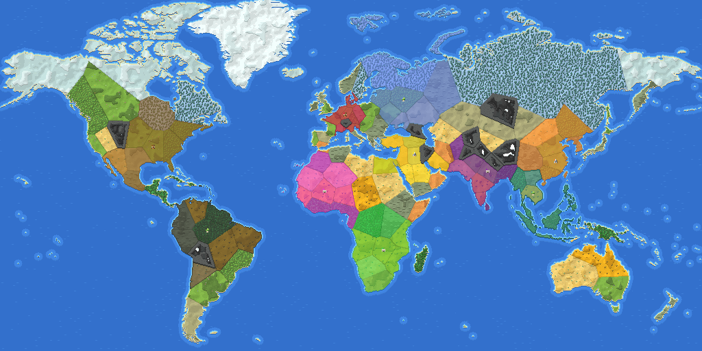 | 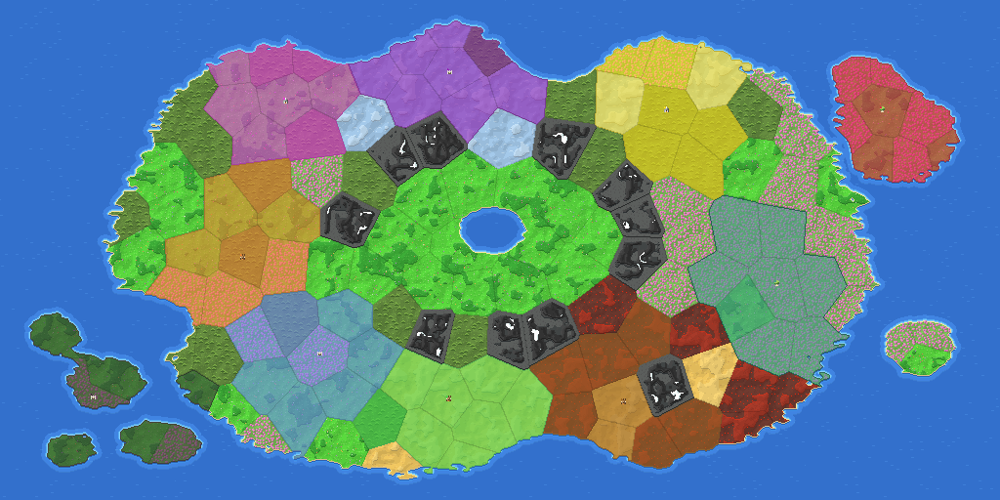 | 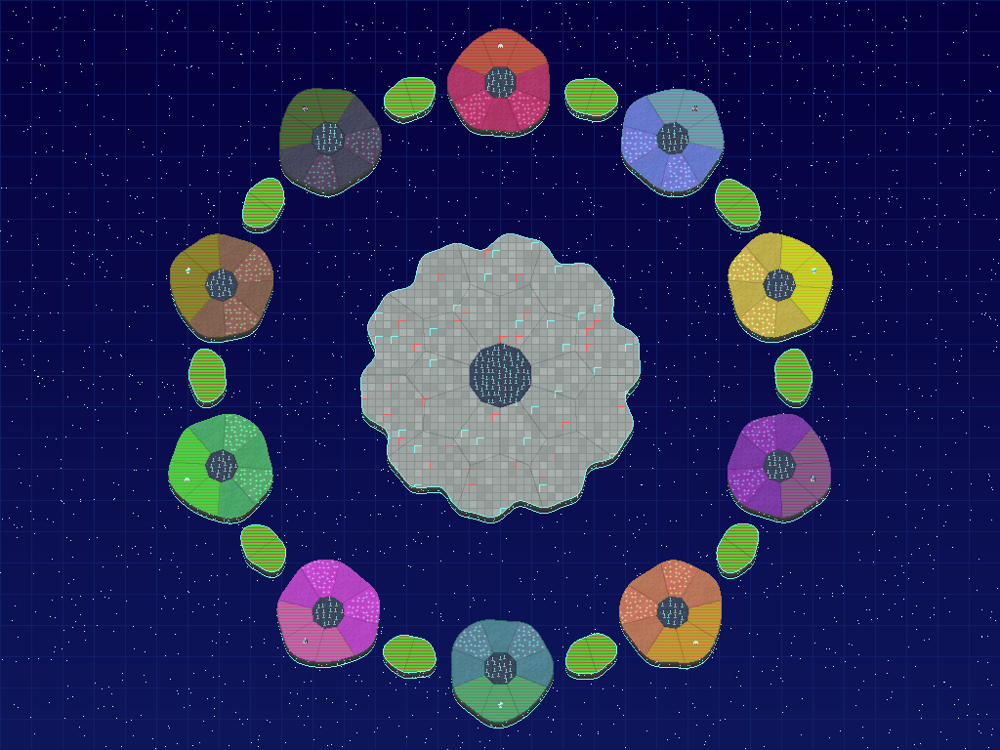 |
| Zoomed in | 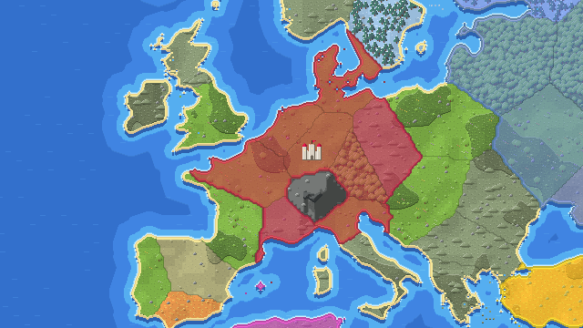 | 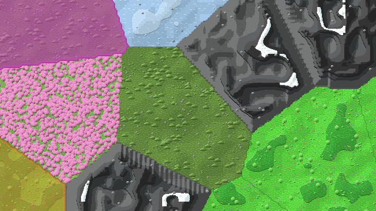 | 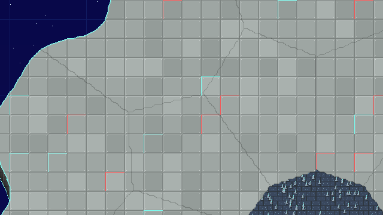 |
| Preview | 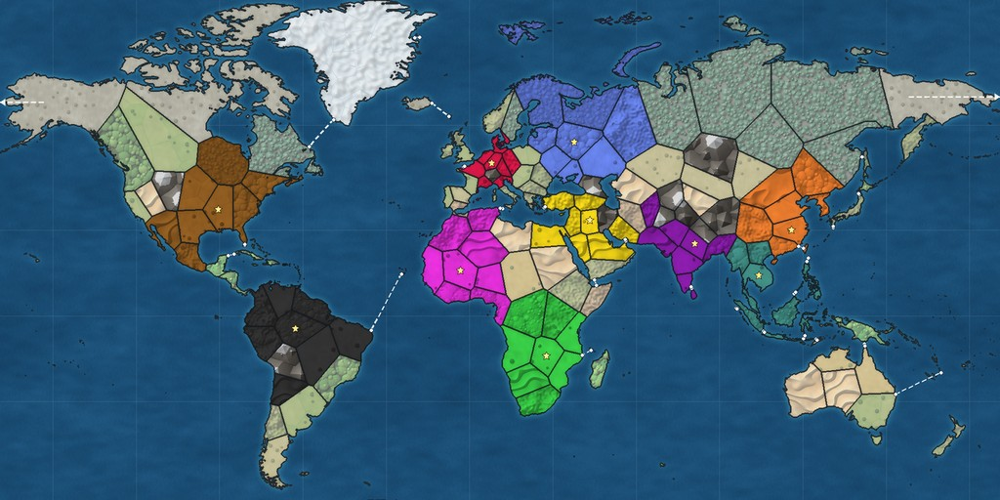 | 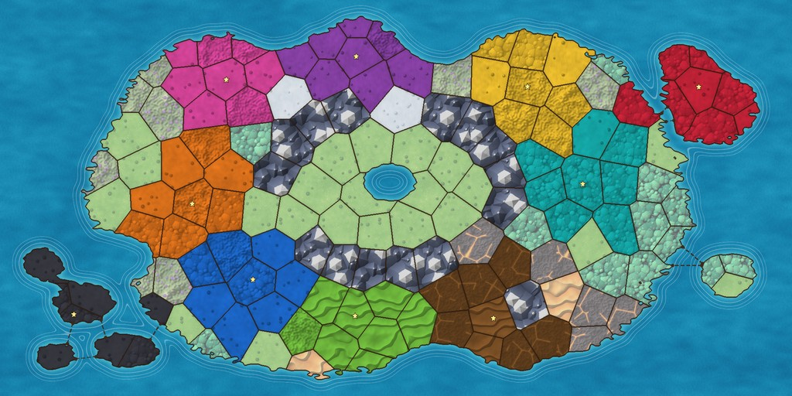 | 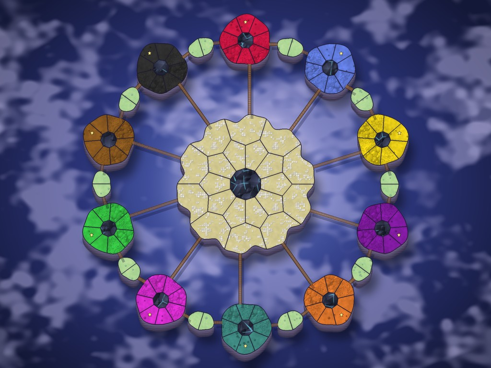 |
| Idea | The real world, 1:1 coastlines | Fantasy continent around a rich heartland | A shattered world of floating islands |
| Provinces | 150 (11 mountains) | 147 (11 mountains) | 131 (11 mountains) |
| Straits | 25 sea lanes (1 wraps around the map) | 8 sea lanes | 30 rope bridges |
| Sea zones (docs/DESIGN.md "Navies") | 22 seas and oceans | 10 seas | 10 space zones |
| Ship | Galleon | Dragonship | Starship |
| Neutral at start | 59 | 56 | 40 |
| Fairness | Asymmetric geography, equal start | Semi-balanced | Perfectly symmetric |
| Feel | Familiar, epic, great for clips | Chokepoint fights over the centre | Fast and aggressive, competitive |

The pictures above show each map at the start of a match.

- **In game:** the 2D pixel art the game paints. Rebuild it with `python3 tools/harness/paint_maps.py`.
- **Zoomed in:** a piece of the close-up detail the map lays over the view when you zoom in (see "Art direction"), painted by the same script.
- **Preview:** the generator's political view (nation colours, stars on capitals, grey neutral land), used for vote cards.

## Rules every map follows

These are checked by the generator (`tools/mapgen/layout.py`), so a map that breaks one doesn't get built.

- **10 start nations.** Each starts with **8 provinces and 17 total development**, capital at least development 3. Geography differs between maps and start spots; starting wealth never does.
- **About 40% of passable land starts neutral**, as the design doc asks.
- **One connected world.** Every passable province can reach every other one by land or strait. Mountains are impassable and never owned; they only shape the routes.
- **≤ 150 provinces** (the performance budget).
- **Straits** are extra neighbour links across water or void, exactly as in the design doc. Each map draws them in its own style: dashed sea lanes on Earth, ink sea lanes on Eldmoor, rope bridges on Skyshards.
- **Neutral garrisons** default to one regiment (1,000 men, `Config.NeutralGarrison`). A map can give a province a bigger garrison: the two map centres (the Crownlands and the Heartstone) and a few provinces set for start-position balance (see each map).
- **Races** (docs/DESIGN.md "Races"): every nation has one of WorldBox's four races, set per nation in the generator (`RACES` in each `tools/mapgen/maps/*.py`, written into `layout.json` and `MapData` as the nation's `race`). Every map mixes all four, at least two nations of each, fitted to the land where it makes sense: Elves on the forest starts, Dwarves in the hills, Humans and Orcs elsewhere. The validator flags a nation without a race and a map missing one. The race also picks what the nation's capital looks like in the pixel art ("Capitals and armies by race").
- **Start-position balance** is measured, not assumed: `lune run tools/harness/tournament 200 <map>` plays 200 bot matches and prints each slot's wins against its fair share. The goal (`docs/BALANCE.md` section 17) is that no slot wins more than about twice its share and none (almost) never wins. Fixes go into the generator (garrisons, passes, sea lanes, where a capital sits), never into special rules.
- **Sea zones** (docs/DESIGN.md "Navies", "Sea zones" below): the water is split into named zones, as many as the map wants (Earth 15–22, Eldmoor and Skyshards 8–12), each in one piece with at least one coast, all of them one connected sea, and every strait lies in a zone whose coasts hold both its ends. The validator prints a `PROBLEM` line for any zone that breaks one, and names the map's ship.

## Sea zones

Each map's water (Skyshards' void) is split into named zones for navies (docs/DESIGN.md "Navies"). The generator (`build_sea_zones` in `tools/mapgen/layout.py`) grows the zones over the water from seed points listed in each map's module (`SEA_ZONES`), every water pixel going to the nearest seed along a path over water, so a zone never jumps across land; the first seed is where the zone's name and fleets stand. Then it lists each zone's neighbours, its coasts (provinces with at least 3 pixels and 10% of their shore on it) and the zone each strait crosses. Water no seed reaches is a lake with no zone: the Caspian, Moonmere.

| Map | Zones |
| --- | --- |
| Earth (22) | Arctic Ocean, Norwegian Sea, North Sea, Baltic Sea, North Atlantic, Hudson Bay, Caribbean Sea, South Atlantic, Gulf of Guinea, Mediterranean, Black Sea, Arabian Sea, Indian Ocean, Bay of Bengal, Java Sea, South China Sea, East China Sea, Sea of Japan, North Pacific, Coral Sea, East Pacific, South Pacific |
| Eldmoor (10) | Frostwater, Wyrmdeep, Sea of Whispers, Corsair Shallows, Sunscorch Sea, Cinder Gulf, Sunrise Sea, Mistwater, Stormreach, Pearl Sea |
| Skyshards (10) | Vega Drift, Lyra Reach, Orion Span, Draco Rift, Cygnus Deep, Altair Gulf, Rigel Void, Sirius Verge, Nova Expanse, Polaris Abyss |

- **Earth:** the Pacific runs on across the map's left and right edges (the North Pacific holds the Bering Strait, which wraps). At this scale Gibraltar, the Bosporus and the Øresund are land borders, so the Mediterranean, the Black Sea and the Baltic are water of their own: `SEA_LINKS` joins them to the North Atlantic, the Mediterranean and the North Sea like the real channels. The Canadian Arctic is split between the North Pacific (the Beaufort Sea) and the North Atlantic (Baffin Bay), a Northwest Passage. At the start the Americas share the North Atlantic with Europe and North Africa (Rhine, Niger), and the Caribbean and the Pacific between themselves.
- **Eldmoor:** ten seas in a ring round the continent; the Isle of Mists has the Mistwater on the mainland side and the Pearl Sea outside, the Corsair Isles the Corsair Shallows and the Sea of Whispers.
- **Skyshards:** one 36° wedge of space round each home shard, cut by angle from the centre rather than grown (`assign` in `build_sea_zones`), so the map stays exactly symmetric: each zone touches its shard's 8 provinces, its Heartstone Approach and the near half of each drift isle beside it, and holds the shard's three bridges (the Gate bridge and the bridges to both drift isles). A space fleet off a shard closes all three.

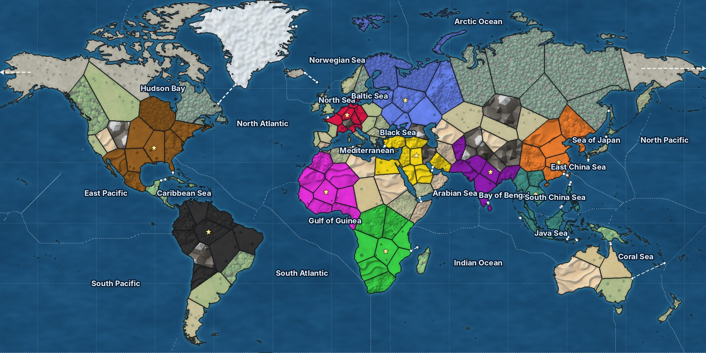

`assets/maps/<map>/zones.jpg` shows each map's zones (a faint dotted line where two meet, and their names).

## Earth

The real world on a Miller projection, centred on 11°E so the Americas sit on the left, Asia on the right, and the Bering Strait wraps across the map edge. Coastlines come from Natural Earth (public domain).

**Names avoid modern countries.** Provinces use geographic and historic regions (Castile, Anatolia, Levant, Bengal, Formosa, Patagonia), and the ten nations are named after great rivers. That keeps the map clear of touchy borders and flags (the concern in the design doc's open questions) while staying instantly recognisable.

| Colour | Nation | Capital | Start region | Race |
| --- | --- | --- | --- | --- |
| 1 crimson | Rhine | Rhineland | Western Europe | Orcs |
| 2 blue | Volga | Muscovy | Russia | Elves |
| 3 gold | Tigris | Mesopotamia | Middle East | Dwarves |
| 4 violet | Ganges | Ganges Plain | India | Humans |
| 5 orange | Yangtze | Yangtze Valley | China | Dwarves |
| 6 teal | Mekong | Mekong | Southeast Asia | Elves |
| 7 magenta | Niger | Niger Bend | West Africa | Humans |
| 8 lime | Zambezi | Zambezi | Southern Africa | Humans |
| 9 bronze | Mississippi | Mississippi | North America | Orcs |
| 10 charcoal | Amazon | Amazonia | South America | Elves |

**Races:** Elves in the great forests (Volga's taiga, the Mekong and Amazon jungles), Dwarves in the hills of Mesopotamia and China, Humans on the plains of India and Africa, Orcs on the plains of Western Europe and North America. Orcs were kept off any region where "orcs" could read as a jab at a real people. Start positions are spread over the races: the first draft gave the Humans Yangtze and Niger, two of the weakest starts, and the Dwarves Zambezi, one of the strongest; now Zambezi is Human and the hilly Yangtze Dwarven (`docs/BALANCE.md` section 18).

**How it plays**

- **Crowded Old World.** Rhine, Volga and Tigris start only a province or two apart, so Europe and the Middle East turn violent first. The Alps, Caucasus and Zagros funnel those wars.
- **The Roof of the World.** Tibet, Himalaya, Karakoram, Pamir and Hindu Kush form one impassable wall, so India and China can only reach each other through Southeast Asia or Central Asia.
- **Lonely Americas.** Mississippi and Amazon get lots of quiet expansion room but only two ways out: Greenland–Iceland in the north and the Bering Strait wrap. (There used to be a Dakar–Natal lane too; see start-position balance below.)
- **Big empty wilds.** Siberia, Canada, the Sahara and Australia are a few huge, poor provinces. They're cheap to take and add province count (which counts towards the 50% domination win) but little development.

Sea lanes: Iceland–Scotland, Iceland–Greenland, Greenland–Laurentia, England–Seine, Latium–Numidia (Sicily), Hellas–Anatolia, Yemen–Horn, Najd–Persis (Hormuz), Lanka–Dravida, Malaya–Sumatra, Sumatra–Java, Java–Borneo, Borneo–Luzon, Luzon–Formosa, Formosa–Lingnan, Korea–Yamato, Yamato–Ezo, Ezo–Amur (Sakhalin), Java–Top End, New Guinea–Queensland, Murray–Aotearoa, Madagascar–Sofala, Antilles–Appalachia, Antilles–Yucatan, and Chukotka–Alaska (Bering, wraps). Gibraltar, the Bosporus and the Øresund are narrow enough to count as land borders.

**Start-position balance (Phase 5).** Bots attack their weakest neighbour, so on Earth the nations with a safe backyard won and the crowded middle lost: Amazon and Mekong won about 2.5× their share, Niger and Tigris almost never (numbers in `docs/BALANCE.md` section 17). Four generator changes, each small and real-world-shaped:

- **No Dakar–Natal lane.** Niger was Amazon's only neighbour, so Amazon declared war on it 85 times in 100 matches. Without the lane Amazon's wars go north, to Mississippi.
- **Oman and Mauretania are new provinces** next to Tigris and Niger, the two nations with the least neutral land. To stay at 150 provinces, Westralia merged into the **Outback** and Araucania into **Patagonia** (both dead-end backyards of Mekong and Amazon). The two new provinces reuse the old ids (89 and 145), so no other id moved.
- **2,000-man garrisons** on the quiet wilds of Volga and Zambezi, which nobody else reaches early: Ob and Yenisei (western Siberia), the Horn, Abyssinia and Madagascar.
- The Bering wrap, Gibraltar, the Bosporus and every other lane are unchanged.

## Eldmoor

A fantasy continent built for chokepoint fights. Ten kingdoms ring the **Crownlands**, a rich neutral heartland around Moonmere lake. The **Dragonspine** mountains wall the Crownlands off: three wide gaps and four one-province mountain passes. Crownlands provinces have development 3–4 and 3,000-man garrisons, so taking the centre is a mid-game commitment, not an opening move.

| Colour | Nation | Region | Terrain | Race |
| --- | --- | --- | --- | --- |
| 1 crimson | Mistborn | Isle of Mists (east island) | Wildwood, meadows | Elves |
| 2 blue | Saltmarsh | Southwest coast | Meadows, woods | Humans |
| 3 gold | Ironholds | Northeast | Highlands, frost | Dwarves |
| 4 violet | Frostmarch | Frozen north | Frostfields | Humans |
| 5 orange | Greenvale | Western breadbasket | Meadows | Orcs |
| 6 teal | Elderwood | Great eastern forest | Wildwood | Elves |
| 7 magenta | Wyrmcoast | Northwest | Highlands, meadows | Dwarves |
| 8 lime | Sunscorch | Southern desert | Dunes | Orcs |
| 9 bronze | Ashen Dominion | Southeast volcano | Ashlands, dunes | Orcs |
| 10 charcoal | Corsairs | Corsair Isles (southwest archipelago) | Meadows, highlands | Humans |

**Races:** Elves in the two wildwoods (the Isle of Mists, Elderwood), Dwarves in the highlands (Ironholds, Wyrmcoast), Orcs in the desert, the ash wastes round Mount Cinder and the western breadbasket, Humans on the southwest coast, the frostfields and the Corsair Isles. Start positions are spread over the races (`docs/BALANCE.md` section 18): the first draft gave the Orcs Frostmarch and Wyrmcoast, the two strongest kingdoms, and the Dwarves and Humans the weakest (Ironholds, Greenvale).

**How it plays**

- **The Crownlands are the prize.** About 13 rich provinces sit behind the Dragonspine. Three gaps (north for Frostmarch, west for Greenvale and Saltmarsh, south-east for Ashen and Elderwood) and four narrow passes (Gianttalon Pass for Wyrmcoast, Titanspine Pass for Ironholds, Titanpeak Pass for Sunscorch, Eaglespire Pass for Saltmarsh) lead in, so every mainland kingdom has its own door and whoever holds one controls part of the centre's economy.
- **Island nations** (Mistborn, Corsairs) start safe but have to cross sea lanes to grow, like Britain and Japan on Earth. Each island group has at least two crossings, so no single army can seal one in.
- **Mount Cinder** sits inside Ashen territory as a natural fortress wall.

**Start-position balance (Phase 5).** With only the three gaps, Ironholds and Sunscorch were walled in with almost no neutral land and won 0 of 200 bot matches, while Frostmarch (the only kingdom with a gap to itself) won 125 (numbers in `docs/BALANCE.md` section 17). The generator now:

- **cuts four passes** through the Dragonspine (`PASSES_FOR` in `tools/mapgen/maps/fantasy.py`): the peak straight between each walled-in kingdom and Moonmere becomes a passable highland province, neutral at the start with a normal garrison;
- **moves Elderwood's capital** to the south of the great forest (`CAPITAL_AT`), so its start territory no longer reaches Ironholds' border and the northern forest starts neutral;
- **adds an eighth province to the Isle of Mists** (Oakshire, `EXTRA_SEEDS`), so Mistborn starts on its island alone instead of on a mainland foothold wedged against Ironholds;
- **garrisons Ironholds' two open flanks** with 2,000 men (Highcairn towards Frostmarch, Duskshade towards Elderwood and the Mistborn crossing; `GARRISONS`).

Peaks are placed before every other province, extra seeds after them, and passes and garrisons are applied after naming, so no other province moved or was renamed; slots and colours stay as listed above.
- **Terrain flavour is cosmetic.** Frostfields, dunes and meadows all play as Plains; ashlands and highlands play as Hills.

Province names are generated from per-region word lists (Hoarreach, Silvershade, Dunehaven). Rename anything by editing `NAME_PARTS` or the zone list in `tools/mapgen/maps/fantasy.py`. Names and terrain use separate random streams, so renaming never moves terrain.

## Skyshards (new map)

**The story:** the last war of the Primordials shattered the world. What's left floats above the clouds: ten home shards circling the **Heartstone**, the glowing core that still holds the old world's riches. Knocked-out players rise as Primordials in every match, so this is the world they broke.

**The layout:** perfectly symmetric (10-fold rotation), so every nation has exactly the same land, terrain and routes.

```text
            Heartstone (20 ruin provinces + central spire)
                 ▲  one long bridge per nation
   ┌─────────────┴─────────────┐
   │  Gate                     │
   │  Glade  ▲ Spire ▲  Grove  │   home shard: 8 provinces around
   │  Leeward          Windward│   an impassable storm spire
   │  Fields          Meadows  │
   │        Landing (capital)  │
   └───────────────────────────┘
 Leeward ◄─ drift isle ─► Windward of the next shard (2 provinces each)
```

- **Home shards:** 8 provinces around an impassable storm spire. The capital (Landing) is on the far side from the Heartstone, and the Gate faces it.
- **Races:** every shard has the same land, so the races alternate round the ring and no two neighbouring shards share one: Aurora Humans, Zephyr Orcs, Nimbus Elves, Tempest Dwarves, Halo Humans, Solace Elves, Ember Dwarves, Rime Humans, Verdance Elves, Umbra Orcs (3 Humans, 3 Elves, 2 Orcs, 2 Dwarves). Races are the one thing that differs between shards.
- **Drift isles:** 10 two-province islets between neighbouring shards. These are the first contested land.
- **The Heartstone:** 10 Approaches (development 3, 2,000-man garrisons) and 10 Sanctums (development 4, 3,000-man garrisons) around the Heartstone Spire. That's almost two-thirds of the map's neutral development in one place.

**The look (sci-fi):** the shards are platforms hanging in deep space, with neon rims and dark hulls underneath. The Heartstone is a steel station around a reactor spire, home shards grow crops in rows, crystal groves glow, the storm spires are reactor towers, and the bridges are energy links. The biome keys (`skymeadow`, `heartruins`, …) keep their names; only the drawing is sci-fi.

**How it plays:** every nation owns its whole shard at the start, so the Peace phase is a race for drift isles and Heartstone Approaches. It's the fastest and most aggressive map, and the one to run playtests on, because symmetry means any imbalance is the rules' fault, not the map's.

Skyshards uses no new rules: shards are islands and bridges are straits, both already in the design doc.

## Art direction

- **2D pixel art, like WorldBox.** One map pixel is one stud; trees, peaks, dunes and capitals are little sprites a few pixels big. Painted at runtime by `src/client/PixelArt.luau`, in two paintings:
  - **The whole map**, one pixel per map pixel: what the zoomed-out and region views show.
  - **The close-up**, laid over the part of the map in view once you zoom in past about 4 screen pixels per map pixel: the same map at 4 × 4 sub-pixels per map pixel, so zooming in shows more detail instead of bigger blocks, the way WorldBox draws each tile as a little 8×8 sprite.
- **Textures, not noise.** Each biome's ground is a small hand-made 8×8 pattern (grass tufts, dry strokes, sand ripples, snow drifts, rock facets, jungle floor, ash cracks, crystal facets, goo bubbles, metal plates), several variants of it plus their mirror images picked per block by a hash, so nothing visibly repeats. The whole map uses them at one pixel per map pixel with soft colours; the close-up at full contrast, four times finer.
- **Height and light.** A smooth elevation field gives each biome raised patches of its darker "high" variant, with a dark lip on their south side and a lit north edge, and every slope is a little lighter or darker by the light from the north-west. Mountains keep WorldBox's rock bands; in the close-up their faces are lit and shaded and the bands blend smoothly.
- **Water.** Three depth bands measured with a round (chamfer) distance from land, darker lips where it gets deeper, a light foam line along the shores, a shadow under south shores and gentle staggered wave dashes on rough patches of open water. In the close-up the coast is smooth (a blurred land mask, so the grid's steps round off, while 1-pixel islands and straits stay), with beaches of dry and wet sand, white surf and foam.
- **Close-up decorations.** Dense forests of shaded trees with shadows cast to the south-east, snowy pines, jungle canopies, acacias, palms, cacti, bushes, rocks, boulders, flowers, hill mounds, glowing crystals, storm towers; crop rows and bevelled, riveted hull plating on Skyshards, with glowing rims and plated hulls under its platforms; each race's detailed capital flying the owner's flag ("Capitals and armies by race" below).
- **Map colour is power.** On the whole map, owned provinces are washed with their nation's colour at 59% opacity over the terrain, WorldBox's kingdom overlay, and each nation has a 1-pixel border in its darker border colour. In the close-up the wash is lighter (48%) so the terrain shows through, with a stronger band (70%) just inside the border and a crisp border line in the darker colour; thin lines separate provinces and the selected province gets a white outline. Neutral land shows its natural colours.
- **WorldBox's colours.** The terrain uses WorldBox's tile colours, taken from the game's data:
  - Ocean in three depth bands: shallow `#55aef0`, close `#4084e2`, deep `#3370cc`. A `#2d61af` shadow line runs just south of land.
  - Beaches are `#f7e898`.
  - Mountains are grey: hills rock `#5b5e5c`, ridges `#414545`, summits `#333333`, a few snow caps `#fcfdfd`. Each step has a dark lip on its south side.
  - The biome colours are listed in `PixelArt`'s `BIOMES` table.
- **Nation palette** (`Nation.colorIndex`, 1–10). These are WorldBox's kingdom colours, each with the darker border colour WorldBox pairs with it. Blues close to the sea colour are left out.

| Index | Colour | Fill | Border |
| --- | --- | --- | --- |
| 1 | Red | `#e6194b` | `#97233d` |
| 2 | Blue | `#6c89f6` | `#517aa8` |
| 3 | Yellow | `#ffe119` | `#beab23` |
| 4 | Purple | `#911eb4` | `#75298a` |
| 5 | Orange | `#f58231` | `#b76c33` |
| 6 | Teal | `#469990` | `#145a4f` |
| 7 | Magenta | `#f032e6` | `#b436ab` |
| 8 | Green | `#3cd74b` | `#47b052` |
| 9 | Brown | `#9a6324` | `#7b572a` |
| 10 | Charcoal | `#353535` | `#2d2e2b` |

### Capitals and armies by race

Each race builds its own capital (docs/DESIGN.md "Races"), so you see at a glance whose kingdom it is. The owner's colour is on its flag, roofs and banners, and a capital keeps its founders' look when someone else takes it: only the flag changes.

| Race | Earth and Eldmoor | Skyshards (sci-fi materials) |
| --- | --- | --- |
| Humans | a stone castle: two towers and a keep with roofs in the owner's colour | a glowing dome on a steel base |
| Elves | a tree hall: a great pale-barked tree, its crown lit from the north-west, little halls with the owner's roofs up in the leaves, lanterns, a glowing door between the roots | a crystal tree with cyan leaves and a steel trunk |
| Orcs | a spiked war camp: a hide tent on crossed poles with a band in the owner's colour, bone spikes, a fire in its door, a palisade of sharpened stakes | a plated war camp with steel spikes and a red glow |
| Dwarves | a stone hall carved into a snowy mountain: pillars, a gable and banners in the owner's colour, a gate glowing with a forge | a steel mountain with a glowing peak and a red-lit gate |

On the whole map each capital is a 5 × 6 pixel sprite in the same colours (a white castle, a green crown on a pale trunk, a brown tent with white spikes, a grey peak with a lit gate); in the close-up it is a 21 × 22 sub-pixel building, and the capital's name stands below it. Armies are little soldiers of their nation's race (a footman, an elf archer, an orc warrior, a dwarf with an axe) unless it has a token skin equipped, and each army's badge shows the icon of the troop type it is mostly made of (docs/DESIGN.md "Map rendering"). `lune run tools/harness/play kingdoms` (with `MAP=earth` or `MAP=eldmoor` for the classic looks) photographs each race's capital and army at the three zooms.

### Map themes

Shop cosmetics that re-skin the terrain of any map (docs/MONETIZATION.md 3.2), painted by `PixelArt` in the same pixel style: `PixelArt.themeColor` recolours each terrain pixel (on the whole map and in the close-up) before the kingdom overlay goes on, so nation colours, borders and capitals never change, and armies, names and effects are drawn on top as always.

| Theme | Land | Sea / space | Extras |
| --- | --- | --- | --- |
| Night | moonlit: mostly grey, a little of the old hue, cool | navy; space a little darker | village lights; crystal rims and lava keep glowing |
| Winter | snow, with trees and rock only frosted so forests still show | icy blue | frozen shallows, snow sparkles |
| Autumn | leaves and grass turn maroon, scarlet, amber and gold (no mid browns, for the brown nation); pines, rock and snow stay | unchanged | |

Since the overlay mixes a fixed share of the nation colour into the terrain, two nations always differ by the same amount on any theme; a theme can only change how a nation stands out from its terrain. `tests/themes.spec.luau` measures that on all three maps (the share of land where each nation's wash and border stand out, against the classic look). `python3 tools/harness/paint_maps.py --themes` paints every theme on every map into `tools/harness/out/themes/`.

### Terrain textures

These 512×512 seamless tiles are used for the previews and vote cards; the game itself draws the pixel art. `detail/` holds the greyscale version for tinting. Each look maps to one of the four terrains in the rules:

| Theme | Plains | Forest | Hills | Mountain | Background |
| --- | --- | --- | --- | --- | --- |
| Earth | grassland, steppe, savanna, desert, tundra | forest, taiga, jungle | hills, drylands, ice | mountains | sea |
| Eldmoor (`fantasy`) | meadow, frostfields, dunes | wildwood | highlands, ashlands | peaks | sea |
| Skyshards (`sky`) | skymeadow, heartruins | crystalgrove | crags | stormspire | void, bridge |

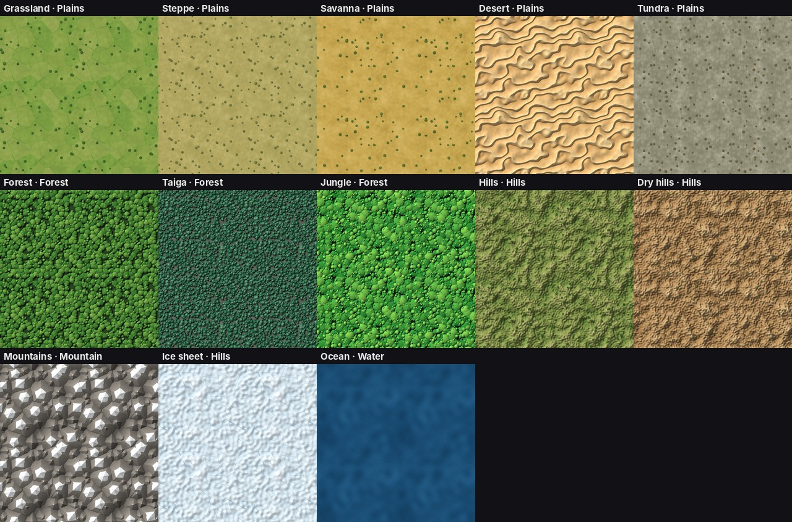
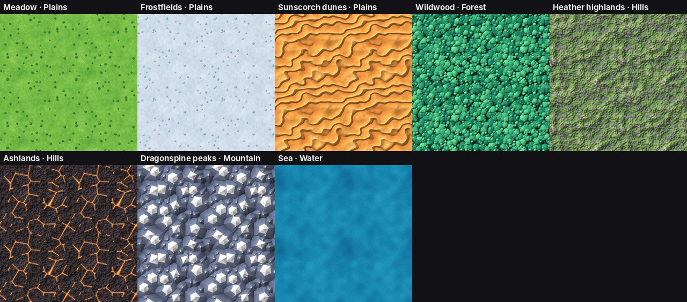
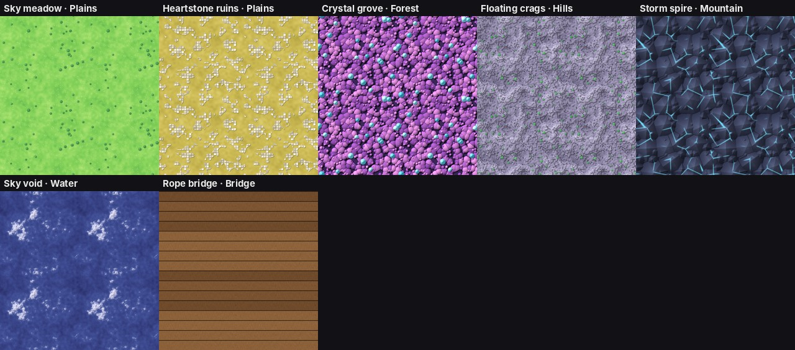

## Map data pipeline

Everything here comes from `python3 tools/mapgen/generate.py` (about 1–2 minutes; needs Python 3 with numpy and Pillow). Output is deterministic.

| File | What it is | Used by |
| --- | --- | --- |
| `assets/maps/<map>/layout.json` | Provinces, neighbours, straits (with their sea zone), sea zones, the ship's name, nations (with their race), start owners, development, garrisons | Converted into `src/shared/MapData/<Map>.luau` |
| `assets/maps/<map>/province_ids.png` | Every pixel's province id (`R + 256·G`, 0 = none) | The province grid in `MapData` (half resolution) |
| `assets/maps/<map>/sea_ids.png` | Every pixel's sea zone id (`R + 256·G`, 0 = land or a lake) | The sea grid in `MapData` (`seaGrid`, half resolution): taps on the sea, zone lines in the pixel art |
| `assets/maps/<map>/zones.jpg` | The political view with the sea zones and their names | Reviews (docs/MAPS.md "Sea zones") |
| `assets/maps/<map>/terrain.jpg`, `political.jpg` | Full-size previews | Reviews and Studio reference |
| `assets/maps/<map>/atlas.jpg` | Terrain view with province ids printed | Debugging, bug reports ("army stuck in 57") |
| `assets/maps/<map>/vote_card.jpg` | 1024×512 lobby card | Map vote |
| `assets/textures/<theme>/…` | 512 px terrain tiles | Previews and vote cards |

**Scale:** 1 layout pixel = 0.5 stud, so Earth and Eldmoor are 1024×512 studs and Skyshards is 1024×768, and the 2D map has one pixel per stud. `center` in `layout.json` is where the province label and garrison token sit.

**Never hand-edit `layout.json`.** Change the generator (`tools/mapgen/maps/*.py`) and regenerate. The validator then re-checks every rule above.

### Province grid: generated, not hand-made

This answers the open question "keep the hex grid or switch to hand-made provinces?": **neither**. Hand-tracing 3 × 150 provinces in Studio would take weeks and drift from the data. Instead `tools/mapgen/export_luau.py` takes `province_ids.png` at half resolution (one pixel per stud) and writes it into each `MapData` module as `grid`: run-length encoded (id, length) runs in base64, 30–50 KB per map. The client decodes it with `MapGrid`, paints the pixel art from it and looks up taps in it, so there is no import step: regenerate a map and the game draws it. A Lune test checks that every province covers about its area in the grid and that its centre lies inside it.

## Roadmap changes

| Phase | Before | Now |
| --- | --- | --- |
| 1 | Generated hex map | **Skyshards `MapData`** converted from `layout.json`, drawn as simple flat discs at province centres with lines for neighbours. Real data from day one, and symmetric, so early tests are fair. |
| 2–3 | (one map) | Build and test on Skyshards. Add Eldmoor once war works (Gate 2). |
| 4 | Hand-made final map | **2D pixel-art maps for all three** (done early, painted from `MapData`), plus the **map vote** with the three cards. |
| 5 | A second map | **Per-map balance** from win rate by start position (done: `docs/BALANCE.md` section 17). |

## Task cards

Paste one per Claude Code session, in order. Each follows the design doc's task template.

```text
## Task: MapData from layout.json (done)
Phase: 1   Service: MapData
Goal: the game loads Skyshards (and the other maps) from generated Luau data.
Read first: docs/MAPS.md, src/shared/Types.luau, assets/maps/skyshards/layout.json
Do:
- Add tools/mapgen/export_luau.py: layout.json -> src/shared/MapData/<Map>.luau (generated header, --!strict, a MapDef table)
- Add MapDef and ProvinceDef types to Types.luau as in DESIGN.md "Map data"
- Lune test: ids are 1..N, neighbours are symmetric, every passable province is reachable, each nation starts with 8 provinces and 17 development
Don't: hand-edit the generated modules; change Province or MatchState
Done when: lune run tests/run passes for all three maps; rojo build passes
```

```text
## Task: Province map (done, as 2D pixel art)
Phase: 4   Service: tools/mapgen + PixelArt + MapView
Goal: every map shows its real province shapes.
Done: export_luau.py puts each map's province grid into MapData; PixelArt paints a WorldBox-style pixel map from
it at runtime (EditableImage), MapView pans and zooms it, and taps look provinces up in the grid.
```

```text
## Task: Map vote
Phase: 4   Service: MatchService + UI
Goal: in the Lobby, players vote between Earth, Eldmoor and Skyshards using the vote cards.
Do: three 2-tap cards, majority wins, ties random, private servers can lock a map
Done when: 3 test clients vote and the chosen map loads
```

## Decisions to confirm

- **Third map:** Skyshards, the floating-island map described above.
- **Earth naming:** geographic regions instead of countries, and river nations.
- **Equal start on every map:** 8 provinces and 17 development per nation.
- **Neutral garrison:** 1,000 men by default (`Config.NeutralGarrison`). Maps may override per province.
- **Scale:** 1 px = 0.5 stud, and texture tiles every 128 studs.
- **Earth straits:** the Bering Strait wraps around the map edge. The Dakar–Natal lane was removed for start-position balance (Amazon attacked Niger through it in almost every match); the Americas reach the Old World through Greenland–Iceland and Bering.
- **`biome`** is a cosmetic field in map data only. `MatchState` is unchanged.
- **Races per nation** (the tables above): set in the generator, fitted to the land and spread so each race gets strong and weak start positions; Orcs only where the name can't read as a jab at a real people.
