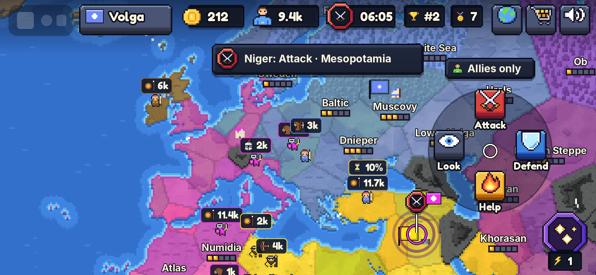
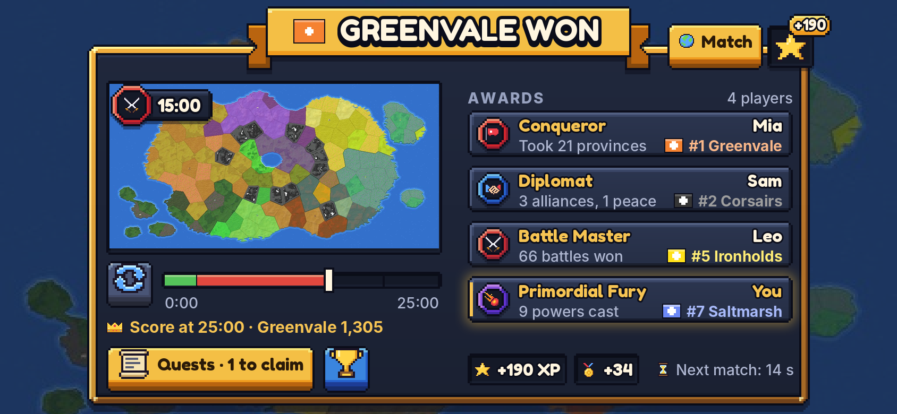
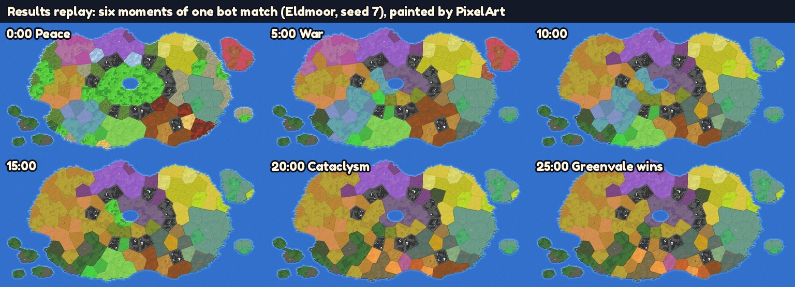
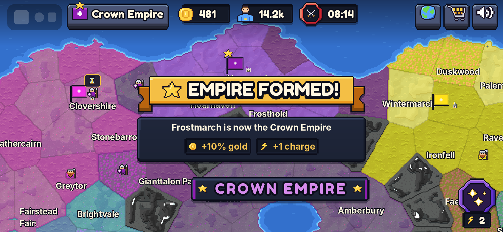
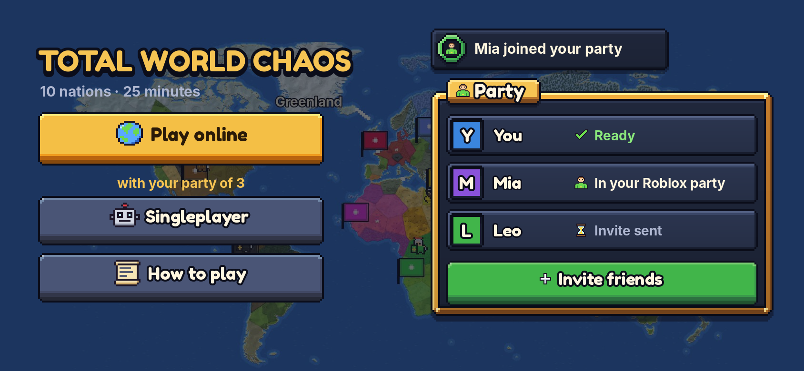
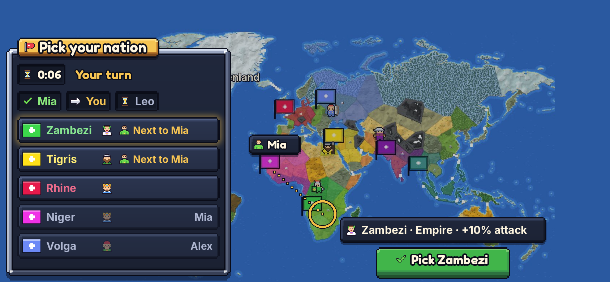

# Next features: plans for the builders

Plans for thirteen ideas the owner picked, written so another agent can build each one from its task card. Music (section 6, stages 1–2) is built and its rules are in `docs/DESIGN.md` "Sound and effects"; nothing else here is built yet, and nothing here changes a rule until it is added to `docs/DESIGN.md` (the appendix has the text). The top five get full plans; the other eight are shorter but still buildable.

- Platform facts were checked against Roblox's Creator Hub, Developer Forum and newsroom in October 2026. Sources are at the end; anything we couldn't confirm is marked **unverified**.
- Numbers marked "measured" come from bot matches through the real Sim (the method is in each section). Every number is a starting value and goes in `src/shared/Config.luau`.
- Mockups are in `docs/images/next/`, drawn by `tools/uimock/mock_next.py` on real harness map renders in the Slate & Brass kit (`docs/UI_DIRECTION.md`). `python3 tools/uimock/render_all.py` redraws them.

## Contents

1. [Summary](#1-summary)
2. [Five findings that change the plans](#2-five-findings-that-change-the-plans)
3. [Build order](#3-build-order)
4. [Quick chat and map pings](#4-quick-chat-and-map-pings)
5. [Results replay and awards](#5-results-replay-and-awards)
6. [Music](#6-music)
7. [Form an empire](#7-form-an-empire)
8. [Play with friends](#8-play-with-friends)
9. [The other ideas](#9-the-other-ideas)
10. [Analytics additions](#10-analytics-additions)
11. [Mockups](#11-mockups)
12. [Decisions for the owner](#12-decisions-for-the-owner)
13. [Sources](#13-sources)
14. [Appendix: proposed DESIGN.md text](#appendix-proposed-designmd-text)

## 1. Summary

| # | Idea | Who it's for | Size | Depends on | Can start |
| --- | --- | --- | --- | --- | --- |
| 1 | **Quick chat and map pings**: Roblox Quick Words for phrases, our own ally-only map pings | Everyone in an alliance; younger players who don't type; solo players with bot allies | M | Nothing (Quick Words is owner setup) | Quick Words today; pings at the first free slot |
| 2 | **Results replay and awards**: 10 s of borders spreading, one award per player | Losers and eliminated players; clip makers | L | Slate & Brass step 6 (Results) for the UI | Sim part now; UI after step 6 |
| 3 | **Music**: calm, war, Cataclysm and Lobby tracks with crossfades; Music and Sounds toggles | Everyone; 13–17s most | S–M | Slate & Brass step 3 (top bar) for the toggle popover | At the first free slot |
| 4 | **Form an empire**: hold 75% of a region and become its empire | Strategy fans, EU4 players, anyone who likes a crown | L | Map regions in `tools/mapgen` (after the navy's map changes) | After navies land |
| 5 | **Play with friends**: Roblox Party and invites, friends seated next to each other | 13–17s (friends are why they play); parents of younger players | M | The start menu (in flight) | After the start menu lands |
| 6 | Weekly twists | Returning players | M | EU4 pack (fog switch), navies | Wave 3 |
| 7 | Battle animations | Younger players, clip makers | S | Five troops per race | Wave 3 |
| 8 | Advisor | New and younger players | M | Pings, empires, start menu | Wave 4 |
| 9 | Blitz mode (12 min) | Short sessions on phones | M | Weekly twists' settings plumbing | Wave 4 |
| 10 | Daily challenge | Solo players, completionists | L | Singleplayer sandbox (in flight) | Wave 4 |
| 11 | Race mastery and collection book | Younger players, collectors | M | Awards, empires | Wave 4 |
| 12 | Accessibility: colour-safe map, text size, translations | Colourblind players (about 1 in 12 boys), non-English speakers, everyone on small phones | M (three S slices) | Slate & Brass step 8 | Palette slice any time |
| 13 | Ranked mode | Competitive 15+ players | L | 1,500 peak CCU (`docs/MONETIZATION.md` 7.5) | After launch |

## 2. Five findings that change the plans

1. **Roblox now runs preset chat itself, so we build pings, not a phrase wheel.** Since April 2026, preset text systems may only coordinate gameplay, and on 13 October 2026 Roblox launched game-specific **Quick Words**: up to three categories of 3–10 phrases, set in Creator Hub, reviewed, and auto-translated to each player's chat language. Its October 22 roadmap says creator-built presets must move to Quick Words (policy update February 2027, required May 2027), and `TextChannel:SendAsync()` presets stop working under platform-integrated chat. So "Ally?", "Help!" and "GG" become Quick Words the owner sets up with no code, and the agent builds only **icon pings**, which are map markers, not text. The same rule hits the EU4 pack's **"joke insults with comebacks"**: preset messages "cannot be used for social communication", so insults should be diplomatic actions with a game effect shown as system toasts, never preset lines players send each other.
2. **Roblox Party already keeps friends together; our tutorial splits them.** Up to six friends in a Roblox Party join the same server automatically, and `Player.PartyId` with `SocialService:GetPlayersByPartyId()` tells the server who came together (Studio's Party Simulator fakes it). The real problem is ours: `TutorialService` teleports every brand-new player to a reserved tutorial server, so a friend's first visit pulls them away from the party. Play with friends starts by deferring the tutorial for anyone who came with friends.
3. **The replay needs no new image and almost no data.** Measured over 36 bot matches, a match has 78–115 ownership changes on average (142 at most), so the whole timeline is a few hundred numbers, under 5 KB sent once at Results. `PixelArt.setOwners` already repaints only the provinces that changed (1.9–3.9 ms per changing tick in Lune), and one `EditableImage` can back several labels, so the replay paints into the existing map image and a second `ImageLabel` shows it in the Results card. No new painter and no new memory.
4. **Empires need generated regions, and the name "Empire" is taken twice.** With Earth's continents as regions, a 5-province Oceania was fully owned by 2.5 minutes in 12 of 12 bot matches: a free empire every time. With Eldmoor's and Skyshards' generator zones, "75% of a region that isn't your home" gives about one empire per match at a median of 7–8.5 minutes, but mostly to the nation already leading (16 of 26). So regions must be generated with 8–20 provinces, empires only form in War and Cataclysm, one per nation, with a modest bonus checked by the tournament. Also "Empire" is already Earth's race (Zambezi, Amazon) and an achievement (hold 40 provinces). Rename those two before shipping (decision 3).
5. **Sound and text settings moved on the platform.** Roblox now discourages `Sound` and `SoundGroup` in favour of `AudioPlayer`, `AudioFader` and `Wire`. Its accessibility guide asks for separate music and effects volumes, so our one Mute button becomes a two-toggle popover. `GuiService.PreferredTextSize` has scaled every non-`TextScaled` label since August 2025, so fixed-size panels can clip on "Largest". And our VIP chat tag uses `TextChatMessage.PrefixText`, which platform-integrated chat doesn't support (native prefixes come in early February 2027, platform-integrated chat is required in May 2027). That last one is a separate fix, not part of these plans.

## 3. Build order

### 3.1 How the order was made

- **At most 5 agents at once**, counting the five building now: the Slate & Brass restyle, five troops per race (stage 1b), the singleplayer sandbox and start menu, navies, and the EU4 pack. Until one of them finishes, the only new work is the owner's Quick Words setup (no agent).
- **Each freed slot takes the next item whose dependencies have landed.** Items that touch files an in-flight agent is rewriting wait for it: `Results.luau` (Slate & Brass step 6), `Hud.luau` (step 3), the start menu, and `tools/mapgen` plus `MapData` (navies; two agents regenerating map data collide badly).
- **Small and finished first.** Music and pings are self-contained and visible in every match.

### 3.2 The order

| Wave | Item | Starts when | Runs alongside | Touches |
| --- | --- | --- | --- | --- |
| 0 | Quick Words setup (owner, 15 minutes) | Today | Everything | Creator Hub only |
| 1 | Music, stages 1–2 | First free slot; the toggle popover after Slate & Brass step 3 | All in-flight work | New `Music.luau`, `MusicMood.luau`; `Hud` mute button |
| 1 | Pings, stages 1–2 | Second free slot | All in-flight work (small merge in `CommandRouter` with the EU4 pack) | New `Sim/Pings`, `PingService`, `UI/Pings`; `MapView` long-press |
| 1 | Replay and awards, stage 1 (Sim, data, server) | Third free slot | All in-flight work | New `Sim/Timeline`, `Sim/Awards`; `Snapshot`, `ProgressionService` |
| 2 | Replay and awards, stage 2 (Results UI) | Slate & Brass step 6 merged | Wave 1 leftovers | `UI/Results`, new `UI/Replay` |
| 2 | Play with friends | Start menu merged | Replay UI | New `PartyService`, `UI/Party`; `Sim/Lobby`, `TutorialService` |
| 2 | Empire, stage 1 (regions in the generator) | Navies' map changes merged | Play with friends | `tools/mapgen`, regenerated `MapData` |
| 3 | Empire, stages 2–3 | Stage 1 | Accessibility | `Sim/Empire`, `Economy`, `Bot`, UI |
| 3 | Accessibility slices | Palette slice any time; text size and motion after Slate & Brass step 8 | Empire | `Palette`, `PixelArt` tests, UI audit |
| 3 | Battle animations | Five troops per race merged | Empire | `Effects` |
| 3 | Weekly twists | EU4 pack (fog switch) and navies merged | Battle animations | `Sim/Settings`, new `Sim/Twists` |
| 4 | Advisor, Blitz, daily challenge, mastery and collection book | Their dependencies (section 1) | Each other (different files) | Mostly new modules |
| After launch | Ranked | 1,500 peak CCU | — | New place, `Sim/Rating` |

Pings stage 3 (bots follow and send pings) waits for the EU4 pack because both change `Sim/Bot.luau`.

### 3.3 Pieces built once and shared

| Piece | Built by | Used by |
| --- | --- | --- |
| `RequestPreference(key, value)` remote and pure `Sim/Preferences.luau` (allowed keys and values, saved in `profile.settings`) | Music | Advisor (on/off), accessibility (palette), pings (wheel hint seen) |
| `Sim/Timeline.luau` (ownership changes, sent at Results) | Replay | Awards (comeback), daily challenge (replay of your run), collection book |
| Map regions (`ProvinceDef.region`, `MapDef.regions`) | Empire stage 1 | Advisor tips, weekly twists ("Empire week"), daily challenge goals |
| A "markers" layer in `MapRenderer` (one pooled set of map overlays above badges) | Pings | Empire label, advisor arrows, daily challenge goals |
| `Award` records in the snapshot | Awards | Collection book, mastery |

## 4. Quick chat and map pings



*You are Volga, allied with Niger, at war with Tigris (a real harness render at 6:05 on Earth). Niger's "Attack" ping marks Tigris's capital and its toast sits under the top bar; your long-press on your own land opened the four-ping wheel.*

### Player experience

**Quick Words (Roblox's preset chat).** Players open Roblox's chat (the chat button in Roblox's own top-bar controls) and pick a phrase from our three categories. Roblox shows it in the chat window, translates it into each reader's chat language, and applies its own age and safety rules. We build nothing for it; the owner uploads the phrases (stage 0).

| Category | Phrases (English input, no end punctuation, gameplay only) |
| --- | --- |
| Battle | Attack now · Defend · Help me · Retreat · Watch out · Wait for me · Go together |
| Diplomacy | Ally with me · Make peace · Stop the leader · Truce · Join the war |
| Match | Good luck · Good game · Well played · Nice move |

Greetings and yes/no are left out on purpose: Roblox's April 2026 guidance calls them "more social in nature". Our categories replace Roblox's default ones in our game, and Roblox's "General" category stays available.

**Map pings (ours).** Pings are pictures on the map, never words:

- **Long-press** any province for 0.45 s (or right-click on PC). A wheel of four gem buttons opens under your finger: **Attack** (crossed swords, crimson), **Defend** (shield, azure), **Help** (fire, gold), **Look** (eye, slate). Tap one. That's two taps.
- The **province sheet** gets a small ping icon button next to the close gem, for players who never discover the long-press. It opens the same wheel, anchored to the province.
- **Every ally** sees the ping for 8 s: two pulse rings in your nation colour round the spot, a 32 px medallion with the ping icon on a stem, and your flag beside it. They also get a toast in the kit's style: the medallion, then "Niger: Attack · Mesopotamia". You hear `Ping` (a short two-note chime) if the ping is within your view or on your land.
- **Enemies and neutrals never see it.** The server sends a ping only to the sender's alliance.
- **Allied bots respond** (stage 3). An Attack or Help ping becomes their next target if they are strong enough, and they ping where they are about to attack. That makes pings matter in solo play, where every ally is a bot.

**Why each age group enjoys it.** 13–17s know pings from Fortnite and Valorant, and they turn "who is attacking whom" into team play without typing. Younger players get coordination without reading or spelling, and the icons are the same as the buttons they already press. Older players get fast, precise orders between allies. And bot allies that answer pings make solo matches feel like a team game.

### Rules and numbers

`Config.Pings` (new):

| Key | Value | Meaning |
| --- | --- | --- |
| `Kinds` | `{ "Attack", "Defend", "Help", "Look" }` | The four pings (icons `war`, `powerShield`, `fire`, `eye`) |
| `LifeTicks` | 8 | Seconds a ping stays |
| `CooldownTicks` | 3 | Seconds between one player's pings |
| `MaxActive` | 2 | A third ping replaces the sender's oldest |
| `MaxPerMinute` | 12 | Hard cap per player |
| `LongPressSeconds` | 0.45 | Hold time that opens the wheel (client) |
| `BotFollowTicks` | 30 | How long an allied bot treats an Attack or Help ping as its target |
| `BotPingEveryTicks` | 20 | Most often an allied bot pings its own attack target |

Rules (pure, `src/shared/Sim/Pings.luau`):

- `Pings.canPing(state, nationId, kind, province, tick, history) -> (ok, reason)`: the sender's nation is alive, is in an alliance with another living nation, the phase is Peace, War or Cataclysm, the province exists and isn't a mountain, and the cooldown and per-minute cap allow it. Reasons: `NoAllies`, `TooSoon`, `TooMany`, `BadTarget`, `Phase`.
- `Pings.add(state, nationId, kind, province, tick) -> Ping`: appends to `state.pings` with `untilTick = tick + LifeTicks` and drops the sender's oldest past `MaxActive`.
- `Pings.recipients(state, ping) -> { NationId }`: the sender's living alliance members (never the sender's enemies, never neutrals).
- `Pings.expire(state, tick)`: Tick step 6 (with charges and timers) drops old pings.
- `Pings.forBot(state, botId, tick) -> Ping?` (stage 3): the newest live Attack or Help ping from an ally that `Bot.plan` may adopt as its target.
- Lune tests (`tests/pings.spec.luau`): no allies refuses; an enemy is never a recipient; cooldown and per-minute caps; a third ping replaces the oldest; pings expire at `untilTick`; a dead sender's pings go; mountains refused; bots adopt only allies' pings and only when strong enough (stage 3).

### Code changes

| Where | Change |
| --- | --- |
| `Types.luau` | `Ping = { id, by: NationId, kind: string, province: ProvinceId, untilTick: number }`; `MatchState.pings: { Ping }`; `Command` gains `{ kind: "Ping", ping: string, province: ProvinceId }` |
| `Remotes.luau` | `RequestPing` (client → server: requestId, kind, provinceId); `Ping` (server → allies only: id, by, kind, province, untilTick; and `PingGone` id when replaced) |
| `CommandRouter.luau` | Shape check (`kind` in `Config.Pings.Kinds`, `isId(province)`), the usual rate limit, then the queue like every command (bots use the same path) |
| `Sim/Commands.luau` | `Ping` runs `Pings.canPing` + `Pings.add` |
| `Services/PingService.luau` (new, thin) | After each tick, sends new pings to `Pings.recipients` with `FireClient`, never `FireAllClients`; the snapshot and delta never carry pings, so enemies can't read them from the network |
| `src/client/UI/Pings.luau` (new) | The wheel (four 44 px gem buttons, names `Ping_Attack` … `Ping_Look`) and the markers on a new `MapRenderer` "Markers" layer (pooled, at most 8 shown, 6 GuiObjects each) |
| `MapView.luau` | A long-press: a press held `LongPressSeconds` without moving past `TAP_SLOP` fires `onLongPress(mapPoint)` and swallows the tap; right-click does the same on PC |
| `ProvinceSheet.luau` | A ping icon button in the header |
| `Sounds.luau` | `Ping` sound (stand-in until the owner picks one) |
| `Sim/Bot.luau` (stage 3) | Attack step: prefer `Pings.forBot`'s province when the strength ratio allows; allied bots send `Ping` commands for their own attack targets, at most every `BotPingEveryTicks` |
| `IconArt.luau` | No new icons (`war`, `powerShield`, `fire`, `eye` exist) |
| ProfileStore | `settings.pingHintSeen` (through `RequestPreference`, section 3.3) so the advisor's long-press tip shows once |

### Measuring and testing

**Analytics** (LAUNCH.md format, custom events):

| Event | Value | Field 1 | Field 2 | Field 3 | Answers |
| --- | --- | --- | --- | --- | --- |
| `ping_sent` | 1 | kind (attack, defend, help, look) | map | target (own, ally, enemy, neutral) | Do pings get used, and which |
| `ping_followed` | seconds until an ally ordered a Move into the pinged province | kind | sender (human, bot) | follower (human, bot) | Do allies act on them |

**Harness scenario** `tools/harness/scenarios/pings.luau` (`{ run = run }`, Earth, SkipLobby):

1. Alice, Bob and Carol join. Alice and Bob ally through the UI (Alice taps Bob's province, Ally; Bob presses Accept).
2. `Emulator.longPress(alice, x, y, 0.5)` (new Emulator helper: `InputBegan`, run 0.5 s, `InputEnded`) on a Carol province. Expect the wheel (`Ping_Attack` visible). Screenshot `01_wheel`.
3. Press `Ping_Attack`. Expect Bob's map to show `Ping1` and a toast containing "Attack". Expect Carol's not to. Screenshot Bob `02_ally_sees`.
4. Alice pings again at once: refused with `TooSoon`, and the toast says to wait. Run 8 s: `Ping1` is gone on Bob's map.
5. Stage 3: Alice allies a bot and pings Attack on a weak neutral province next to it. Within `BotFollowTicks` the bot's army has that province on its route.

**Studio test steps:**

1. Test tab → Clients and Servers → 3 players, Workspace `SkipLobby` = true, `DevTick` = 179 on the server.
2. Player1 taps Player2's province → Ally; Player2 presses Accept.
3. Player1 holds the mouse button on any province for half a second: the four-ping wheel opens. Tap Attack.
4. Player2 sees rings, the crossed-swords medallion and Player1's flag on that province, plus a toast. Player3 sees nothing.
5. Tap Attack again at once: refused. Wait 8 s: the ping fades.
6. Quick Words: in a published test place after the owner set them up, open the chat on a phone: the Battle, Diplomacy and Match categories are there.

### Roblox APIs and platform rules (checked October 2026)

- **Text presets.** Roblox's March 26, 2026 rules: preset systems coordinate gameplay only, are labelled as system presets, are visually distinct from chat, have no end punctuation, go through `TextService:FilterStringAsync()` once at load, have a 10-second rate limit, and stop at 12 presets per universe. The October 13 launch of game-specific Quick Words (Creator Hub → the experience → Configure → Chat → Quick Words; up to three categories of 3–10 phrases; English input; auto-translated; reviewed at publish) and the October 22 roadmap (creator presets move to Quick Words; `TextChannel:SendAsync()` presets unsupported under platform-integrated chat, required May 2027) mean we **don't build a text preset system at all**.
- **No API opens Quick Words from a script** (developers asked on the forum; no answer as of October 22). So the HUD can't add a "quick chat" button that opens it; the advisor tip points to Roblox's chat button instead.
- **All player-to-player text goes through `TextChatService`** (Roblox, January 9, 2026). Pings carry no text from players: the marker is an icon and a flag, and the toast is a system line describing a game action, like "Rhine declared war on you". **Risk:** if Roblox ever counts icon pings as presets, raising `CooldownTicks` to 10 meets their rate limit with no other change.
- **Age groups.** Since January 2026, chat needs an age check and users chat only within nearby age groups. Quick Words follow the player's own chat settings. Pings aren't chat, so they reach every ally, which is what makes them useful for younger players without chat.
- **No filtering needed** for pings: they carry no player text. The toast is built from our own strings and nation names, which come from the map data.

### Fits with work in flight

- **EU4 pack:** military access and alliances decide who an "ally" is (`Diplomacy.friendly`); pings go to alliance members only, not to nations with military access. Fog of war: a ping on a fogged province still shows its marker to allies, but reveals nothing about armies there. **Insults with comebacks** must follow finding 1.
- **Navies:** when sea zones arrive, a ping's target becomes "a map place" (province or sea zone id); the marker code doesn't care.
- **Slate & Brass:** the wheel uses `Widgets.iconButton` gems and the toast medallion from step 6.

### Risks, size, dependencies

- **Risks:** the long-press competes with panning (hence `TAP_SLOP` and the sheet button); toast spam (the caps); a policy change (above). Bots following pings could be exploited to drag them into bad fights, so they follow only when their normal strength check passes.
- **Size:** M (stage 3 adds S). **Depends on:** nothing for stages 1–2; the EU4 pack for stage 3 (both edit `Bot.luau`).

### Task card

```text
## Task: Quick Words and map pings
Phase: next   Service: Sim/Pings + PingService + UI/Pings
Goal: allies coordinate on phones without typing: Roblox Quick Words for phrases, our own icon pings on the map.
Read first: docs/NEXT_FEATURES.md section 4; docs/DESIGN.md "UI and controls", "Map rendering"; docs/UI_DIRECTION.md 7.3, 7.7;
  src/client/MapView.luau (taps), src/shared/Sim/Diplomacy.luau (friendly), src/server/CommandRouter.luau
Stage 0 (owner, no code): Creator Hub → the experience → Configure → Chat → Quick Words: the three categories and phrases in
  section 4; publish; fix any phrase the review rejects.
Stage 1 (rules and server):
- Add the Pings rule text to docs/DESIGN.md (appendix of NEXT_FEATURES.md); Config.Pings; Types (Ping, MatchState.pings,
  the Ping command); Sim/Pings.luau and tests/pings.spec.luau (the cases in section 4)
- RequestPing through CommandRouter and Sim/Commands; Services/PingService sends each new ping to its recipients only
- Telemetry: ping_sent in Sim/Telemetry.CUSTOM_EVENTS and TelemetryService
Stage 2 (client):
- MapView long-press (and right-click); UI/Pings wheel and markers on a MapRenderer "Markers" layer; the province sheet's
  ping button; the toast; the Ping sound stand-in
- Emulator.longPress helper; tools/harness/scenarios/pings.luau (steps 1-4 of section 4)
Stage 3 (bots, after the EU4 pack merges): Pings.forBot, Bot.plan adopts allies' pings, allied bots ping their targets;
  ping_followed; scenario step 5
Don't: build any text preset, chat wheel of phrases or custom chat; send pings to anyone but the sender's allies; put
  pings in the snapshot or the delta
Done when: stylua --check src tests, selene src, lune run tests/run, rojo build and lune run tools/harness/play pings pass;
  the soak stays at or under 2,000 GUI objects; the roadmap line is ticked in docs/DESIGN.md; committed and pushed; the
  final message has What changed, How to test in Studio and Decisions.
```

## 5. Results replay and awards



*The Match tab after a real bot match on Eldmoor (seed 7: Greenvale won with 42 provinces). The replay card shows 15:00. You played Saltmarsh, were knocked out, and as a Primordial cast nine powers: your award is Primordial Fury. Player names are made up.*



*The same match painted by PixelArt at 0:00, 5:00, 10:00, 15:00, 20:00 and 25:00: what the 10-second replay plays through.*

### Player experience

- **Results opens on a Match tab** (two tabs on the window's top edge: Match, gold while selected; Rewards, a well with a "+190" XP badge). The ribbon says "YOU WIN!" or "GREENVALE WON" with the winner's flag, as now.
- **The replay** fills the left card: the whole map with the borders of the match, played from 0:00 to the end in 10 s. A clock plate rides on the card with the phase medallion (green Peace, red War, purple Cataclysm). Under the card, a scrubber shows the three phases as coloured segments with a knob. The slate replay button plays it again. It starts by itself, except under reduced motion, where it waits for a tap.
- **The awards** fill the right column: every player who held a nation gets one, listed in placement order. Each row has a medallion with the award's icon, the award's name in gold, one line of why ("9 powers cast"), the player's name, and their place and nation in the nation's colour. Your row has a gold glow and a gold marker. Bots get no awards.
- **The Rewards tab** is today's Results content: the top 5, the XP and Glory breakdown, the level bar, quests and achievements. The footer of both tabs keeps Quests, Trophies, your XP and Glory chips, and the "next match" countdown.
- Nothing needs a tap; seeing the breakdown is one tap.

**Why each age group enjoys it.** 13–17s get a clip-worthy replay and a title to show off ("Battle Master"). Younger players who lost still walk away with a prize and a reason ("Builder: developed 9 times"). Older players see how the match turned, like an EU4 end-of-game map. And LAUNCH.md section 5 asks for a screenshot-friendly Results screen for creators: this is it.

### Rules and numbers

**Timeline** (`src/shared/Sim/Timeline.luau`, pure):

- `Timeline.start(state)`: after `Settings.prepare`, records every province's owner at tick 0.
- `Timeline.sample(state)`: every tick (Tick step 8), compares owners with the last sample and appends `{ tick, province, owner }` per change. Comparing 150 owners per tick is far below the 5 ms budget, and it catches every way a province changes hands (sieges, eliminations, dev switches) without touching each rule.
- `Timeline.encode(tl) -> { number }`: a flat array of start owners, then triples. `Timeline.decode` reverses it; `Timeline.ownersAt(tl, tick)` gives every owner at a tick.
- Measured (12 Normal-bot matches per map, real Sim): ownership changes per match averaged 109 on Earth (max 139), 115 on Eldmoor (max 142) and 78 on Skyshards (max 108). So the encoded timeline is about 600 numbers, under 5 KB once at Results.

`Config.Replay`: `Seconds = 10` (replay length), `MaxChanges = 2000` (recording stops there; the replay then ends at the last recorded tick), `AutoPlay = true`.

**Awards** (`src/shared/Sim/Awards.luau`, pure):

- `Awards.values(state, stats) -> { [awardId]: number }`: what one player did, per award, from their `PlayerMatchStats`.
- `Awards.assign(state, statsByUser) -> { Award }`: one award per player who was seated, stayed to Results and wasn't AFK. Each award's value is divided by its threshold. The highest (player, award) pair is assigned first; ties go to the award earlier in the list, then the lower userId. Each award goes to one player while unused qualifying awards remain; a player with nothing left gets their best award again, or Contender.

`Config.Awards` (first thresholds; the tournament prints how often each is given):

| Award | Icon | Stat | Threshold |
| --- | --- | --- | --- |
| Conqueror | `flag` | provinces taken from nations | 3 |
| Pioneer | `map` | neutral provinces taken | 4 |
| Battle Master | `war` | battles won | 5 |
| Diplomat | `handshake` | alliances formed + peace deals made | 1 |
| Builder | `farm` | develop orders + buildings | 4 |
| Marshal | `manpower` | regiments recruited | 10 |
| Giant | `globe` | most provinces held at once | 15 |
| Iron Wall | `powerShield` | sieges of your forts that failed | 1 |
| Comeback Champ | `up` | places climbed from 10:00 to the end | 2 |
| Primordial Fury | `meteor` | powers cast as a Primordial | 2 |
| Loyal Ally | `teams` | allied with a winner at the end, without winning | 1 |
| Survivor | `hourglass` | never knocked out, finished with 5 or fewer provinces | 1 |
| Contender | `medal` | finished the match (the fallback) | — |

- New `PlayerMatchStats` counters: `peacesMade`, `primordialPowers`, `rankAtCheck` (a number in place of `feats.lowAtCheck`'s boolean, from the same 10:00 check) and `fewestProvinces`.
- `Config.Progression.AwardXp = 25`: a reward line "Award: Battle Master +25" (XP only, so Glory stays as balanced in MONETIZATION 4).
- **Naming:** the award is "Conqueror", not "Warlord", because Warlord is already last week's top-100 frame. "Comeback Champ" is gender-neutral, and "Comeback" is already an achievement.
- Lune tests (`tests/timeline.spec.luau`, `tests/awards.spec.luau`): a siege, an elimination and a dev switch each record one change; `ownersAt` reproduces the state at every recorded tick; encode and decode round-trip; the cap holds; every finished player gets exactly one award; AFK and early leavers get none; ties are deterministic; no award twice while another qualifying one is free; a solo player gets their best one; Primordial Fury needs powers cast while eliminated.

### Code changes

| Where | Change |
| --- | --- |
| `Types.luau` | `Award = { userId, nation, id: string, value: number }`; `MatchState.timeline` (Timeline data, server only) and `MatchState.awards: { Award }?` |
| `Sim/Tick.luau` | `Timeline.sample` at step 8; `Timeline.start` from `MatchService.prepare` |
| `Snapshot.luau` | `timeline: { number }?` only when the phase is Results (never encoded on other ticks); `awards: { Award }?` sent when it changes (like `result`) |
| `ProgressionService.luau` | At Results: `Awards.assign` → `state.awards`, then the rewards (the Award line), then the hooks |
| `Sim/Progression.luau` | `matchReward` adds the Award line |
| `src/client/UI/Replay.luau` (new) | Drives the replay: decodes the timeline, sets `MapRenderer`'s owners with `PixelArt.setOwners` for each frame (only changed provinces repaint), shows the map's own `EditableImage` in the card through a second `ImageLabel`, restores the final owners at the end; the scrubber, the clock plate, the replay button (Name `Replay`) |
| `MapRenderer.luau` | `MapRenderer.replayOwners(owners)` and `MapRenderer.endReplay()`; armies, badges and pills hide while it runs (they're behind the dim anyway) |
| `UI/Results.luau` | Tabs (`Tab_Match`, `Tab_Rewards`), the award rows (`Award_<userId>`), the card; the Rewards tab keeps today's content and names |
| `Effects.luau` | Nothing new; the Results banner stays |
| Without EditableImage | The card shows the final standings as text ("Replay needs the map art") and the awards still show |
| ProfileStore | `awards = { [awardId]: count }` (the collection book, section 9.6); profile version 4 with a migration |

### Measuring and testing

**Analytics:**

| Event | Value | Field 1 | Field 2 | Field 3 | Answers |
| --- | --- | --- | --- | --- | --- |
| `award_given` | 1 | award_id | placement (1, 2-3, 4-10) | map | Is the spread fair; do losers get the good ones |
| `replay_watched` | seconds watched | completed (yes, no) | started (auto, tap) | — | Does the replay hold attention (client signal `ReplayWatched` through `RequestTelemetry`) |

Watch `MatchFlow` step 7 (`next_match_started`) before and after: the replay must not cost the next match.

**Harness scenario** `tools/harness/scenarios/replay.luau` (Eldmoor, SkipLobby): Alice plays to Results in `DevTick` steps under 300 with an order after each. Expect `Tab_Match` selected and the card visible; run 5 s and check the client's PixelArt owners equal `Timeline.ownersAt` at the replay clock; expect `Award_<Alice's userId>` with a known award name; press `Tab_Rewards`: the XP lines are there; press `Replay`: the clock restarts. Screenshots `01_match_tab`, `02_rewards_tab`. Also run with `NO_EDITABLE_IMAGE=1`: the fallback text shows.

**Studio test steps:** `SkipLobby`, Play solo, `DevTick` 179, then 250, 500, 750, 1000, 1250, 1499 with an order after each. Results opens on Match: the card plays the borders from 0:00 to 25:00 in about 10 s, the clock and the scrubber move, and one award row shows yours. Tap the star tab: today's breakdown. Clients and Servers with 3 players (each gives an order after every jump, or they count as AFK): three award rows, all different.

### Roblox APIs and platform rules (checked October 2026)

- **EditableImage:** one image can back several labels (`Content.fromObject(image)` in `ImageContent`), so the card costs one `ImageLabel`, no new memory (`docs/UI_DIRECTION.md` section 4 table). The game setting "Allow Mesh / Image APIs" is already required for the map.
- **Reduced motion:** `GuiService.ReducedMotionEnabled` is the player's own setting (read-only to scripts); Roblox's guide says to reduce or remove motion when it is on. The replay doesn't autoplay under it.
- **Optional, unverified for minors:** `CaptureService:TakeScreenshotCaptureAsync` and `PromptShareCapture(capture, launchData, …)` could add a "Share" button to Results that shares the card with a launch link. The reference lists them without age or platform limits, so check eligibility before building it (not in this card).

### Fits with work in flight

- **Slate & Brass step 6** restyles Results (ribbon, sunburst, reward cells). Stage 2 of this card starts after it and adds the tabs on top of that layout.
- **EU4 pack:** generals with traits could add a "Best General" award later; events with choices don't affect awards. Fog of war doesn't apply at Results: everything is revealed.
- **Navies:** sea zones have no owner, so the timeline ignores them; an "Admiral" award (sea battles won) slots into the table later.

### Risks, size, dependencies

- **Risks:** Results gets busier; the tabs keep the breakdown one tap away. Awards that feel random would cheapen them, so each reason line shows the number. A long match on a crowded map could pass `MaxChanges`; the measured maximum is 142.
- **Size:** L (stage 1 M, stage 2 M). **Depends on:** Slate & Brass step 6 for stage 2.

### Task card

```text
## Task: Results replay and awards
Phase: next   Service: Sim/Timeline + Sim/Awards + ProgressionService + UI/Replay + UI/Results
Goal: Results replays the match's borders in 10 s and gives every player an award, so losers get a moment too.
Read first: docs/NEXT_FEATURES.md section 5; docs/UI_DIRECTION.md 7.13; src/client/PixelArt.luau (setOwners);
  src/shared/Sim/Progression.luau; src/shared/Sim/Achievements.luau (the 10:00 check); src/shared/Snapshot.luau
Stage 1 (rules and data, can run now):
- docs/DESIGN.md text (appendix); Config.Replay, Config.Awards, Config.Progression.AwardXp
- Sim/Timeline.luau + tests/timeline.spec.luau; Sim/Awards.luau + tests/awards.spec.luau (section 5 cases)
- New PlayerMatchStats counters in Sim/Progression.observe; the Award reward line
- Tick step 8 samples; Snapshot sends timeline (Results only) and awards; ProgressionService assigns awards first
- Telemetry: award_given
Stage 2 (after Slate & Brass step 6): UI/Replay, MapRenderer.replayOwners/endReplay, Results tabs and award rows,
  the reduced-motion and no-EditableImage paths; replay_watched; tools/harness/scenarios/replay.luau
Don't: add a second map painter or EditableImage; pay Glory for awards; give awards to bots, AFK players or early leavers
Done when: stylua, selene, lune run tests/run, rojo build, lune run tools/harness/play replay (and with NO_EDITABLE_IMAGE=1)
  and the soak (Results at or under 2,000 GUI objects) pass; roadmap line ticked; committed and pushed; final message with
  What changed, How to test in Studio and Decisions.
```

## 6. Music

### Player experience

- **Four moods** follow the match: **Lobby** (the menu and the map vote: a light theme), **Peace** (calm, for building and expanding), **War** (drums, only while your nation is at war or fought in the last 30 s; otherwise War plays Peace), **Cataclysm** (the epic one, from 20:00). Results plays a short **Victory** sting if you won, else **Results**, then the Lobby theme.
- Tracks **crossfade** over 2.5 s and never switch back within 40 s, so a quick peace doesn't flip the music twice.
- **The speaker button** in the top bar opens a small popover with two toggles: **Music** (a note icon) and **Sounds** (the speaker). Two taps either way. Both are remembered across sessions.
- Music ducks under the War, Cataclysm and Empire banners so their sounds land.

**Why each age group enjoys it.** 13–17s get the war drums when a fight starts, which makes every war feel like an event. Younger players hear the calm-to-chaos arc of the match without reading anything. Older players and anyone in a quiet room or on a call can turn music off and keep the effects. Creators who worry about music claims in their videos have the Music toggle (risk below).

### Rules and numbers

`Config.Music`: `Volume = 0.35`, `FadeSeconds = 2.5`, `MinMoodSeconds = 40`, `BattleWindowSeconds = 30`, `DuckVolume = 0.12`, `DuckSeconds = 2.6`.

Pure mood rules in `src/client/MusicMood.luau` (client, Roblox-free, tested like `PixelArt`):

- `MusicMood.pick(input, current, now) -> string` where `input = { screen: "Menu" | "Lobby" | "Match", phase, atWar: boolean, battleAt: number?, won: boolean? }` and `current = { track, since }`.
- Order: Menu and Lobby → `Lobby`; Results → `Victory` or `Results`; Cataclysm → `Cataclysm`; War phase → `War` if at war or a battle of yours within `BattleWindowSeconds`, else `Peace`; Peace → `Peace`. A change waits until `now - current.since >= MinMoodSeconds`, except for Results and Cataclysm, which switch at once.
- Lune tests (`tests/music.spec.luau`): every phase's track; the hysteresis; Results and Cataclysm cut through it; an eliminated player in War hears War.

### Code changes

| Where | Change |
| --- | --- |
| `src/client/Music.luau` (new) | Two `AudioPlayer`s (A and B, `Looping = true`) wired into one `AudioFader` named Music, wired into an `AudioDeviceOutput` in `SoundService`. A mood change loads the new track on the idle player, plays it at volume 0 and tweens it up while the other tweens down and stops. `TRACKS = { Lobby, Peace, War, Cataclysm, Victory, Results }`, each `rbxassetid://<id>` (empty until the owner picks them: silent, never an error) |
| `Sounds.luau` | The mute popover: `Sounds.attachMuteButton` gains the two toggles; the button keeps Name `Mute` and Attribute `Muted` (true when both are off) |
| `Hud.luau` | The popover (a `plate` with two 44 px toggles, Names `MusicToggle` and `SoundsToggle`) under the speaker button |
| `Remotes.luau`, `CommandRouter.luau` | `RequestPreference(key, value)`: shape check, rate limit, then `Sim/Preferences.set` |
| `src/shared/Sim/Preferences.luau` (new, shared piece) | Allowed keys and values (`music`, `sounds`: booleans; later `advisor`, `palette`, `pingHintSeen`) and `set(profile, key, value)`; tests in `tests/preferences.spec.luau` |
| `PlayerDataService` | Saves `profile.settings.music` and `settings.sounds`; the `Profile` remote carries them so the client starts muted if needed |
| `IconArt.luau` | Two new 16×16 sprites: `music` and `musicOff` (with emoji fallbacks 🎵 and 🔇) |
| Harness `Emulator.luau` | Stubs for `AudioPlayer:Play/Stop`, `Wire`, `AudioFader`, `AudioDeviceOutput`; plays recorded in `Emulator.sounds` like `Sound:Play` |

### Measuring and testing

- **Analytics:** `music_setting` (value 1; field 1 music on/off; field 2 sounds on/off; field 3 screen) when a toggle changes, through `RequestPreference`. Watch average session length (LAUNCH.md gate: 30 minutes) before and after.
- **Harness scenario** `tools/harness/scenarios/music.luau` (SkipLobby): Alice joins: the `Peace` track plays; `DevTick` 179 and Alice declares war: after `FadeSeconds` the `War` track plays and `Peace` stopped; a peace and 40 s later, back to `Peace`; `DevTick` 1199: `Cataclysm` at once; press `Mute`, then `MusicToggle`: no music player is playing; rejoin: still off.
- **Studio:** paste stand-in ids in `Music.luau`, Play solo with `SkipLobby`: calm track; `DevTick` 179, declare war: drums fade in over about 2 s; `DevTick` 1199: the Cataclysm track; tap the speaker: two toggles; Music off silences the music only.

### Roblox APIs and platform rules (checked October 2026)

- **Audio objects.** The Creator Hub says `Sound`, `SoundGroup` and `SoundEffect` "are now discouraged" in favour of `AudioPlayer` → `Wire` → `AudioDeviceOutput` (non-positional, so everyone hears it at the same level). `AudioPlayer` has `Asset`, `Volume`, `Looping`, `IsReady`, `TimeLength`, `Play()`, `Stop()` and an `Ended` event; we tween `Volume` with `TweenService` for crossfades. `Sounds.luau` keeps `Sound` for now; moving it over is a separate small task.
- **Where the music comes from.** The Creator Store has over 100,000 free audio items from Roblox's music partners; the July 27, 2026 Too Lost launch added thousands of rights-cleared songs. **What the owner does in Studio:** View → Toolbox → Creator Store → category Audio → filter Audio Type: Music, search "calm medieval", "war drums", "epic orchestral", "fanfare"; preview; right-click → Copy Asset ID; paste `rbxassetid://<id>` into `Music.luau`'s `TRACKS`. Prefer loops of 1–3 minutes. If a track shows "Failed to load" in Studio's Output, it isn't usable in our experience; pick another.
- **Uploading our own music** is possible (mp3, ogg, wav, flac; under 20 MB and 7 minutes; 2,000 imports a month for ID-verified users), but we'd need the rights, and private audio needs permission granted to the experience. Not planned.
- **Accessibility:** Roblox's accessibility guide recommends separate volume controls for effects, music and speech, and pairing sound cues with visual ones (we already have toasts and effects for every sound).
- **Unverified risk:** whether licensed Creator Store tracks trigger music claims in creators' YouTube videos. The Music toggle is the fix; mention it in the creator brief (LAUNCH.md section 5).

### Fits with work in flight

- **Start menu and sandbox:** the menu plays `Lobby`; the sandbox plays `Peace` (or its own track later).
- **Slate & Brass step 3** rebuilds the top bar; the popover goes in after it (the mood logic and `Music.luau` can merge first).
- **EU4 pack events with choices** and the **Empire banner** duck the music like the phase banners.
- **Navies:** a sea battle counts as "a battle of yours" for the War mood.

### Risks, size, dependencies

- **Risks:** a bad track choice annoys players (the owner picks, and every track is one id to swap); four streaming tracks cost memory on low phones (one plays at a time; the other stops after the fade).
- **Size:** S for the music, M with the popover and preferences. **Depends on:** Slate & Brass step 3 for the popover only.

### Task card

```text
## Task: Music with crossfades, and the Music and Sounds toggles
Phase: next   Service: Music + MusicMood + Preferences
Goal: calm, war, Cataclysm and Lobby music that follows the match, with separate Music and Sounds toggles.
Read first: docs/NEXT_FEATURES.md section 6; src/client/Sounds.luau; src/client/UI/Hud.luau; docs/UI_DIRECTION.md 7.9
Stage 1: docs/DESIGN.md "Sound and effects" text (appendix); Config.Music; src/client/MusicMood.luau + tests/music.spec.luau;
  src/client/Music.luau with the AudioPlayer/AudioFader/AudioDeviceOutput chain and empty TRACKS; Emulator audio stubs;
  tools/harness/scenarios/music.luau
Stage 2 (after Slate & Brass step 3): RequestPreference + Sim/Preferences + tests; the speaker popover with MusicToggle and
  SoundsToggle; music and sounds saved in profile.settings; IconArt music/musicOff; music_setting telemetry; ducking
Owner, after merge: pick the tracks in Studio (section 6) and paste their ids
Don't: upload audio we don't own the rights to; play more than one music track at once; change Sounds.luau to AudioPlayer here
Done when: stylua, selene, lune run tests/run, rojo build and lune run tools/harness/play music pass; roadmap line ticked;
  committed and pushed; final message with What changed, How to test in Studio and Decisions.
```

## 7. Form an empire



*A real harness render of Eldmoor at 7:09 with Frostmarch given the Crownlands. Everyone sees the ribbon; the nation that formed the empire also gets the reward plate. On the map, the empire's name lies on a plate over its new region, and a gold star tops the capital's flag pole (the coalition leader's crown stays the crown). The top bar already shows the new name and dropped the rank and level chips to fit it, as `fitBar` does.*

### Player experience

- **Every map is divided into named regions** (10–12 per map): each nation's homeland, plus one or two rich prizes (Earth's Steppe, Eldmoor's Crownlands, Skyshards' Heartstone and the Drift).
- **Hold 75% of a region that isn't your homeland** during War or Cataclysm and your nation becomes that region's empire, once per match. The first nation to do it takes the title; nobody else can form that empire in the same match.
- **The moment:** everyone sees a gold ribbon, "EMPIRE FORMED!", for 2.6 s and a toast ("Frostmarch is now the Crown Empire"). The nation that formed it also gets a plate with its rewards. Your nation's name changes everywhere (top bar, nations drawer, toasts, Results), with "was Frostmarch" in dim text in the drawer.
- **On the map:** the empire's title sits on a slate plate over the region it formed, in the nation's colour, from the whole-map view to the region zoom. A gold star tops the capital's flag pole.
- **Progress is visible:** tap any province and its sheet shows a region chip: "Crownlands 8/14 · empire at 11", or "Crown Empire" once formed. Your own homeland's chip just names it.
- **The reward:** +10% gold income for the rest of the match (gross, like a Gold race; it stacks with one) and +1 Primordial charge at once (capped at 5). The score formula doesn't change.

**Why each age group enjoys it.** 13–17s get status everyone sees: a new name, a banner, a title on the map. Younger players get a simple, visible goal ("own the Crownlands") and a crown-sized moment. Older players get the EU4 formable-nation fantasy and a mid-game objective that isn't just "get bigger".

### Rules and numbers

**Measured** (12 Normal-bot matches per map through the real Sim; a nation "forms" the first region not its own homeland where it holds the share; one per nation, one per region):

| Map, candidate regions | Share | Matches with an empire | Empires per match | Median minute | Formed by the leader |
| --- | --- | --- | --- | --- | --- |
| Earth, `earth.py` continents | 75% | 12/12 | 1.42 | 2.5 | 2 of 17 |
| Earth, continents | 100% | 12/12 (Oceania, 5 provinces, every time) | 1.08 | 2.7 | — |
| Eldmoor, `fantasy.py` zones | 75% | 8/12 | 1.08 | 7.2 | 9 of 13 |
| Eldmoor, zones | 100% | 3/12 | 0.25 | 8.5 | 2 of 3 |
| Skyshards, shards + Heartstone + Drift | 75% | 9/12 | 1.08 | 8.5 | 7 of 13 |

- The bots never held 60% of the Crownlands, the Heartstone or the Drift in these runs: the rich prizes are a player's deliberate goal.
- Earth's continents don't work as they are: Oceania (5 provinces) is taken during Peace in every match, Central Asia (10, all neutral) often, and Europe and Africa hold two homelands each.

`Config.Empire`: `Share = 0.75`, `MinRegionProvinces = 8` and `MaxRegionProvinces = 20` (the generator's bounds, also checked by a Lune test on `MapData`), `GoldBonus = 0.10`, `Charges = 1`, `Phases = { "War", "Cataclysm" }`, `BotBias = 0.25` (stage 3: how much more a bot values a province in a region it holds half of).

Rules (pure, `src/shared/Sim/Empire.luau`):

- `Empire.home(state, nationId) -> regionId`: the region of the nation's start capital (from the map data, fixed for the match).
- `Empire.progress(state, nationId, regionId) -> (held, needed, size)`: ownable provinces held, `ceil(Share × size)`, size.
- `Empire.check(state, map)`: after sieges (Tick step 4, only on ticks with a `ProvinceTaken` event): for each living nation without an empire and each unformed region that isn't its home, form the empire when `held >= needed` and the phase is in `Phases`. Two regions on one tick: the bigger one, then the lower region index.
- `Empire.form(state, nationId, regionId)`: `nation.empire = regionId`, `nation.formerName = nation.name`, `nation.name = region.title`, `nation.charges = min(MaxCharges, charges + Charges)`, `state.empires[regionId] = nationId`, event `EmpireFormed (a = nation, b = region index)`.
- `Empire.goldMultiplier(state, nationId)`: `1 + GoldBonus` with an empire; `Economy.monthlyIncome` multiplies gross gold by it beside `CatchUp.goldMultiplier` and `Races.goldMultiplier`.
- An empire stays an empire for the rest of the match (EU4 does the same), until the nation is knocked out.
- Lune tests (`tests/empire.spec.luau`): 74% doesn't form and 75% does; your homeland never forms; Peace never forms; one per nation; a region forms once; the gold multiplier stacks with a Gold race's; the charge cap holds; the rename and `formerName`; the event; two regions on one tick picks the bigger one; a knocked-out nation's empire leaves `state.empires` taken (no second empire of that region).

**Regions per map** (stage 1, in the generator; names and titles are proposals for the owner):

| Map | Regions (homeland of) | Prize regions | Empire titles |
| --- | --- | --- | --- |
| Earth | Western Europe (Rhine), Eastern Europe (Volga), Middle East (Tigris), South Asia (Ganges), East Asia (Yangtze), Southeast Asia and Oceania (Mekong), West Africa (Niger), Southern Africa (Zambezi), North America (Mississippi), South America (Amazon) | The Steppe (Central Asia and Siberia) | Empire of the West, of the North, of the Two Rivers, of the Monsoon, of the East, of the Spice Isles, of Gold, of the Savanna, of the Plains, of the Andes, of the Steppe |
| Eldmoor | The ten kingdoms' zones from `fantasy.py` (9–18 provinces each) | The Crownlands (14, rich, 3,000-man garrisons) | Empire of Winter, Wyrm Empire, Empire of the Vale, Marsh Empire, Corsair Empire, Sun Empire, Ember Empire, Wildwood Empire, Iron Empire, Mist Empire; the Crown Empire |
| Skyshards | The ten home shards (8 each) | The Heartstone (10 Approaches and 10 Sanctums), the Drift (the 20 drift-isle provinces) | Empire of Aurora … of Umbra (each shard's name); Heartstone Empire; Empire of the Drift |

Generator rules (`tools/mapgen/layout.py` validator, `PROBLEM` lines): every passable province belongs to exactly one region; every region has 8–20 ownable provinces; each nation's start provinces all sit in its homeland region (Eldmoor's Wyrmcoast zone now holds one Greenvale start province, and Earth's South America one of Niger's); no two capitals share a region. Titles avoid modern countries and religious words.

### Code changes

| Where | Change |
| --- | --- |
| `tools/mapgen/maps/*.py`, `layout.py`, `export_luau.py` | `REGIONS` per map (Earth's split by the section comments, Eldmoor's from `ZONES`, Skyshards' by shard), `region` per province and `regions = [{ id, name, title, center }]` in `layout.json` and `MapData`; the validator rules above; rerun `python3 tools/mapgen/generate.py` |
| `Types.luau` | `ProvinceDef.region: string`; `MapDef.regions: { { id: string, name: string, title: string, center: Point } }`; `Nation.empire: string?`, `Nation.formerName: string?`; `MatchState.empires: { [string]: NationId }` |
| `Sim/Empire.luau` (new) | The rules above; called from `Sim/Tick.luau` step 4 |
| `Sim/Economy.luau` | The empire multiplier in `monthlyIncome` |
| `Snapshot.luau` | `NationRecord.empire` ("" = none) and `formerName` |
| `Effects.luau` | The gold ribbon (`EmpireFormed`, the `imperial` icon), ducking music; the reward plate for the former |
| `MapRenderer.luau`, `LabelLayout.luau` | The empire plate on the "Markers" layer at the region's `center` (names under it step aside, as names do for each other); the star finial on the capital's flag pole |
| `ProvinceSheet.luau`, `UI/Nations.luau` | The region chip; the empire name and "was …" in the drawer |
| `IconArt.luau` | New `imperial` sprite (a gold laurel star; the mockup uses `star` as its stand-in) |
| `Sim/Bot.luau` (stage 3) | Expand and Attack scores get `BotBias` for provinces in a region the bot holds half of |
| `Config.Achievements` | New "Emperor" (form an empire, 150 Glory); the old "Empire" achievement's display name becomes "Superpower" (its id `empire` stays) |
| `Config.Progression.Quests` | A weekly quest "Form an empire" |
| ProfileStore | `stats.empires` (count) and `collection.empires` (titles formed) for the collection book |

### Measuring and testing

- **Analytics:** `empire_formed` (value: minute; fields: map, region, controller human/bot). Read it with `match_win`: does forming an empire predict winning, and how often does a human form one?
- **Tournament:** extend `tools/harness/tournament.luau` to print empires per match, the median minute, the share formed by the leader, and wins of empire nations. Gate: 0.5–1.5 empires per match on every map, median 6–14 minutes, and the start-position spread still inside `docs/BALANCE.md`'s limits (no slot above about twice its share).
- **Harness scenario** `tools/harness/scenarios/empire.luau` (map `eldmoor`, SkipLobby, `DevTick` 179): give Alice's nation 10 of the Crownlands' 14 provinces on the server, then let her army take the 11th through the UI (Move, siege). Expect the `EmpireFormed` event, the `EMPIRE FORMED!` ribbon, her `Nation` label showing the title, +1 charge, the `Empire<n>` plate on the map, and the region chip "Crownlands 11/14" on the province sheet. Screenshot `01_formed`, `02_region_chip`.
- **Studio:** `SkipLobby`, `MapId` = `eldmoor`, Play solo, `DevTick` 179. On the server command bar give your nation 10 Crownlands provinces (a one-line loop over `MatchService.state().provinces` with `region == "crownlands"`), then march into the 11th and finish the siege. Check the ribbon, the new name in the top bar and drawer, the plate on the map, the gold income (+10% on the next payout) and the charge.

### Roblox APIs and platform rules

None beyond what the game already uses. The names are our own strings (no filtering needed) and go through localization like any other text (section 9.7).

### Fits with work in flight

- **EU4 pack:** missions can use `Empire.progress` ("Form the Crown Empire" as a mission goal); events with choices could offer "Proclaim now / wait" later, but the first version forms automatically (simplest). Generals with traits and gifts don't interact. Fog of war: the empire's name and banner are public.
- **Navies:** both change `tools/mapgen` and regenerate `MapData`; empire stage 1 waits for the navy's map changes, then adds regions on top. Regions are land only; sea zones have none.
- **Five peoples per map:** decision 3 (rename the Earth race "Empire").

### Risks, size, dependencies

- **Risks:** snowballing (most empires go to the leader; the coalition rule is the brake, and the tournament gate checks it). Confusion from three "Empires" (decision 3). A region shape that makes one start position form early (the validator bounds and the tournament).
- **Size:** L. **Depends on:** the navies' map changes (stage 1), the EU4 pack for bots (stage 3).

### Task card

```text
## Task: Form an empire
Phase: next   Service: tools/mapgen regions + Sim/Empire + UI
Goal: a nation that holds 75% of a region that isn't its homeland becomes that region's empire, with a new name, a banner,
  a map label, +10% gold and +1 charge.
Read first: docs/NEXT_FEATURES.md section 7; docs/MAPS.md "Map data pipeline"; tools/mapgen/maps/*.py; Sim/Economy.luau;
  Sim/CatchUp.luau; docs/BALANCE.md sections 17-19
Stage 1 (after the navies' map changes merge): regions in the generator, the validator rules, layout.json and MapData
  regenerated (no PROBLEM lines); Types; a Lune test that every map's regions are within the bounds and homelands hold
  their nation's start provinces
Stage 2: docs/DESIGN.md text (appendix); Config.Empire; Sim/Empire.luau + tests/empire.spec.luau; Tick step 4; Economy;
  Snapshot fields; empire_formed telemetry; the ribbon, the plate, the star finial, the region chip, the drawer; the
  IconArt imperial sprite; achievements and the weekly quest; tools/harness/scenarios/empire.luau
Stage 3 (after the EU4 pack merges): Bot BotBias; the tournament prints empires; run 200 seeds per map and record the
  numbers in docs/BALANCE.md (a new section); adjust Share or GoldBonus if the gate fails
Don't: hand-edit layout.json or MapData; change the score formula; let an empire change a nation's colour
Done when: stylua, selene, lune run tests/run, rojo build, lune run tools/harness/play empire and the tournament gate pass;
  roadmap line ticked; committed and pushed; final message with What changed, How to test in Studio and Decisions.
```

## 8. Play with friends



*The start menu (being built by another agent) with the party panel: Mia came in your Roblox Party, Leo has an invite. "Play online" takes the whole party to one server.*



*Party members pick one after another. Mia took Niger, so the two free nations whose capitals are nearest to hers carry a "Next to Mia" tag, and a dotted line joins her capital to the one you tapped.*

### Player experience

- **The start menu gets a Party panel** (right side): you, then each friend with their status: "In your Roblox party", "Invite sent", "Joined". An emerald **Invite friends** button opens Roblox's own invite prompt; you pick friends there. The "Play online" button says "with your party of 3".
- **Friends land in your server.** A Roblox Party (up to six friends) joins together on its own; an invited friend who lands elsewhere is moved to your server if it has room.
- **In the draft, a party picks one after another**, and free nations whose capitals are at most five provinces from a party member's capital show "Next to Mia". If a party member's turn runs out, the random pick prefers those nations. You aren't allied automatically: allying is two taps (MONETIZATION 7.1).
- **A friend's first visit is a real match with you**, not the tutorial: the tutorial waits until they play alone, and "How to play" in the start menu offers it any time.
- **In the match**, party members' rows in the nations drawer carry the `teams` icon, so you can find each other.

**Why each age group enjoys it.** For 13–17s, friends are the main reason to open a game; joining one server and starting side by side is the whole feature. For younger players, everything goes through Roblox's own Party and invite prompts, which parents can restrict, and we show no friend lists of our own. Older players get a quick way to play as a team without a private server.

### Rules and numbers

`Config.Party`: `NearSteps = 5` (a nation is "next to" a party member when their capitals are at most this many provinces apart), `MaxNearTags = 2` (the two nearest free nations get the tag), `JoinRetries = 3` and `JoinRetrySeconds = 5` (moving an invited friend to your server).

Rules (pure, in `src/shared/Sim/Lobby.luau`):

- `Lobby.partyOrder(order, partyOf) -> order`: after the random shuffle, each party's members move up to sit right after its first member, in their shuffled order; deterministic, and nobody outside a party changes relative place.
- `Lobby.nearNations(match, nationId, steps) -> { NationId }`: free nations by capital-to-capital path length (BFS over passable neighbours and straits), nearest first.
- `Lobby.autoPick` prefers `nearNations` of a party member's pick; `Lobby.view` adds `party` (your party's userIds and picks) and `near` (nation → the party member it's near).
- `LobbyState.parties: { [userId]: string }` (a party key), set by the server.
- Lune tests (in `tests/lobby.spec.luau`): party members are consecutive; non-members keep their order; `nearNations` on Earth lists Zambezi then Tigris for Niger (capital distances 3 and 5, measured on the map data); the auto-pick prefers a near nation; a party of one changes nothing.

### Code changes

| Where | Change |
| --- | --- |
| `Services/PartyService.luau` (new, thin) | On join: `player.PartyId` (pcall; "" = none) and `GetPlayersByPartyId`; `player:GetJoinData().LaunchData` (our JSON `{ "inviter": userId }`); builds the party key; tells `LobbyService` and `TutorialService`. If the inviter isn't in this server: `TeleportService:GetPlayerPlaceInstanceAsync(inviter)` and, on a public server with room, `TeleportAsync(placeId, { player }, options)` with `ServerInstanceId`, retried `JoinRetries` times |
| `TutorialService.luau` | `Tutorial.needed(profile)` and not `PartyService.withFriends(player)` (a party member here, an invite, or `FollowUserId ~= 0`); a deferred player gets `profile.tutorialDeferred = true` and the start menu's "How to play" |
| `LobbyService.luau`, `Sim/Lobby.luau` | Parties into the draft order and the view; auto-pick |
| `src/client/UI/Party.luau` (new) | The panel in the start menu (and a Party button in the Lobby): rows, the Invite button (`SocialService:CanSendGameInviteAsync` first; hidden when false), the invite prompt with `ExperienceInviteOptions` (`LaunchData`, `InviteMessageId`) |
| `UI/Draft.luau` | "Next to …" tags, the party order chips, the dotted line on the map |
| `UI/Nations.luau` | The `teams` icon on party members' rows |
| `Sim/Telemetry.luau` | The `Party` funnel (already planned in LAUNCH.md) and client signal `InviteSent` |
| ProfileStore | `invitedBy` (userId, set once) and `recruits` (count, at most 10) for MONETIZATION 7.1's "Comrades" flag (stage 3); `tutorialDeferred` |
| Harness `Emulator.luau` | `addClient(name, opts)` with `opts.partyId` and `opts.joinData`; stubs for `SocialService` and `GetPlayerPlaceInstanceAsync` |

### Measuring and testing

- **Analytics:** the `Party` funnel from LAUNCH.md: 1 `invite_sent` (the client saw `GameInvitePromptClosed` with at least one recipient), 2 `invite_accepted` (a player joined with our LaunchData; logged on the inviter's session), 3 `party_match_started` (two or more party members got nations). Plus `party_size` (value: members seated; fields: map, source party/invite) and `tutorial_deferred` (field: reason party/invite/follow). Read D1 and D7 for players who arrived in a party against those who didn't.
- **Harness scenario** `tools/harness/scenarios/party.luau` (`lobby = true`): Mia (brand new, `partyId = "p1"`), Alice (`partyId = "p1"`) and Bob join. Expect no "off to the tutorial" line for Mia; the draft order has Mia and Alice next to each other; when Mia picks Niger, Alice's view tags Zambezi and Tigris; Alice's timeout picks one of them; `party_match_started` is logged. Screenshot `01_draft`.
- **Studio:** turn on Studio's Party Simulator (Roblox's "Studio testing modes" page) with 2 test players in one party, then Test tab → Clients and Servers, no `SkipLobby`: both are in the Party panel; the draft puts them one after the other and shows the tags. Invites only work in a published game: publish to a test place and invite a second account from the Invite button; it joins your server.

### Roblox APIs and platform rules (checked October 2026)

- **Party:** "up to six friends" can "jump into an experience together" and "automatically join the same instance" (Roblox newsroom, December 2024). `Player.PartyId` ("" when not in a party), `SocialService:GetPartyAsync(partyId)` (members across servers, with JobId and ReservedServerAccessCode) and `SocialService:GetPlayersByPartyId(partyId)` (members in this server). Studio's **Party Simulator** assigns test players to parties. The Player reference lists `PartyId` with Roblox-security tags, while Roblox's own samples read it from game scripts: **check it in Studio first**; if a game script can't read it, use `GetPlayersByPartyId` alone.
- **Party chat** is for users 13+; parents can turn Party off for under-13s. We add no chat.
- **Invites:** `SocialService:CanSendGameInviteAsync(player)` (pcall; "may vary depending on the platform or player") then `SocialService:PromptGameInvite(player, ExperienceInviteOptions)` with `PromptMessage`, `InviteUser`, `InviteMessageId` (a Notification String made on the Creator Dashboard under Engagement → Notifications; it must contain `{experienceName}`) and `LaunchData` (up to 200 characters, read by the server with `Player:GetJoinData().LaunchData`, which can take a few seconds to appear). The docs don't promise the invitee lands in the inviter's server, hence the move in `PartyService`.
- **Teleports:** `TeleportAsync(placeId, players, options)` from the server; for a group "the information of the first user in the list is used for matchmaking", so a party sent in one call lands together; `ServerInstanceId` targets a server; teleport data is visible to the client (never trust it); wrap in pcall and handle `TeleportInitFailed` (as `TutorialService` already does). Teleports don't run in Studio.
- **Matchmaking:** Custom Matchmaking (November 2025) scores servers with signals including **Friends**; raising its weight on the Creator Dashboard sends players to servers with their friends, free. Party joins and following a friend bypass matchmaking experiments.
- **Safety for 13–17s and younger:** we show only display names of people already in the server or in your Roblox party, never a friend list we fetched; invites and parties use Roblox's own prompts and settings.
- **Wording:** Roblox renamed Friends to "Connections" in July 2025 and changed them back to **Friends** (and Trusted Connections to Trusted Friends) in April 2026, so "Invite friends" matches Roblox's own wording. `docs/MONETIZATION.md` still says "Trusted Connections".

### Fits with work in flight

- **Start menu:** the Party panel lives there; "Play online" with a party teleports everyone in one `TeleportAsync` if the menu runs on a different server than the match; "Singleplayer" never takes the party along.
- **Sandbox:** a party member who goes to the sandbox leaves the party's server; coming back with "Play online" uses `PartyService`'s join-to-friend path.
- **Tutorial:** deferred for friends (above).
- **EU4 pack:** party members aren't allied automatically; gifts and military access are the natural way to help a friend.

### Risks, size, dependencies

- **Risks:** a full server (12 players) can't take the invitee: show "Mia's server is full" and keep them in theirs. `PartyId` access (above). Deferring the tutorial may lower tutorial completion; compare D1 by group.
- **Size:** M. **Depends on:** the start menu.

### Task card

```text
## Task: Play with friends
Phase: next   Service: PartyService + Sim/Lobby + UI/Party
Goal: friends who come together play in one server, pick nations next to each other, and new friends aren't pulled away
  to the tutorial.
Read first: docs/NEXT_FEATURES.md section 8; docs/MONETIZATION.md 7.1; docs/LAUNCH.md "Funnels"; TutorialService.luau;
  Sim/Lobby.luau; the start menu's code (in flight)
Stage 1: docs/DESIGN.md text (appendix); Config.Party; Lobby.partyOrder, nearNations, auto-pick, view fields + tests;
  PartyService (PartyId, GetPlayersByPartyId, LaunchData); TutorialService defers for friends; Emulator party options;
  tools/harness/scenarios/party.luau
Stage 2: UI/Party in the start menu and the Lobby; Invite button (CanSendGameInviteAsync, PromptGameInvite with LaunchData
  and InviteMessageId); draft tags and the line; the drawer's teams icon; the Party funnel, party_size, tutorial_deferred
Stage 3: move an invitee to the inviter's server (GetPlayerPlaceInstanceAsync + TeleportAsync with ServerInstanceId);
  recruit-a-friend Comrades flag (invitedBy, recruits)
Owner: create the invite notification string; raise the Friends signal in Custom Matchmaking
Don't: fetch or show anyone's friend list; add chat; ally party members automatically; send a party member to the tutorial
Done when: stylua, selene, lune run tests/run, rojo build and lune run tools/harness/play party pass; roadmap line ticked;
  committed and pushed; final message with What changed, How to test in Studio (Party Simulator steps) and Decisions.
```

## 9. The other ideas

Shorter plans, same rules: numbers in `Config`, rules in pure Sim with Lune tests, a harness scenario, the definition of done from CLAUDE.md.

### 9.1 Weekly twists

**Experience.** Each week public servers play one twist, shown on the Lobby's vote cards and the draft as a banner with an icon ("This week: Meteor Week"). Every fourth week is classic. Private servers can pick any twist (a custom rule, so 50% rewards as today).

**Rules.** `MatchSettings.twist: string`; `Config.Twists` lists each twist as named overrides read through `Settings`, never globals:

| Twist | What changes |
| --- | --- |
| Meteor Week | Primordial charges come twice as fast (`NationChargeTicks` and `PrimordialChargeTicks` × 0.5) |
| Rich World | Start gold × 2, gold income × 1.25 |
| Fog Week | The EU4 pack's fog of war switched on |
| Empire Week | `Config.Empire.Share` 0.6 |
| Rebel Week | Cataclysm disasters every 40 s instead of 60 |

`Sim/Twists.luau`: `forWeek(week) -> id` from `Config.Twists.Schedule` (the owner edits the calendar there), `apply(settings, id)`. Tests: the schedule is the same on every server; each override reaches its rule; classic weeks change nothing.

**Code.** `Settings.defaults(week)`, `LobbyService` passes the week (`Sim/Login.weekOf`), a banner in `MapVote` and `Draft`, `twist_match` custom event (value 1; fields twist, map, humans bucket). Public twist matches pay full rewards (they're that week's standard).

**Platform.** Make one **Experience Event** per twist week on the Creator Dashboard (Engagement → Events & Updates; at most 10 upcoming or live) so it shows on the game page with "Notify me"; `Player:GetJoinData().GameJoinContext.EventId` tells who came from it. Experience notifications stay at most twice a week (MONETIZATION 7.6), 13+ only, one per day per experience.

**Fits.** Fog Week needs the EU4 pack's switch; navies could add "Storm Seas". Blitz Week reuses Blitz (9.4). **Size** M; wave 3.

### 9.2 Battle animations

**Experience.** While a battle runs, the two armies' own tokens lunge at each other once per round (3 px, 0.15 s), with dust and white sparks between them; the winner's token hops at the end. Younger players and clip makers see fights happen, not just a burst icon.

**Rules and code.** Client only, in `Effects.luau`: no new sprites, since the tokens (each race's soldier) already stand there. `Config.Effects.BattleLunge` (pixels, seconds) and `MaxAnimatedBattles = 6` (the busiest on screen first); skipped off screen and where the province is under 16 screen pixels wide, like other effects. Under reduced motion: no lunges, the existing crossed swords stay. Pure helper `Effects.pickBattles(view, battles, max)` tested in `tests/effects.spec.luau`; harness scenario `effects` gains a check that two tokens move during a battle and return after.

**Fits.** Five troops per race (in flight) may give each troop its own soldier; the lunge uses whatever token is drawn. Navies: ships rock instead of lunging. **Size** S; wave 3.

### 9.3 Advisor

**Experience.** A small pixel character (the Cartographer: an old map-maker with a quill; one 24×24 portrait, the same for every race) slides in at the bottom-left with one line and a "Got it" button, at most once every 45 s, never during the tutorial or in the first 20 s of a match. Examples: "Long-press the map to ping your allies", "2 more Crownlands provinces make you an empire", "Peace ends in 30 s: put a fort on your border", "Your army can take Rosebury: tap it, then Move". A toggle turns it off; it turns itself off at level 10 unless turned back on.

**Rules.** `Sim/Advice.luau`: a table of tips, each with a condition on the state, a cooldown and a "done" check (the player did the thing); `Advice.next(state, nationId, history, tick) -> tipId?`. Tests: a tip never repeats once done; the cooldown; nothing in the tutorial; the empire tip uses `Empire.progress`. `Config.Advisor` (`EveryTicks = 45`, `QuietStartTicks = 20`, `AutoOffLevel = 10`).

**Code.** `AdviceService` (thin) sends `Advice(tipId)` to one player; `UI/Advisor.luau`; strings are keys (localized, 9.7); `settings.advisor` via `RequestPreference`. Analytics `advisor_tip` (tip id; action shown, followed, dismissed).

**Fits.** Pings, empires and the start menu give it things to say; the sandbox can use it too. **Size** M; wave 4.

### 9.4 Blitz mode

**Experience.** A 12-minute match: 1 minute of Peace, War to 9:00, a 3-minute Cataclysm. Same map, same rules, faster clock. A start-menu button "Blitz (12 min)".

**Rules.** A `mode` in `MatchSettings` ("Standard" or "Blitz"). `Config.Blitz`: `Minutes = 12`, `PeaceMinutes = 1`, `CataclysmMinutes = 3`, `IncomeEveryTicks = 5` (a month every 5 s), `ChargeScale = 0.5`. `Settings.timing` reads the Cataclysm length from the mode. Tests: phase boundaries; income and charges per minute double; rewards prorate by minutes (as leaving early already does); conquest points × 0.5 (`Config.Leaderboards.BlitzPoints`).

**Code and platform.** The simplest serving is a second place in the same universe ("Blitz") running the same code with Workspace `Mode = "Blitz"`; Roblox matchmakes it as its own pool, and the start menu teleports there with `TeleportAsync` (a party goes in one call). Analytics: `match_end` already uses its three fields, so Blitz gets its own `blitz_match_end` event (value: minutes; fields: map, win type, humans bucket). **Size** M; wave 4, after twists.

### 9.5 Daily challenge

**Experience.** One solo puzzle a day for everyone, on a reserved server like the tutorial: a fixed map, nation and bot setup with a goal ("Take the Crownlands by 8:00", "Survive to 15:00 as the smallest nation", "Win without declaring a war"). 1–3 stars by thresholds; a daily leaderboard of the best scores; the first clear of the day pays a little Glory.

**Rules.** `Config.Challenges`: about 14 templates (map, slot, bot difficulty and count, start tweaks, goal, star thresholds) rotated by day; `Sim/Challenge.luau`: `forDay(day)`, `setup(state, def, rng)` (seeded by the day so everyone gets the same puzzle), `stars(state, def) -> 0..3`, `score(stars, tick)`. Tests: same day, same puzzle; stars at each threshold; a failed goal scores 0.

**Code.** `ChallengeService` (reserved server, teleport in and out like `TutorialService`); the `Daily` OrderedDataStore, scope `D<day>`, key userId, value score (one `SetAsync` per run, reads cached, as LeaderboardService does); profile `challenge = { day, stars }`; Glory 10/20/30 for the day's first 1/2/3 stars (`Config.Challenges.Glory`, a `challenge` Glory source in LAUNCH.md's economy table); the `DailyChallenge` funnel (opened, started, finished, starred). The replay (5) can show your run at the end.

**Fits.** Built on the singleplayer sandbox's reserved-server setup (in flight). **Size** L; wave 4.

### 9.6 Race mastery and the collection book

**Experience.** Every match adds its XP to your mastery of the race you played; ten levels per race (fifteen races). Level 5 gives a race banner frame, level 10 the title "Dwarf Master" (earned, never sold). A **collection book** screen (a Lobby corner button) collects peoples (with mastery bars), awards (section 5), empires formed (section 7) and maps won: things to fill, which younger players love.

**Rules.** `Config.Mastery.Levels` (XP per level), `Sim/Mastery.luau` (`add(profile, race, xp)`, `levelFor(xp)`), tests for the curve and the rewards. ProfileStore: `mastery = { [race]: xp }`, `collection = { awards, empires, maps }` (version 4 with the others). Catalogue: 15 earned frames (never sold, like Warlord). Analytics: progression path `RaceMastery` (level name = race).

**Fits.** Needs awards and empires; the races are the five-peoples cast. **Size** M; wave 4.

### 9.7 Accessibility

Three slices, each S:

- **Colour-safe map.** A per-player setting swaps the 10 nation colours for a set chosen to stay apart under protanopia, deuteranopia and tritanopia (`Palette.SAFE`; a nation's `colorIndex` never changes, so it's client-only). A Lune test (`tests/palette.spec.luau`) simulates the three kinds of colour blindness with the Machado matrices and checks every pair of nations, and each nation against land and sea, stays apart, like `tests/themes.spec.luau` does for themes. Relations already carry icons; the Diplomacy map mode adds a hatch for enemies so it never relies on red and green alone. Roblox's guide: "Over 5% of people in the world have some form of color blindness"; use symbols beside colour.
- **Text size and motion.** `GuiService.PreferredTextSize` (Medium, Large, Larger, Largest) has scaled every label without `TextScaled` since August 2025; `AutomaticSize` grows the box, `UITextSizeConstraint.MaxTextSize` caps where a layout can't grow (top-bar numbers). The harness emulates Largest (a text scale factor in `Emulator`; Roblox doesn't publish the factors, so test 1.5) and checks no label's text overflows on the HUD, sheets and Results. `GuiService.ReducedMotionEnabled`: Slate & Brass step 8 covers the UI; Effects also drops screen shake and lunges, and the replay waits for a tap.
- **Translations.** Roblox's automatic translation covers 18 languages and only captures text objects with `AutoLocalize` on, as players see them. So: `AutoLocalize = false` on province names, nation names, player names and numbers (they'd waste the translation quota and get mangled); strings with numbers become localization-table entries with parameters (`"Level {1}! · {2}"`, `Translator:FormatByKey`) from a `src/shared/Strings.luau` table, built into a `LocalizationTable` the owner uploads; quick phrases are already Quick Words (translated by Roblox). After soft launch, hand-check the top five languages (LAUNCH.md).

**Size** M; the palette slice any time, the rest after Slate & Brass step 8.

### 9.8 Ranked mode

**Experience.** From level 15: a Ranked button in the start menu, standard rules, no twists, 10 real players to start, leagues (Bronze, Silver, Gold, Platinum, Diamond, Primordial), a season reward frame. As MONETIZATION 7.5 planned, only once peak CCU reaches 1,500.

**Rules.** `Sim/Rating.luau`: a multiplayer rating from placements (an OpenSkill-style Plackett-Luce update; mu and sigma per player), leagues by thresholds, a leaver penalty and a 10-minute queue ban. Tests: a win raises, last place lowers, uncertainty shrinks with games, ten-player matches sum to about zero.

**Platform.** A separate "Ranked" place; **Custom Matchmaking** with a custom signal from a player attribute (the rating, stored in a DataStore), one of the two custom signals a configuration allows (the other stays free). Server attributes (`MatchmakingService:SetServerAttribute`) can mark a ranked server's state. Analytics `ranked_match` (rating change bucket). **Size** L; after launch.

### 9.9 The owner's brainstorm (October 2026): later, not planned yet

Three ideas from the owner to come back to after launch. They're recorded here so they aren't lost; none is in the build order.

**A true grand strategy mode, PC and tablet first.**
- The deep, slow game the Conquer The World and Rise of Nations crowd plays (docs/RIVALS.md), built as a separate mode or place. It would use the same maps and peoples.
- Additions: more nations, longer sessions (an hour or more, maybe saved and resumed), technology and production, and a denser UI with mouse hover and tooltips.
- Phones can join, but the layout targets bigger screens. The 25-minute match stays the main mode.
- **Hard parts:**
  - a second UI density alongside Slate & Brass's phone-first one;
  - saving and resuming a match (DataStore size and server lifetime);
  - bots good enough for long games (the bot strategy stage helps).
- **Relation to the planned Long format (task #33):** Long is a 45–60-minute version of today's game. This would be its own game inside the game.

**Earth develops better weapons: eras and super weapons.**
- Earth's nations could advance through eras (muskets, then artillery, tanks and planes, then rockets), with a late super weapon such as a nuke. RoFront's nukes (atom bombs, hydrogen bombs, MIRVs) are one of its draws.
- The other maps need equivalents in their own style: Eldmoor dragons or an arcane cataclysm; Skyshards orbital strikes.
- **Open questions:**
  - Super weapons overlap the Primordials' powers and the Cataclysm phase. They need their own role, for example a nation's own late-game strike with a long build time, a counter (RoFront's SAM launchers) and the immunity rules.
  - They can't snowball a 25-minute match, so they probably fit the Long and grand strategy modes best.
  - Roblox allows stylised weapons; keep them cartoon pixel art for the 13+ audience.

**A sandbox at WorldBox level or better, with player-made worlds and "mods".**
- Today's sandbox is the match world without rules: take over nations, change the speed, use the powers.
- WorldBox level means:
  - painting terrain and biomes;
  - placing and growing civilisations of every people;
  - wildlife and creatures;
  - many more powers and disasters;
  - traits, culture and history;
  - time controls;
  - saved worlds.
- **Player-made content, all of it data rather than code** (Roblox players can't upload scripts):
  - custom worlds and scenarios (painted maps, start positions, rules);
  - custom peoples (name, colours, numbers within limits);
  - sharing through codes and a world browser with likes.
- **Must have:**
  - Roblox's text filter on every name and description players write;
  - report and remove tools for shared worlds, since drawn pixel art can be misused;
  - storage limits per player.
- The sandbox shares the map, peoples and powers with the PvP game. That's the advantage over World Sim (docs/RIVALS.md): every sandbox world is one tap from a real match.
- It's also where the Sandbox Pass (docs/MONETIZATION.md 13.2) would earn its price.

### 9.10 A bigger Earth with a larger Europe, and tap help (owner request, October 2026)

**The problem.** Earth is 2048 × 1024 px with 150 provinces (the performance budget). The median land province is about 2,550 px, but the crowded middle of Europe is far below it: Lombardy 552 px (the 3rd smallest on the map), the Low Countries 569, Provence 577, the Alps 582, Bavaria 668, Latium 804, Jutland 876. Italy is two small provinces. Zoomed all the way out on a phone, Lombardy is about 10 screen px across, too small to tap. Siberia, Canada, the Sahara, Australia and the Pacific take a lot of the map for little play. Scandinavia is fine (Sweden 2,519 px, about the median).

**The goal.** Europe's provinces as easy to tap and fight over as the rest of the map, with more map overall, at the same province count and no worse phone performance.

**Targets (measured by the generator and the harness):**
- No land province under 1,200 px of the new image (today 151–700 px for ten of them). Lombardy, Latium, the Low Countries, Provence, Bavaria and Jutland at least 2× their area today.
- At the zoom a match opens at on an 844 × 390 phone, every province is at least 44 screen px across its narrowest tap area, or tap help (part C) covers it.
- 150 provinces, every nation still 8 provinces and 17 development, Gate 3 and section 17's spread (no slot above about 2×) hold.
- Phone cost: the map's painting time and memory measured before and after on the harness's phone profile; at most +60% memory for the map images, no visible hitch when the close-up paints.

**Part A: a warped projection that enlarges Europe (generator only).** `tools/mapgen/maps/earth.py` projects with Miller cylindrical centred on 11°E. Replace `_project_raw` with Miller followed by a smooth, monotonic warp of x and y:
- x: a piecewise-smooth stretch of about 1.6× between 10°W and 40°E (the Atlantic coast to the Urals' edge), paid for by compressing the open Pacific (the map's left and right edges) and, a little, central Siberia. The warp is monotonic, so continents keep their order and outlines stay continuous.
- y: about 1.3× between 36°N and 60°N (Sicily to Stockholm), paid for by the far north (Arctic coasts, above 70°N) and the Southern Ocean.
- Everything that uses `project` (coastlines, capitals and province seeds, straits, sea-zone seeds, labels) follows automatically. Check the straits (Dover, Gibraltar, Bosporus, Øresund) and sea-zone seeds by eye on the preview, and that the validator prints no `PROBLEM` lines.

**Part B: a bigger image, 2560 × 1280 (all of Earth 25% larger at the same zoom).** The generator's size, `imageSize` and the half-resolution grid (1280 × 640) grow. To check before building:
- the largest EditableImage Roblox allows (**unverified**; if 2560 × 1280 is over it, the whole-map painting is split into two tiles side by side);
- the client's painting time and memory for the whole map and the close-up (`PixelArt`), the camera's zoom limits (`MapView`), and the MapData module size (the grid is RLE, so it grows less than the area).
Eldmoor and Skyshards keep their size for now; the same change can follow if Earth plays better.

**Part C: tap help (client only).**
- When zoomed out, a tap picks the province whose centre is nearest within 24 screen px if the pixel under the finger is a province edge, sea or another province much bigger than a tiny neighbour next to it (a tiny province wins ties).
- A province under 44 screen px across at the current zoom shows a small magnifier bubble while the finger is down (the area around the finger at 2×, with the province names); releasing taps what is under the bubble's centre.
- Both in `MapView`/`Intents`, with a harness scenario that taps Lombardy and Jutland at the opening zoom on 844 × 390 and 667 × 375.

**Part D (optional, the owner's call): merge the tiniest provinces.** For example Provence into Gaul, and use the freed slots to split Siberia or Canada. Bigger targets in Europe and more meaningful land elsewhere, but it changes history and start balance, and part A may make it unnecessary. Decide after part A's measurements: only if a province is still under the 1,200 px target.

**Balance.** Moving land changes start positions, so after A and B re-run section 17's start-position tournament (200 seeds on Earth, with navies on) and fix any slot above about 2× with section 17's levers. This fits the combined balance pass, which already has Earth's Volga (2.14× with navies) and Yangtze (0.33×) on its list.

**Order and effort.** One stage before the combined balance pass, so that pass measures the new map: parts A + B (generator, client size limits, regenerate, previews and docs' map pictures) about 3–4 hours at high effort; part C about 1.5 hours (it can ride with Slate & Brass step 8, which also works on phone controls); part D +1 hour if chosen.

### 9.11 Primordials as a real role (owner request, October 2026)

**The problem.** A Primordial today earns 1 charge every 60 s (max 5) and spends it on one of six powers: pick a power, tap a target, wait a minute. It keeps knocked-out players in the match, but it is a cooldown, not a role. The goal: a knocked-out player has something to do every few seconds, with skill in it, and the living get counterplay. All without letting Primordials decide matches: they never win, never own land, and chaos leans on the leader.

**What stays (the guardrails that already work):** no powers in Peace; a nation can be hit by a harmful power at most once per 60 s from anyone, and by the same caster at most once per 2 minutes; Primordials may target anyone; Cataclysm disasters as now.

#### Stage 1 (build this): Essence, aimed powers, the rebel host, scaling, an award

All numbers are starting values in `Config.Primordial`; rules in `Sim/Primordial.luau` (and a new `Sim/Rifts.luau`), pure and seeded, with Lune tests; every action a command through `CommandRouter`.

1. **Essence replaces charges (Primordials only; living nations keep their charges).**
   - Base income 1 Essence per 6 s (10 a minute, the same as today's 1 charge a minute at 10 Essence a charge), cap 50.
   - Costs: Meteor 20, Plague 20, rebel host 25, Storm 15, Earthquake 10, Blessing 10, Shield 10.
   - **Rifts:** every 45 s each Primordial gets a rift on a random land province in view (seeded per Primordial), shown only to them. Press and hold it 1.5 s to close it: +5 Essence. It fades after 20 s.
   - **Battle calls:** when a land or sea battle starts anywhere, Primordials see a small bubble over it with the two sides' flags. Tap the side you think wins before round 2: +3 Essence if right, nothing if wrong. Never changes the battle.
   - **Active cap:** rifts and calls add at most +6 Essence a minute on top of the base, so an active Primordial casts about 1.6× as often as an idle one, not 10×.
2. **Aimed powers with a warning (counterplay).**
   - **Meteor:** aim at a province instead of an army. A shadow and a 4 s countdown show for everyone; at impact it kills 50% of the biggest army of a non-immune nation still in that province (−1 development as now). An army whose march out of the province is past halfway escapes. Hard bots move armies out of a shadow when they can (Normal half the time, Easy never).
   - **Storm (new, 15):** draw a path of up to 4 neighbouring provinces; the storm crosses one province every 2 s (8 s in all). Armies under it march at half speed and sieges under it pause. It is soft (no losses), so it doesn't trigger immunity, but each Primordial has one storm at a time and a 60 s storm cooldown.
   - **Plague:** as now (−50% manpower income for 60 s), and the hit nation can **cure** it at once for 60 gold (a button on its toast).
   - Earthquake, Blessing and Shield stay as they are (tap a province).
3. **Command a rebel host (replaces the Rebels power for Primordials).** 25 Essence spawns a 3,000-man rebel army in a province (same targets as Rebels), and **the Primordial controls it for 90 s**: tap it, then tap a neighbouring province to march (rebel speed = the map's line troop). It besieges like Rebels today (a province it takes turns neutral). It can't enter a capital or cross water, fights with base strength (no race bonus, no morale edge), and disbands at 90 s or when beaten. One host per Primordial at a time. Living nations keep the plain Rebels power.
4. **Scaling with the number of Primordials.** Each Primordial's base income is × 1/√n (n = Primordials in the match): 1 → full, 4 → half each (2× the total of one), 9 → a third each (3×). The active cap scales the same way. Late matches with many knocked-out players stay chaotic but not crushing.
5. **Fame, not power.**
   - A **"Most chaotic Primordial"** award on Results (Essence spent, armies hit, rifts closed, calls right).
   - Three Primordial quests in the daily pool ("close 10 rifts", "make 5 right battle calls", "march a rebel host into 2 provinces"), paying XP and Glory like other quests.
   - Two achievements (a host takes 3 provinces in one life; 10 right calls in one match).

**Client (phone first, the Slate & Brass kit):** the Primordial bar shows an Essence gauge (purple, with the +/min) in place of charges; the power radial shows costs. Meteor aim: drag the target ring, release to cast. Storm: tap up to 4 provinces in a row, then Cast. Rifts: a glowing purple tear sprite with a fill ring while held. Battle calls: a 2-flag bubble over the battle (44 px buttons). The host uses the normal army controls (select, tap to march) with a 90 s ring. Meteor shadows and storms are visible to everyone, with a warning toast for the nation under a shadow.

**Networking:** rifts are sent only to their Primordial; shadows, storms and hosts go in the normal deltas (a few dozen bytes); check the soak's per-tick bytes stay under budget.

**Testing and balance (the part that decides whether it ships as is):**
- Lune tests for every rule: Essence income, cap and scaling; rift timing and the active cap; calls paid once and only before round 2; meteor dodge at halfway; storm slow and siege pause; host limits (no capitals, no water, 90 s, one at a time); plague cure.
- Harness scenario `primordial2`: Alice is eliminated, closes a rift, makes a battle call, casts an aimed meteor that Bob's army dodges and one that hits, draws a storm, marches a rebel host; screenshots at 844 × 390 and 667 × 375.
- **Tournament with simulated Primordials:** eliminated bot nations rise as bot Primordials (a simple policy: aim at the top two nations, close most rifts, call battles for the bigger side). Compare with Primordials off, 200 seeds per map. Ship if: Gate 3 holds; no start slot's win share moves by more than 0.3×; the nation leading at 15:00 wins less often than with today's powers (chaos leans on the leader) but still at least 35% of the time; matches still end at 25:00 in about the same share.

**Effort:** see "Staging, updated" below. Place it after the bot strategy stage (Hard bots dodge meteors, and the simulated Primordials reuse the bot code) and before the combined balance pass.

#### Targeting, teaming and balance (owner request: plan these before building)

**Targeting: chaos leans on the leader, never on the weak.** Hard bans feel bad, so most of it is price:
- Harmful powers (Meteor, Plague, host, Earthquake) cost **30% less on the top three nations by score** and **50% more on the bottom three**.
- **Newcomer and underdog protection:** a nation with 3 provinces or fewer can't be hit by Primordial harm at all (the power picker greys it, "too small to notice").
- **Revenge, once:** a Primordial's first harmful power on the nation that eliminated it costs half. After that, normal prices and the normal 2-minute per-target cooldown.
- **Total harm cap per nation:** the existing 60 s immunity stays, and a nation takes at most 3 Primordial hits in any 5 minutes from all Primordials together, so a lobby of knocked-out friends can't erase one player.
- Meteor shadows, storms and hosts are visible to everyone with a warning, so every hit has counterplay.

**Teaming: allowed, but bounded.** Primordials have no alliance (their old one is gone), but players will help friends; the rules limit how much that can decide a match:
- **Help cap:** a living nation receives at most 2 Primordial gifts (Blessing, Shield) per 2 minutes from all Primordials together, and **the top two nations by score can't receive Primordial gifts at all**.
- **Former allies:** gifts to a nation you were allied with when you fell cost double for 5 minutes (stops instant "dead ally becomes a buff bot").
- **Primordials together:** they can pool Essence only for Wrath (stage 2), which only hits the top one or two nations. They can't pool against anyone else.
- **Living ↔ dead deals** (stage 2 champions): gold offerings to a Primordial are capped (at most 10 Essence a minute from offerings), and a champion can't be a top-two nation.
- **Kingmaking check** in the tournament (below): a Primordial that helps one friend all match may raise that friend's win rate by at most 8 percentage points.

**Balancing method: bot Primordials with four personalities.** The tournament gets eliminated nations that rise as bot Primordials, each match mixing four policies:
- *Leader hunter* (aims at the top nations), *griefer* (always the weakest legal target), *kingmaker* (helps one nation and hurts its enemies), *chaotic* (random legal actions, closes rifts and calls battles).
Gates to ship, on 200 seeds per map against Primordials off:
- Gate 3 holds; no start slot's win share moves by more than 0.3×.
- The nation leading at 15:00 wins less often than today but at least 35% of the time.
- A griefer alone never eliminates a nation that wasn't already losing (it had fewer than half its 10:00 provinces).
- A kingmaker raises its friend's win rate by at most 8 points.
- Matches still end at 25:00 in about the same share, and the soak's network and GUI numbers stay in budget.

#### The sandbox layer: playing in the world, not just at it

Knocked-out players should feel like they are in the sandbox, in a live match. Two layers:

**Toys (free, unlimited, no effect on the match).** Like the sandbox's power palette, but cosmetic and visible to other Primordials (and to the living as faint weather):
- weather brushes (rain, snow, aurora, sandstorm) painted over provinces for 20 s;
- fireworks, lightning flashes and comets across the sky;
- runes: draw a short stroke on the map that other Primordials see for 10 s (for "let's hit Volga" without chat);
- ambient life: let a flock of birds or a whale cross the map.
Rate-limited so they can't flood the screen or the network (at most 1 toy every 2 s per Primordial, 8 on screen per player). They give the dead constant, harmless play between powers.

**World events that involve everyone (Essence, part of the game):**
- **Beasts:** 30 Essence calls a roaming beast (a dragon on Eldmoor, a sea serpent on Earth, a void leviathan on Skyshards) into neutral land or a sea zone. It wanders, attacks armies and fleets near it, and the Primordial can nudge its direction every 10 s. **Living nations get a gold bounty for killing it**, so it is a shared threat and a prize, not just harm. One beast per map at a time, 3 minutes at most.
- **Omens:** the Primordials' Essence spending raises a visible "chaos meter" for the match; when it fills, the next Cataclysm disaster is one the Primordials vote on (from three choices). It gives them a say in the endgame without a direct hit on anyone.
- **Time and view:** Primordials see the whole map (as now) and get a free camera with a "follow the biggest battle" button, so watching is fun too.

**Staging, updated.**
- **Stage 1** (about 8–9 hours at xhigh, with the land scars): Essence with rifts and battle calls; aimed Meteor and Storm with warnings, plague cure; the rebel host; scaling; **the targeting and teaming rules above**; **toys**; the award, quests and achievements; the four-personality tournament and its gates.
- **Stage 2** (about 4–5 hours, after a playtest): beasts, omens and the vote, champions, Wrath, and the Wildfire, flood and Volcano scars.

#### Fun for the living: readable chaos, not dice (owner request)

The owner's direction: **a fun chaos EU4-style game, not a twitch-skill game.** Primordial play should be wild and readable: you see what is coming and can make a choice about it, but you don't need fast reflexes, and the rules below are about fairness, not about mastery. Rules for every power, stage 1 and 2:

1. **Every hit is announced and dodgeable.** Meteor: a 4 s shadow; Storm: its path is drawn before it moves; the rebel host: a 3 s portal before it appears; beasts: shown a minute ahead as a stirring on the map. A player who watches the map and reacts loses nothing. Hard bots dodge, so bot matches teach it.
2. **Every effect has an answer that costs a decision, not luck.** Plague: cure it for 60 gold or ride it out. Storm: wait, or march round it. Host: fight it (it has base strength and no race bonus) or Shield the province. Meteor: spread out, or keep a second army behind. A **Ward** building (cheap, one per nation, in the capital) makes the capital's province immune to Primordial harm, so players choose what to protect.
3. **Handling chaos pays.** Dodging a meteor, killing a host or a beast, and curing a plague quickly earn a little Glory and count toward the "Unbreakable" award and quests, so the living hunt Primordial threats instead of dreading them.
4. **No hidden numbers.** Primordial damage is fixed (50% of the biggest army in the province, never a roll); the warning toast says exactly what will happen ("Meteor on Anatolia in 4 s: your 6k army loses half"). The ±10% battle roll stays the only randomness in fights; Cataclysm disasters are announced 15 s ahead with their target, so the endgame stays readable too.
5. **Primordials need skill as well.** Aiming at a moving army, reading where it will be in 4 s, steering a storm across a march route and choosing targets under the price and cap rules reward a good Primordial over a button-masher; rifts and battle calls reward map reading.
6. **Measured, not guessed.** The tournament adds two numbers: how often a reacting nation (Hard bot) avoids a meteor versus a non-reacting one (Easy), and the win-rate gap between them under Primordial pressure. If reacting doesn't save at least half the losses, the warnings get longer.

#### A "No Primordials" mode (owner request)

Private servers can already switch powers off (the Rules tab's Powers switch). This makes it a full mode, a pure EU4-style war:
- **Public playlist "Classic":** no Primordial powers for anyone (living nations' charges too), Cataclysm disasters off, everything else the same (25 minutes, missions, events, navies, fog). It sits beside the normal "Chaos" playlist on the start menu and in the game-modes stage (Easy, Blitz, Long), so a Classic Blitz or a Classic Long works too.
- **Knocked out in Classic:** you become a **spectator**, not a Primordial: the free camera with "follow the biggest battle", battle calls and the toys (cosmetic only, seen by other spectators), and a "Play again" button to join a fresh match at once. No Essence, nothing that touches the match.
- **Rewards:** full XP and Glory (it is not a custom rule); Primordial quests and achievements don't count there, the rest do.
- **Balance:** the Classic tournament is the "Primordials off" run the Primordial stage measures anyway; section 17's start positions are checked on it too.
- **Size:** small (the switches exist); it rides with the game-modes stage, about +1 hour.

#### Powers that change the land (owner request)

WorldBox's best moments are the world itself changing: a meteor leaves a crater, a fire burns a forest away. Today terrain is fixed (plains; forest and hills +25% defence and slower; mountains impassable). The plan makes some of it change during a match, as **scars** on provinces:

| Scar | Made by | What it does | Heals |
| --- | --- | --- | --- |
| **Crater** | Meteor (every hit) | −1 development (as now), the province's gold −50% while scarred, movement through it slower (like hills), no defence bonus | after 3 minutes, to its old terrain |
| **Scorched** | Meteor on a forest, or the new **Wildfire** power (spreads to one neighbouring forest every 5 s, up to 3) | forest becomes open ground: its +25% defence and the forest races' bonuses are gone | regrows after 4 minutes |
| **Rubble** | Earthquake | the building is destroyed (as now) and the province can't build for 2 minutes | after 2 minutes |
| **Flooded** | Storm crossing a river or coastal province | slower movement and no sieges there while flooded | after 60 s |
| **Lava field** | stage 2's **Volcano** (on hills only) | impassable for 90 s, then hills with +1 development (fertile ash): a short wall, then a reward | after 90 s |

**Rules that keep it from breaking the game:**
- Scars are **temporary** and the map always returns to its generated terrain, so start balance and the generator's guarantees (every nation has a way out, no walled-in kingdoms) hold over a match.
- **Nothing can make a province permanently impassable**, and a lava field never forms where it would cut a nation off from all its own provinces or close a strait (checked against the map's neighbours when cast).
- Capitals can be cratered but never turned to lava.
- At most 12 scarred provinces on a map at once (the oldest heals first when a new one forms).
- All scars follow the targeting and cap rules above; scars from Cataclysm disasters count too.

**How it's built:** a per-province `scar` (kind and ticks left) in `MatchState` read by the terrain rules (`Sim/Battle`, movement, economy, sieges), so bots see it too; one small delta field per change on the network. `PixelArt` repaints just that province with the scar's look (a crater with ejecta and smoke, burnt trees and ash, cracked ground and stones, water over the fields, glowing lava), and back when it heals; the close-up gets matching detail sprites. The sandbox gets every scar for free, with no timers if the player wants a permanently changed world there.

**Staging:** craters, scorched forests and rubble go in stage 1 (about +2 hours: the scar rule, the repaint, tests, the tournament checks scars don't shift start balance); Wildfire, floods and Volcano in stage 2. In the Classic mode there are no scars, since there are no powers.

#### Stage 2 (after playtests): champions and Wrath

- **Champions:** a Primordial picks one living nation as its champion (not the top-ranked nation); its Blessings and Shields on the champion are cheaper, and the champion can send it gold offerings that become Essence (capped per minute). Gives the living a reason to court the dead.
- **Wrath:** two or more Primordials pool Essence (60 together) for one big event on the **top one or two nations** only: a meteor shower on three of its armies or a realm-wide plague. Once every 3 minutes, never in the last 60 s.
- Decide after stage 1's playtest data: how often Primordials act, and whether players feel targeted.

## 10. Analytics additions

All in LAUNCH.md's format; `Sim/Telemetry.luau` holds them as data, `TelemetryService` sends them. Today's plan uses 17 of 100 custom event names and 6 of 10 funnels (with `PrivateServer` and `Party` planned).

| Event | Value | Field 1 | Field 2 | Field 3 | From |
| --- | --- | --- | --- | --- | --- |
| `ping_sent` | 1 | kind | map | target (own, ally, enemy, neutral) | 4 |
| `ping_followed` | seconds | kind | sender (human, bot) | follower (human, bot) | 4 |
| `award_given` | 1 | award_id | placement (1, 2-3, 4-10) | map | 5 |
| `replay_watched` | seconds | completed | started (auto, tap) | — | 5 |
| `music_setting` | 1 | music (on, off) | sounds (on, off) | screen | 6 |
| `empire_formed` | minute | map | region | controller (human, bot) | 7 |
| `party_size` | members seated | map | source (party, invite) | — | 8 |
| `tutorial_deferred` | 1 | reason (party, invite, follow) | — | — | 8 |
| `twist_match` | 1 | twist | map | humans (1-3, 4-6, 7-12) | 9.1 |
| `advisor_tip` | 1 | tip_id | action (shown, followed, dismissed) | — | 9.3 |
| `blitz_match_end` | match minutes | map | win_type | humans | 9.4 |
| `ranked_match` | 1 | league | rating change (down, flat, up) | — | 9.8 |

That's 12 more (29 of 100). Funnels: `Party` (planned) and a new `DailyChallenge` (1 `opened`, 2 `started`, 3 `finished`, 4 `starred`): 7 of 10. Client signals through `RequestTelemetry`: `InviteSent`, `ReplayWatched`. Economy: a Glory source `challenge` (Gameplay). Progression: a path `RaceMastery`.

## 11. Mockups

| File | Shows | Backdrop |
| --- | --- | --- |
| `docs/images/next/01_pings.png` | The ping wheel under your finger; an ally's Attack ping on an enemy capital; its toast | `tools/uimock/backdrops/next_ping_earth.png` |
| `docs/images/next/02_results_replay_awards.png` | Results' Match tab: the replay card at 15:00, the scrubber, four award rows | `next_replay_eldmoor_strip.jpg` (behind) and `next_replay_eldmoor_0900.jpg` (the card) |
| `docs/images/next/02b_replay_frames.jpg` | Six moments of the replayed match (not a phone mockup) | `next_replay_eldmoor_strip.jpg` |
| `docs/images/next/03_empire.png` | "EMPIRE FORMED!", the reward plate, the empire's plate on the map, the star finial, the renamed top bar | `next_empire_eldmoor.png` |
| `docs/images/next/04_party_menu.png` | The start menu with the Party panel and the invite button | `next_menu_earth.jpg` |
| `docs/images/next/05_party_draft.png` | The draft with party order chips and "Next to Mia" tags | `next_menu_earth.jpg` |

`python3 tools/uimock/render_all.py` redraws them with the rest. How the backdrops were made (for redoing them):

- **Map scenes** (harness renders, map only): build the place, boot the emulator with `SkipLobby`, add one idle player, run the bots, hide the map's `Effects` layer (so no half-finished bursts cover the badges), `Scene.save`, then `tools/uimock/map_only.py`. Ping: Earth at 6:05, the view centred at the region zoom on the Balkans. Empire: Eldmoor at 7:09, the 14 Crownlands provinces (`fantasy.py`'s zone) given to Frostmarch and their garrisons removed, centred between them and Frostmarch's capital, pinched to 0.6, then `map_shift.py … 30 44` so the capital's flag clears the top bar. Menu: Earth's whole map at 0:04.
- **Replay frames:** a Normal-bot match through the real Sim (Eldmoor, seed 7, the tournament's seeding), painted by `PixelArt.new` and `PixelArt.setOwners` at ticks 0, 300, 600, 900, 1200 and 1500 with `tools/harness/paint.luau`'s colours.
- **Measurements** in sections 5 and 7 came from the same kind of run: 12 seeds per map, ownership compared every tick, region shares every 10 ticks.

## 12. Decisions for the owner

| # | Decision | Recommendation |
| --- | --- | --- |
| 1 | Quick chat phrases as Roblox Quick Words (owner setup) instead of our own wheel of phrases | Yes: required by Roblox's preset rules from 2027, translated for free |
| 2 | Pings go to allies only, and allied bots follow them | Yes |
| 3 | "Empire" means three things today (Earth's race, an achievement, the new feature): show the race as "Legion" (its key `Empire` stays) and the achievement as "Superpower" (its id stays) | Yes, before empires ship |
| 4 | Empire reward: +10% gold and +1 charge, permanent for the match | Yes, then let the tournament gate decide |
| 5 | Region names and empire titles in section 7 | Edit freely; keep them clear of modern countries and religious words |
| 6 | Results opens on the replay and awards; the XP breakdown moves to a second tab | Yes |
| 7 | Award names: Conqueror (not Warlord, the weekly frame), Comeback Champ (not Comeback King) | Yes |
| 8 | Music and Sounds toggles saved across sessions (today mute lasts one session) | Yes |
| 9 | A friend's first visit skips the tutorial when they came with friends | Yes; compare D1 by group |
| 10 | Parties: Roblox Party and invites only, no friend list of our own (MONETIZATION 7.1 planned one) | Yes: less data, Roblox handles safety |
| 11 | The EU4 pack's "insults with comebacks" become diplomatic actions with system toasts | Yes (finding 1) |
| 12 | Weekly twists change public matches for everyone that week | Yes, with every fourth week classic |
| 13 | Blitz as a separate place in the universe | Yes |

## 13. Sources

Roblox (official), read in October 2026:

- Experience invite prompts: <https://create.roblox.com/docs/production/promotion/invite-prompts>
- SocialService (invites, GetPartyAsync, GetPlayersByPartyId, GameInvitePromptClosed): <https://create.roblox.com/docs/reference/engine/classes/SocialService>
- Player (PartyId, GetJoinData, FollowUserId): <https://create.roblox.com/docs/reference/engine/classes/Player>
- Studio testing modes (Party Simulator): <https://create.roblox.com/docs/studio/testing-modes>
- Introducing Party on Roblox (December 2024): <https://about.roblox.com/newsroom/2024/12/join-the-party-on-roblox>
- Friends and Trusted Friends are back (April 2026): <https://about.roblox.com/newsroom/2026/04/expanding-trusted-friends>; the July 2025 rename to Connections: <https://about.roblox.com/newsroom/2025/07/advancing-safety-on-roblox-with-age-based-communication>
- Teleport between places: <https://create.roblox.com/docs/projects/teleport>; TeleportService: <https://create.roblox.com/docs/reference/engine/classes/TeleportService>
- Custom Matchmaking is now available (November 6, 2025): <https://devforum.roblox.com/t/custom-matchmaking-is-now-available-to-all-experiences-on-roblox/4051419>; attributes and signals: <https://create.roblox.com/docs/matchmaking/attributes-and-signals>
- Age check requirement to chat (January 2026): <https://devforum.roblox.com/t/age-check-requirement-to-chat-now-live-globally/4226101>
- Age check to chat fast-follow roadmap, preset rules (March 26 and April 1, 2026): <https://devforum.roblox.com/t/march-26-2026-an-update-on-our-age-check-to-chat-fast-follow-roadmap/4539685>
- Create your game-specific Quick Words (October 13, 2026): <https://devforum.roblox.com/t/create-your-game-specific-quick-words/4932108>
- Important TextChatService updates (October 22, 2026): <https://devforum.roblox.com/t/important-textchatservice-updates-how-to-test-and-what%E2%80%99s-next/4948433>
- Platform-integrated chat: <https://create.roblox.com/docs/chat/platform-integrated-chat>
- TextChatService (CanUsersChatAsync, CanUserChatAsync): <https://create.roblox.com/docs/reference/engine/classes/TextChatService>
- Text filtering: <https://create.roblox.com/docs/ui/text-filtering>
- Audio assets (Creator Store, uploads, privacy): <https://create.roblox.com/docs/audio/assets>; audio objects: <https://create.roblox.com/docs/audio/objects>; AudioPlayer: <https://create.roblox.com/docs/reference/engine/classes/AudioPlayer>
- Music on the game details page and Too Lost songs (July 27, 2026): <https://devforum.roblox.com/t/launching-music-on-the-game-details-page-and-new-songs-from-too-lost/4760221>
- Accessibility guidelines: <https://create.roblox.com/docs/production/publishing/accessibility>; GuiService: <https://create.roblox.com/docs/reference/engine/classes/GuiService>
- Localization: <https://create.roblox.com/docs/production/localization>; automatic translations: <https://create.roblox.com/docs/production/localization/automatic-translations>; localize with scripting: <https://create.roblox.com/docs/production/localization/localize-with-scripting>; translate dynamic content: <https://create.roblox.com/docs/production/localization/translate-dynamic-content>
- Experience events: <https://create.roblox.com/docs/production/promotion/experience-events>; experience notifications: <https://create.roblox.com/docs/production/promotion/experience-notifications>
- CaptureService: <https://create.roblox.com/docs/reference/engine/classes/CaptureService>

Third party: the text-size setting's launch (August 2025): <https://caniplaythat.com/2025/08/27/roblox-introduces-global-text-size-accessibility-setting/>; Roblox's licensed-music partnerships coverage: <https://www.tubefilter.com/2026/07/28/bbnos-roblox-conerts-too-lost-music-licensing-rights/>.

**Could not verify:** whether game scripts may read `Player.PartyId` in a live game (samples say yes, the reference's tags suggest not); whether an accepted invite lands in the inviter's server; whether icon pings could ever fall under Roblox's preset rules; the `PreferredTextSize` scale factors; whether licensed Creator Store music gets claimed in YouTube videos; CaptureService sharing rules for minors; the Roblox help centre's Party FAQ and licensed-music pages (they block our fetch).

## Appendix: proposed DESIGN.md text

Each builder adds its feature's text when its card starts (CLAUDE.md: DESIGN.md is the spec), and a roadmap line under a new "Phase 6: Next features" that it ticks when done:

```markdown
### Phase 6: Next features (docs/NEXT_FEATURES.md)

- [ ] Map pings for allies (Attack, Defend, Help, Look) and Roblox Quick Words; allied bots follow pings
- [ ] Results replay of the match's borders and one award per player
- [ ] Music: Lobby, Peace, War, Cataclysm and Results tracks with crossfades; Music and Sounds toggles
- [ ] Map regions and empires
- [ ] Play with friends: Roblox Party, invites, parties seated together, the tutorial deferred
- [ ] Weekly twists
- [ ] Battle animations
- [ ] Advisor
- [ ] Blitz mode
- [ ] Daily challenge
- [ ] Race mastery and the collection book
- [ ] Accessibility: colour-safe map, text size, translations
- [ ] Ranked mode (after launch)
```

Rule text, one paragraph each, for the sections they belong to:

- **UI and controls → Map pings:** "Long-press a province (or tap the ping button on its sheet) to ping it for your allies: Attack, Defend, Help or Look. Pings are icons, never text; they last 8 s, go only to your alliance, and allied bots follow Attack and Help pings when strong enough. Phrases are Roblox Quick Words, set up in Creator Hub."
- **Match structure → Results:** "Results opens on the Match tab: a 10-second replay of the match's borders and one award per player who finished, in placement order; the XP breakdown is the Rewards tab."
- **Sound and effects → Music:** "Music follows the match (Lobby, Peace, War while at war, Cataclysm, Results) with 2.5 s crossfades; the speaker button opens Music and Sounds toggles, saved in the profile."
- **Core systems → Empires:** "Each map is divided into regions. A nation holding 75% of a region that isn't its homeland during War or Cataclysm becomes that region's empire (once per nation, once per region per match): it takes the region's title as its name, earns +10% gold and gets +1 charge."
- **Match structure → Parties:** "Friends who arrive together (a Roblox Party or an invite) pick one after another in the draft, with the nations next to them tagged; a new player who came with friends skips the tutorial until they play alone."
