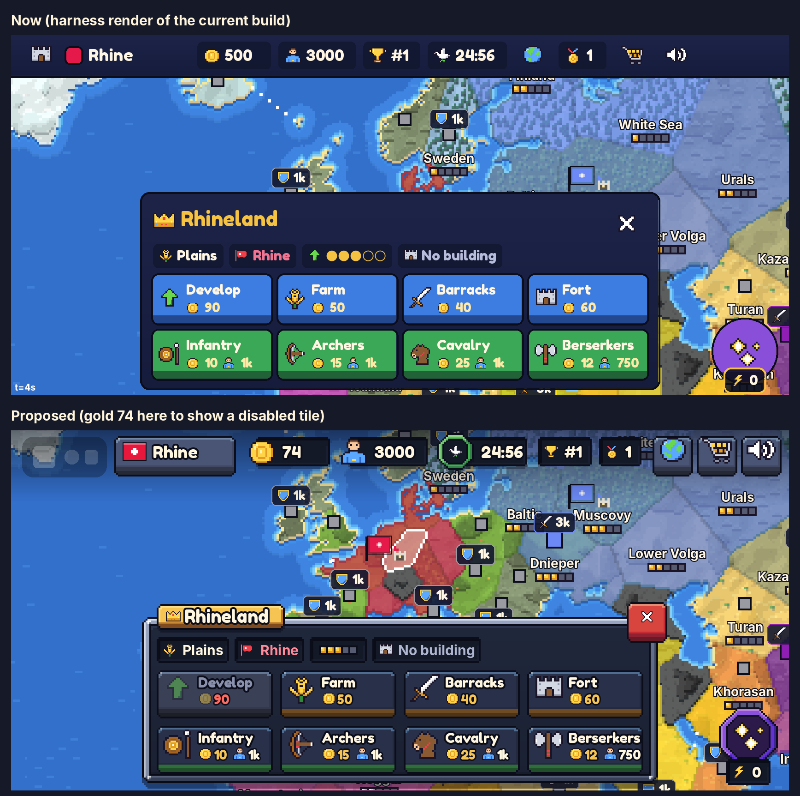

# UI direction: "Slate & Brass"

The design direction for the next GUI pass, written for the builder who implements it. It replaces the look of the "pixel kingdom" kit (docs/DESIGN.md "UI style") but keeps its structure: one token file (`Theme`), one component file (`Widgets`), pixel icons (`IconArt`, `Icons`), screens that never pick their own colours. Everything here uses what Roblox ships to live games as of October 2026, and everything image-based is painted at runtime, so nothing has to be uploaded.

Mockups are in `docs/images/ui/`. They are drawn with the real map (harness renders with the HUD removed), the real icons (read from `IconArt.luau`) and the real content of the matching harness screenshots, at 844×390 drawn at 2x. `tools/uimock/` holds the scripts that draw them, including `frameart.py`, the reference implementation of the frame painter the builder ports to Luau.

| File | What it shows | Based on |
| --- | --- | --- |
| `00_before_after.png` | The current top bar and province sheet above the proposed ones | harness `smoke/02_capital` |
| `01_hud_province.png` | Top bar in the Roblox top-bar row, province sheet, power button | harness `smoke/02_capital` (Rhineland) |
| `02_shop.png` | Shop, Flags tab, page 1 | guide `shop` (harness `shop/03_shop_flags`) |
| `03_results.png` | Results after a Domination win | guide `results` |
| `04_war.png` | Start of the War phase: WAR! ribbon, toast, army sheet with a route | harness `war/01_route_preview` |
| `05_components.png` | Every component in its states, with sizes | the UI kit |
| `06_small_phone.png` | 667×375: what the top bar drops, the sheet docked left | harness `smoke/02_capital` |
| `frameart_sample.png` | The painted frames at 1x with their 9-slice lines, and assembled at phone size | `tools/uimock/frameart.py` |
| `material_ab.png` | Brass band against iron band on the province sheet (why in-match sheets are iron) | |
| `font_test.png` | Fredoka One against Luckiest Guy on the new frames (why Fredoka One stays) | |



## 1. Summary

The current GUI has good bones and a cheap surface. Every panel, sheet, card, chip, well and the top bar is the same flat navy rounded rectangle with a near-black outline, so nothing has material, light or depth. The anti-aliased round corners belong to a web app, not to the crisp pixel map underneath. Saturated blue and green buttons fill whole sheets, so nothing stands out as the action that matters. The top bar is a full-width desktop toolbar.

The direction is a material, in the map's own pixel language:

- **Slate** panels with a lit top edge and stepped pixel corners.
- **Iron** bands on in-match sheets, **brass** bands on reward and meta screens.
- **Enamel** buttons with a real 12 px base that sinks when pressed.
- **Recessed wells** for every value and slot.
- **Ribbons** for the big moments.

All of it is painted at runtime into small EditableImages and shown as 9-slice ImageLabels (FrameArt), on a 2 px pixel grid that matches the 32 px icons. Hard pixel drop shadows (UIShadow) lift it off the map. Display text gets ink outlines. Routine actions become quiet slate slots, so colour is left for decisions. The top bar becomes floating plates in Roblox's own top-bar row.

**The five changes that do the most:**

1. **Painted pixel frames on everything.** Panels, sheets, windows, cards, buttons, chips and wells move from flat navy `UICorner` rectangles to FrameArt 9-slice frames: stepped corners, a lit edge, iron or brass bands, enamel faces on a 12 px base (sections 5, 6.1 and 7.0).
2. **The top bar becomes plates over the map** in the Roblox top-bar row: 32 px coin and manpower icons riding over recessed counters, a phase medallion whose ring is the phase colour, and gem icon buttons. No navy band, and 44 px more map on phones (section 7.9).
3. **Hierarchy through colour discipline.** Build and recruit become slate slot tiles with 32 px icons and gold costs. Saturated faces are kept for decisions: gold for the one primary action, emerald for confirm and buy, crimson for war and close (sections 6.3 and 7.10).
4. **Title plates, corner close buttons, hard shadows.** Every window carries a brass title plate on its top edge and a crimson close gem on its corner, and drops a hard pixel shadow. That is the WorldBox, Kingdom Rush and Into the Breach vocabulary (section 7.1).
5. **The moments look like moments.** Results, War and Cataclysm get ribbons, a turning sunburst, reward cells that count up, and a shine sweep. The shop gets rarity frames, rarity tags, lit display wells and side-by-side prices (sections 7.8, 7.12 and 7.13).

## 2. Why it reads as cheap

References are to the guide screenshots (`map`, `province`, `shop`, `results`, `season`, `quests`, `vote`, `draft`, `powers`, `diplomacy`, `tutorial`, `battle`, `cataclysm`, `army`, `march`) and to harness renders in `tools/harness/out/`.

### Across every screen

1. **One flat material.** The top bar, sheets, cards, chips, wells, tabs and the Results dim are all `#1d2448`, `#12172f` or `#2a3366`, each a plain fill with a 2 px near-black outline. The panel "bevel" multiplies white into `#c4c6d6` over the whole height, which is too faint to read as light. Nothing looks carved, framed or lit. In `province` the sheet, its chips and its header are the same navy at three nearly equal values.
2. **Web-app geometry on a pixel map.** `UICorner` radii of 4–11 px draw smooth anti-aliased curves next to the map's hard pixels and the icons' 1 px outlines. The UI looks like it belongs to a different game than the map it covers. This is the single biggest "cheap" signal.
3. **No depth.** There are no shadows anywhere (UIShadow did not exist when the kit was made). Sheets float on the map with only an outline to separate them (`battle`, `diplomacy`: the peace offer panel and a toast overlap with no sense of which is on top).
4. **Saturated colour everywhere means no emphasis.** The province sheet is eight solid blue and green slabs (`province`, `tutorial`). The powers grid is six solid purple slabs (`powers`), and the draft is ten full nation-colour blocks (`draft`). When everything shouts, nothing reads as the action that matters, and the colours compete with the nation colours on the map.
5. **Flat type.** Fredoka One sits on coloured buttons with no outline or shadow, so captions look printed on rather than embossed (`province`: "Develop", "Infantry"). Titles, numbers and buttons share one face and one treatment, and most body text is bold at 14–15 px, so the type scale has little contrast.
6. **Icons at non-integer scales.** The 16×16 sprites are drawn at 14, 16, 20, 24 and 32 px. At 20 and 24 px their pixels come out uneven (1.25× and 1.5×), which shows on PC and in Studio, where the owner judges the game. The icons themselves are good pixel art (`tools/harness/out/gui/icons.png`).
7. **Icons as decoration.** Nearly every line starts with an icon, including hints and footers (`results`, `quests`). Icons stop meaning anything.
8. **Spacing is either cramped or empty.** The top bar puts 11 items of equal weight in 8 px gaps. Shop cards are 60% empty (`shop`: price buttons float halfway down tall cards). Quests leaves the bottom-left quarter empty (`quests`). The Results reward column is dense while the standings breathe.
9. **No motion beyond a press squash** and a banner pop. Sheets and windows appear instantly, numbers jump, rewards are static text. Static UI reads as unfinished on Roblox, where top games animate every state change.

### Screen by screen

- **Top bar** (`map`, `province`): a full-width solid navy band with a hard bottom outline, like a desktop menu bar. It covers the top of the map. In a published game it also sits under Roblox's 58 px top-bar row, so the HUD takes about 102 of 390 vertical px. The castle, globe, cart and speaker icons float with no plate and do not look like buttons. The match phase (Peace, War, Cataclysm), the most dramatic state in the game, is a small icon inside the clock chip. Gold, manpower, rank and timer chips are dark wells inside a dark band with left-aligned numbers and dead space.
- **Province sheet** (`province`, `diplomacy`, `tutorial`): covers 55% of the screen height and hides the province it describes. The header row spends 44 px on a title. "No building" gets the same chip weight as useful facts. Development is drawn with text glyphs (●●●○○), unlike the pixel pip bar on the map. Build and recruit actions have no grouping, and costs in pale gold on saturated blue are low-contrast.
- **Army sheet** (`army`, `march`): Go and Cancel have the same weight. There is a lot of empty slab around a short hint.
- **Shop** (`shop`, harness `shop/02_shop_offers`): rarity is only an outline colour and a text line, with no rarity frame, glow or tag. The preview sits on bare navy with no display. Two equal price buttons are stacked with no clear primary. The tab row reads as a toolbar of 12 equal dark squares. The header puts the title, Glory, a two-line test note, the pager and the close cross on one line.
- **Results** (`results`): the moment of victory looks like a settings page. "You win!" is gold text in the panel's corner, with no banner, glow, crown or motion. The reward is a dense table of +100 and +20, with XP and Glory as two small chips. The level bar is thin.
- **Season, Quests, Trophies** (`season`, `quests`): grids of identical navy cells with lock squares. The claimable reward is distinguished only by a small green button, with no glow or pulse. The reroll buttons are the loudest thing on the Quests screen.
- **Map vote and Lobby** (`vote`): the best screen, because the map thumbnails carry it. The card bottoms are empty, and the round Lobby buttons are flat discs.
- **Phase banners and toasts** (`cataclysm`, `battle`): the banner is a flat purple plate, the closest thing to premium in the current UI. Toasts are navy boxes with a gold outline, like a web alert, and appear without an entrance.
- **Map overlays** (`europe`, `closeup`): already good. Names have a solid ink outline, pip bars are pixel art, and badges are small dark pills edged in the nation colour. Leave them almost alone (section 7.11).

## 3. What premium looks like in this genre

I studied store screenshots of each game (Steam for the PC titles, the App Store for the mobile ones), the Game UI Database gallery for Clash Royale's menus, and the written sources in Appendix B. For Clash of Clans, Rise of Kingdoms and the top Roblox games the store images are marketing art rather than menus, so those notes lean on the written sources and on what those games are known for, and say so.

| Reference | What makes it look polished | What we take |
| --- | --- | --- |
| **WorldBox** (in-game windows and the world-powers bar in its Steam screenshots) | The UI is muted: olive-slate pixel frames with stepped corners and dark inset wells. The map is the only saturated thing on screen. Each window title sits on a dark plate notched into the frame's top edge, with a red square close button on the corner. The world-powers bar is a row of square slots, each a bevelled well holding a detailed pixel icon, with category tabs above it. Stat rows are pixel icon plus number. | The material logic: quiet frames, saturated map. Title plates on the frame edge, close on the corner, square icon slots. |
| **The Battle of Polytopia** | Extreme restraint. The in-match HUD is typography on the map: a small label over a big number ("Score / 5,635", "Stars (+11) ★57", "Turn 11"). Round icon buttons carry a label underneath. One type family, a lot of air. | Fewer containers. A label/value hierarchy for counters. Never more chrome than the moment needs. |
| **Kingdom Rush** | The HUD lives in compact corner plates: dark iron and stone with rivets, holding hearts, gold and wave counts. Hero portraits and power buttons sit in metal-framed squares. Windows have heavy riveted frames, a title plate over the top edge and small bevelled buttons with uppercase captions. | Iron and brass trim, rivets, corner plates instead of a full-width bar. |
| **Clash Royale and Clash of Clans** (Supercell) | Counters are discrete dark capsules with the currency icon riding over one end, not a band. Backgrounds are textured. Buttons are two-tone (lighter face, darker base, a gloss highlight) with a thick dark outline, and their text is chunky, outlined and drop-shadowed. Colour is coded strictly: yellow for the main action, green for secondary actions and buys, blue as the base, red for notifications (The Rookies breakdown). Navigation is one level deep. Results use ribbons with folded ends. Key buttons get an animated highlight. | The depth stack (outline, base, face, highlight). Outlined display text. One primary colour per screen. Ribbons and celebration on rewards. Counters as capsules. |
| **Rise of Kingdoms** | Ornate gilded frames on parchment and dark leather, with heavy title cartouches, giving a sense of an empire's chancellery. (From store art and general knowledge; I could not capture menu screenshots.) | Brass reads as "empire" for a strategy game. Kept for reward and meta screens, not for every in-match sheet. |
| **Stardew Valley** | One frame family everywhere: a wood and parchment 9-slice at the same pixel scale as the world. Nameplate ribbons under portraits. Warm palette. The UI and the world feel like one object. | One frame language at the world's pixel scale (2 px here). Nameplates on edges. |
| **Into the Breach** | Dark navy panels with crisp 1–2 px light borders and chamfered corners. Header tabs attached to the panel's top-left. Strict alignment and very high information clarity, with nothing extraneous. Subset Games have said they would sacrifice cool ideas for clarity every time. | Proof that dark navy is not the problem: crisp borders, header tabs and alignment make it premium. Chamfered corners. |
| **Terraria, Loop Hero, Dead Cells** | Terraria uses translucent inventory slots with light borders and outlined text straight over the world, with the HUD kept in the corners. Loop Hero is dense, but every frame is the same retro pixel kit. Dead Cells shows almost no UI. | Outlined text over the map. Slots as the unit of interaction. One kit. |
| **Top Roblox games** (Pet Simulator 99, Pls Donate; 2025's biggest, Grow a Garden and Steal a Brainrot) | The DevForum notes that Pet Simulator 99 and Pls Donate build their UI from images: designed in Figma or Photoshop as layered images (outline, base, face, highlight, shine) and shown as ImageButtons (April 2024). Roblox UI tutorials teach the same layering, with green price buttons and big icons. I could not capture in-game screens of 2025's biggest games, so this row rests on those sources: bold outlined text, big icons, lots of motion, which teen players read as quality. | The layered depth and motion, in a pixel dialect, painted at runtime instead of uploaded (section 5). |

**The rules that fall out of it:**

1. The UI is a quiet frame around a loud map: saturation belongs to nation colours, the map, and the one action that matters on each screen.
2. One material family at the map's pixel scale. Every frame is drawn on the same 2 GUI px grid as the 32 px icons.
3. Everything has an edge, a lit side and a shadow side, lit from the top left like the map's mountains.
4. Buttons look physically pressable: an outline, a face with a highlight row, and a thick base that sinks when pressed.
5. Titles live on plates on the frame edge, and close buttons live on the corner.
6. Values live in recessed wells, and counters carry a big icon over one end.
7. Display text is outlined in ink. Hero text is outlined and drop-shadowed.
8. Colour encodes role: gold for the primary action (one per screen) and Glory prices, emerald for confirm and buy, crimson for war, close and danger, azure for diplomacy and info, royal for Primordial and season content, slate for everything secondary.
9. Moments get motion: banners pop, rewards count up, claimables pulse, rare items shine.
10. Nothing wider than it needs to be: no full-width bars, no empty halves.

## 4. What Roblox can do now (checked October 2026)

| Feature | Status in live games | Exact API | Use here |
| --- | --- | --- | --- |
| **UIShadow** | Full release (June 2026). Text shadows, inset and knockout shadows and gradient shadows are a Studio beta ("Upgraded UIShadows") that **cannot be published**. | `UIShadow`: `BlurRadius` (UDim), `Color`, `Transparency`, `Offset` (UDim2), `Spread` (UDim2), `ZIndex` (negative only), `Enabled`. Several per object. Follows the parent's rectangle and its `UICorner`, **not image alpha**. Roblox: no more than 100 on screen; "consistently faster than 9-sliced ImageLabels". | Hard pixel shadows: `BlurRadius` 0, ink, offset (0, 4–6). Rarity glows: blur 12, rarity colour. **Do not use** `Mode = Text`, `Inset` or a UIGradient child. |
| **UICorner per corner** | Full release (June 2026) | `TopLeftRadius`, `TopRightRadius`, `BottomLeftRadius`, `BottomRightRadius` (UDim). `CornerRadius` sets all four. Do not mix the two. | Round the UIShadow under chamfered frames (radius 6 on windows, 4 on plates and buttons). The flat fallback look. |
| **UIStroke improvements** | Full release (Dec 2025) | Several **border** strokes per object (one contextual). `BorderStrokePosition` `Outer` (default), `Center` or `Inner`; `BorderOffset` (UDim); `StrokeSizingMode` `FixedSize` or `ScaledSize`; `ZIndex` (give stacked strokes different values). With a UICorner, Bevel and Miter joins become Round. Roblox: fewer than 300 strokes on screen. A UIGradient child colours a stroke. | Text outlines (`ApplyStrokeMode.Contextual`). The flat fallback's double edge (ink Outer plus band Inner). The tutorial glow as a second stroke: `Widgets.stroke`'s "step aside" logic is no longer needed. Do not tween `Thickness` on text strokes (glyph cache churn). |
| **UIGradient** | Linear: live. Radial, Elliptical, Conical, `Scale` and `TileMode` are a Studio beta ("Upgraded UIGradients") and **cannot be published**. | `Color` (ColorSequence), `Transparency` (NumberSequence), `Rotation`, `Offset`. Multiplies the parent, including its image and text. | Panel lighting, the scrim, progress fills, the glow behind shop previews, the shine sweep (tween `Offset`). |
| **9-slice** | Live | `ImageLabel.ScaleType = Enum.ScaleType.Slice`, `SliceCenter` (Rect, source pixels), `SliceScale` (multiplies the border size), `ResampleMode = Enum.ResamplerMode.Pixelated`. An EditableImage can go in `ImageContent` via `Content.fromObject(image)`. | Every frame, at `SliceScale = 2`. |
| **EditableImage** | Live, but fails in published games unless the game setting **Allow Mesh / Image APIs** is on (Studio: Experience Settings → Security; Creator Dashboard: Configure → Settings, "Enable Mesh / Image APIs"). The owner must be 13+ and ID-verified. | `AssetService:CreateEditableImage({ Size = Vector2.new(w, h) })`, max 1024×1024. `WritePixelsBuffer`, plus `DrawRectangle`, `DrawImage`, `DrawImageTransformed`. Strict, unpublished client memory budget: creation **returns nil** when it is used up. `Destroy()` frees memory at once. One image can back many labels. | Frames, about 50 images under 100 KB in all, next to the map's 2–4 MB. DevForum reports (Aug–Sep 2026) describe device-specific failures, so every frame keeps a flat fallback. |
| **CanvasGroup** | Live | `GroupTransparency`, `GroupColor3`. Always clips. Flattens descendants into a texture only with `ZIndexBehavior.Sibling`. Costs extra texture memory capped by the client's QualityLevel; past the cap it renders **blank**. | **Avoid** for routine fades on phones. Fade a few objects directly instead. |
| **Rich text** | Live (`RichText = true`) | `<font color size face family weight transparency>`, `<stroke color thickness transparency joins sizing>`, `<b> <i> <u> <s> <br/> <uc> <sc> <mark>`. Escape `&lt; &gt; &quot; &apos; &amp;`. No inline images. | Two-colour lines ("<font color='#F4BF45'>Level 2!</font> · Settler"). Keep emoji and pixel icons out of text. |
| **Fonts** | Live | 39 built-in families. Among them: Fredoka One (`Enum.Font.FredokaOne`), Builder Sans (`BuilderSans`, `BuilderSansMedium`, `BuilderSansBold`, `BuilderSansExtraBold`), Builder Extended, Builder Mono, Montserrat, Luckiest Guy, Bangers, Denk One, Press Start 2P (`Enum.Font.Arcade`, `rbxasset://fonts/families/PressStart2P.json`, Regular only), Grenze Gotisch, Fondamento. `Font.new(family, weight, style)`, `Font.fromEnum`, `Font.fromName` (no spaces), `Font.fromId`. | Section 6.5. |
| **TweenService** | Live | `EasingStyle` Linear, Sine, Quad, Cubic, Quart, Quint, Exponential, Circular, Back, Bounce, Elastic. `EasingDirection` In, Out, InOut. TweenInfo time, style, direction, repeatCount, reverses, delayTime. Tweens positions, sizes, colours, transparency, `UIScale.Scale`, `UIGradient.Offset`, and `UIStroke` Color, Thickness and Transparency. | Section 6.8. |
| **Safe areas and the top bar** | Live | Roblox's top-bar row is **58 px** (it was 36 px before the 2024 experience controls). `ScreenGui.ScreenInsets`: `CoreUISafeInsets` (default), `DeviceSafeInsets`, `TopbarSafeInsets`, `None`. `GuiService.TopbarInset` (Rect) is the free part of the top-bar row, and changes at runtime. A 2025 DevForum report says `TopbarSafeInsets` misplaced content, so position from `TopbarInset` instead. | The top bar goes into that row (section 7.9). |
| **Accessibility** | Live | `GuiService.PreferredTextSize` (`AutomaticSize` labels grow with it; `TextScaled` does not). `GuiService.ReducedMotionEnabled`. | Loops and shines stop under reduced motion. Never use `TextScaled`. |

## 5. The asset path: paint frames at runtime

This project cannot upload images from the cloud. Two ways to get image-based UI:

| | Runtime-painted (FrameArt) | Uploaded once by the owner |
| --- | --- | --- |
| How | Frames are character grids plus palettes, like `IconArt`. They are painted into EditableImages on first use and shown as 9-slice ImageLabels. | PNGs exported from a generator are uploaded in Studio, and the asset ids go into a module. |
| Iteration | A code change and a rebuild. The harness renders it. Lune tests check it. | Every change needs the owner to re-upload, wait for moderation and paste new ids. |
| Colours | Any colour at runtime: nation-coloured draft buttons, rarity frames, phase medallions. | One image per colour, or `ImageColor3` tinting, which loses hue-shifted shading. |
| Requirement | **Allow Mesh / Image APIs** on, which the map already needs. EditableImage can fail on some devices. | None. Works on every device. |
| Harness | Already dumps EditableImages. Needs a 9-slice renderer (step 1). | Cannot render asset ids (the screenshots would show nothing). |
| Memory | About 50 images, under 100 KB. | Roblox caches them. |

**Decision: paint at runtime.** The map already depends on EditableImage: without it the game shows no map art at all, so frames add no new failure mode. Painting keeps every pixel in reviewable code, the same palette pipeline as `IconArt` and the map, the harness screenshots and Lune tests the project's whole workflow relies on, and per-colour hue-shifted ramps that uploaded images could not give. Every framed widget keeps a **flat fallback** made of the same objects (fill, `UICorner`, two `UIStroke`s, `UIGradient`, `UIShadow`), used when `Frames.content` returns nil, just as icons fall back to emoji.

**Optional later:** the owner can upload the same PNGs (rendered by `tools/uimock/frameart.py`) so devices that refuse EditableImage still get frames. It is not needed for launch, and nothing in this plan depends on it.

## 6. The visual language

### 6.1 Materials

| Material | Where | Look |
| --- | --- | --- |
| **Slate** (panel fill) | Every panel, sheet, window, card | Deep blue-grey `#1e2538` with a lit lip under the top edge and a shadowed row above the bottom. A gentle vertical light (UIGradient ×1.08 at the top to ×0.90 at the bottom). |
| **Iron band** | In-match sheets and panels: province, army, powers, nations drawer, offers, tutorial card, private settings | A band 3 art pixels wide (6 px on screen), `#c9d1e0` highlight, `#8f9ab3` face, `#5f6a85`/`#3d4660` shade, with rivets in the corners. Calm, so it does not compete with the map or the gold actions. |
| **Brass band** | Meta and reward windows: shop, season pass, quests, trophies, Results, the starter-pack offer | The same band in `#ffe08a`/`#e0a23a`/`#b8752a`/`#7e4a1e`. Reads as treasure. See `material_ab.png` for the comparison. |
| **Rarity band** | Shop cards and season-pass reward cells | The same band in the rarity's ramp (Common steel, Rare azure, Epic violet, Legendary amber). |
| **Brass plate** | Title plates, the Results ribbon | Brass face with a highlight row and a darker base. White Fredoka One with an ink outline. |
| **Enamel** | Buttons, tabs, badges, medallion rings | Hue-shifted ramp (section 6.4): glint, highlight row, face, lower-face shade, 2 px base, base bottom, ink outline. |
| **Well** | Chips, counters, tags, empty slots, progress tracks, unselected tabs, display wells | Recessed: the rim casts a shadow on the top and left, and light catches the bottom and right. |

No parchment and no wood: one family, as in Stardew Valley, keeps it coherent. No textures in the fill: 9-slice centres stretch, and a texture would smear.

### 6.2 The pixel grid

- **2 GUI px per art pixel** everywhere: `SliceScale = 2`, `ResampleMode = Enum.ResamplerMode.Pixelated`. On a 3x phone that is a crisp 6 physical px per art pixel, and on PC or in Studio a crisp 2.
- **Sizes and positions are even numbers**, so frames never land on half pixels. Avoid centring odd sizes with `AnchorPoint` 0.5.
- **Icons only at 16, 32 or 48 px** (1x, 2x, 3x of the 16×16 sprites). Drop 14, 20 and 24. Use 16 inline with text, 32 on buttons, tabs, tiles and counters, 48 in reward cells and heroes.

### 6.3 Palette

Tokens for `Theme.color`. Old names stay as aliases while screens migrate (`navy` = `slate800`, `navyDeep` = `slate900`, `navyRaised` = `slate700`, `goldDeep` = `brass500`, `goldPale` = `brass200`, `primary` = `azure`, `good` = `emerald`, `danger` = `crimson`, `secondary` = `slate`, `special` = `royal`, `warn` = `negative`).

| Token | Hex | Use |
| --- | --- | --- |
| `ink` | `#0b0d1a` | Every outline, text strokes, shadows |
| `slate950` | `#0e111c` | Full-screen dims (at 40% transparency) |
| `slate900` | `#141927` | Well fill |
| `slate850` | `#191f30` | Well light edge, panel bottom shade |
| `slate800` | `#1e2538` | Panel fill |
| `slate700` | `#283149` | Raised cards, slot tile faces, panel lip |
| `slate600` | `#36415f` | Lit plate edges, dividers |
| `slate500` | `#4c5878` | Raised plate edges |
| `slate400` | `#6b7799` | Muted icons on slate |
| `slate300` | `#98a2c0` | Section labels, minor numbers |
| `brass100`…`brass600` | `#fff1b8` `#ffe08a` `#f6c453` `#e0a23a` `#b8752a` `#7e4a1e` | Brass material |
| `iron200` `iron400` `iron500` `iron600` | `#c9d1e0` `#8f9ab3` `#5f6a85` `#3d4660` | Iron material |
| `text` | `#fff6e0` | Body and captions (warm white) |
| `textDim` | `#aeb6d0` | Hints, secondary lines |
| `textDark` | `#2a1a08` | Text on gold |
| `textDisabled` | `#8a91ad` | Disabled captions |
| `gold` | `#f4bf45` | Primary button face, gold text and highlights, selection |
| `emerald` | `#41b54a` | Confirm, accept, go, Robux prices, claim, equip |
| `crimson` | `#d8453e` | War, close, leave, danger |
| `azure` | `#3a85de` | Diplomacy (ally), info, the trophies button |
| `royal` | `#8a52da` | Primordial powers, season pass |
| `slate` | `#4a5576` | Secondary buttons: cancel, not now, pager, top-bar icon buttons |
| `disabled` | `#3a4157` | Disabled button face |
| `peace` `war` `cataclysm` | `#55c35a` `#e0483f` `#9a5bea` | Phase medallion rings and toast medallions (Results uses `gold`) |
| `negative` `positive` | `#ff6b5e` `#8bea7c` | Negative gold, unaffordable costs; gains |

`Theme.rarity`: Common `#b9c1d9`, Rare `#4fa3ff`, Epic `#b36ff2`, Legendary `#ffa53a`.

Contrast (WCAG ratio): `text` on `slate800` 14.2:1, `textDim` on `slate800` 7.6:1 and on `slate700` 6.4:1, `gold` on `slate800` about 9.3:1, `slate300` on `slate800` 6.0:1, `negative` on `slate800` 5.5:1 and on `slate700` 4.6:1, `textDark` on `gold` 9.9:1. White on emerald (2.5:1) and azure (3.5:1) is low, so **white captions on coloured faces always carry the 2 px ink outline**, which makes them legible whatever the face.

### 6.4 Ramps (enamel colours)

Each button colour has six tones. Lightness is scaled rather than shifted, so dark faces keep a visible base. Highlights turn warm (hue towards yellow, at most 10°), and shades turn cool (hue towards blue, at most 12°), the way the map's pixel art is shaded. `FrameArt.ramp(face)` computes them (Appendix A), and the values are listed here so the builder can check the port:

| Colour | W glint | H highlight | F face | S lower face | B base | D base bottom |
| --- | --- | --- | --- | --- | --- | --- |
| `gold` | `#f6ecb0` | `#f7e679` | `#f4bf45` | `#ef9b1e` | `#b9640f` | `#86490d` |
| `emerald` | `#b1daae` | `#7bcd73` | `#41b54a` | `#3a9a4b` | `#2d7140` | `#22522f` |
| `crimson` | `#e8baad` | `#e38c74` | `#d8453e` | `#c42b33` | `#902133` | `#691a26` |
| `azure` | `#acd3eb` | `#71bbe7` | `#3a85de` | `#2561cc` | `#1d3c96` | `#172d6d` |
| `royal` | `#d4b6ea` | `#bb82e4` | `#8a52da` | `#6332d0` | `#3e269a` | `#2f1d70` |
| `slate` | `#aeb6c1` | `#7288a7` | `#4a5576` | `#414864` | `#323649` | `#252835` |
| `disabled` | `#a5abb5` | `#637794` | `#3a4157` | `#33384a` | `#272936` | `#1d1f27` |
| tile (`slate700`) | `#95a4b7` | `#4f6c91` | `#283149` | `#23293e` | `#1b1e2d` | `#141621` |
| `peace` | `#bcdfb8` | `#8ed485` | `#55c35a` | `#41b051` | `#328146` | `#265d34` |
| `war` | `#ecbcae` | `#e98f75` | `#e0483f` | `#d2252c` | `#9a1d2f` | `#701724` |
| `cataclysm` | `#dbb9f1` | `#c789f0` | `#9a5bea` | `#7035e3` | `#401cb4` | `#301683` |
| Common | `#e2e6eb` | `#cdd6e4` | `#b9c1d9` | `#96a0c4` | `#606ba1` | `#485075` |
| Rare | `#b4e2fb` | `#80d2ff` | `#4fa3ff` | `#2275fd` | `#043dd1` | `#052e98` |
| Epic | `#e5c2f6` | `#d897f6` | `#b36ff2` | `#8a44ec` | `#5017cb` | `#3c1393` |
| Legendary | `#fbe3ab` | `#ffd671` | `#ffa53a` | `#fd7911` | `#c44604` | `#8f3404` |

Slot tiles swap only their base (B, D) to say what group they are in: build `#6e4b22`/`#4e3416` (bronze), recruit `#2e6e3a`/`#1f4e29` (green), powers `#3e269a`/`#2f1d70` (royal).

### 6.5 Type

| Role | Font (exact Roblox) | Size | Colour | Treatment |
| --- | --- | --- | --- | --- |
| Hero (banners, the Results headline) | `Font.fromEnum(Enum.Font.FredokaOne)` | 30 | `text` | 3 px ink `UIStroke` (Contextual) plus a hard drop: a second label in ink, 3 px lower, behind |
| Title (title plates) | Fredoka One | 19–20 | `text` | 2 px ink stroke |
| Numbers (counters, prices, scores) | Fredoka One | 18 (top bar), 14–16 (dense) | `text`, `gold` for money gained or prices, `negative` when short | 2 px stroke at 16 px and up, 1.5 px at 14–15 px |
| Button captions | Fredoka One | 17 (16–15 when dense) | `text` with 2 px ink stroke; `textDark` with no stroke on gold | |
| Body | `Font.fromEnum(Enum.Font.BuilderSansBold)` | 15 | `text` | None on slate. 1 px ink `TextStroke` over the map (as the province names already do) |
| Hints, footers | `Font.fromEnum(Enum.Font.BuilderSansMedium)` | 14 | `textDim` | None. No leading icon. |
| Section labels | `Font.fromEnum(Enum.Font.BuilderSansExtraBold)` | 14 | `slate300` or `gold` | Uppercase (`string.upper`), used sparingly ("BUILD", "RECRUIT", "DAILY") |

Nothing is under 14 px. Never use `TextScaled` (it ignores `PreferredTextSize`).

**Considered and rejected:**

- **Luckiest Guy:** punchier, but its lowercase turns into odd small caps and it sits off-centre vertically (`font_test.png`).
- **Press Start 2P:** matches the map, but it is too wide for 14–18 px words on a phone.
- **Grenze Gotisch and Fondamento:** strong theming, but weak legibility for 13-year-olds at phone sizes.

Fredoka One with outlines already reads as premium casual in the mockups. Its look changes through treatment, not replacement.

### 6.6 Depth and light

Light comes from the top left, like the map's slopes. Highlights go on the top and left edges, shades on the bottom and right.

| Level | What | How |
| --- | --- | --- |
| 0 | Map overlays (names, badges, pills) | Ink outline only |
| 1 | Wells | Painted recess, no shadow |
| 2 | Buttons and tiles on a panel | The painted 12 px base is their height. No shadow. |
| 3 | Plates over the map: top-bar items, toasts, the power button, Lobby buttons | `UIShadow` Offset (0, 4), BlurRadius 0, Color `ink`, Transparency 0.55. Buttons over the map get (0, 3) at 0.6. |
| 4 | Windows and sheets | `UIShadow` Offset (0, 6), BlurRadius 0, ink, Transparency 0.5. Modal windows also dim the screen (`slate950` at Transparency 0.4). |
| Glow | Rare and better shop cards, claimable rewards | A second `UIShadow`: Offset 0, BlurRadius 12 px, Color the rarity (or `gold`), Transparency 0.45 |

UIShadow follows the object's rectangle and its `UICorner`, not the painted image. So framed objects get a `UICorner` matching their stepped corner (6 px on windows, 4 px on plates and buttons), which keeps the shadow from showing square corners under a chamfer. **Check in Studio** that the corner does not clip the frame's outline pixels. If it does, drop the `UICorner` and accept 2 px square shadow corners.

### 6.7 Iconography

- Keep the 16×16 IconArt sprites, their 24-colour palette and their 1 px dark outline. They are good.
- Sizes 16, 32 and 48 only (section 6.2).
- Every tappable icon sits on a plate: a gem icon button, a tab well or a slot. No bare floating icons, except inside the close button.
- Icons signify actions and values: on buttons, tabs, counters, slots, and the first column of a table. Hints, footers and descriptive lines get no icon.
- A counter's icon is 32 px and rides 10 px over the well's left end (the Supercell capsule).
- Phase icons sit in medallions whose ring is the phase colour: dove for Peace, crossed swords for War, meteor for Cataclysm, flag for Results.
- The Shield power's pill uses the icon `powerShield` (its current name on main).

### 6.8 Motion and feedback

| Moment | Tween |
| --- | --- |
| Button press | Swap to the `buttonDown` image, content 4 px lower, `UIScale` 0.97 in 0.05 s (Quad Out). Release: back in 0.12 s (Back Out). Tap sound as now. |
| Sheet open and close | Slide 24 px up from below in 0.18 s (Quint Out). Close slides down 0.12 s (Quad In) and then hides. No CanvasGroup. |
| Window open (shop, quests, season, trophies, Results) | `UIScale` 0.92 → 1 in 0.22 s (Back Out). Dim 1 → 0.4 transparency in 0.15 s. |
| Toast | From −12 px and transparent to resting in 0.2 s (Back Out). Stays 2.5 s. Leaves upwards in 0.18 s. |
| Phase banner | `UIScale` 0.6 → 1.08 (0.18 s, Back Out) → 1 (0.1 s). Shine sweep: a white band (`UIGradient` transparency 1 / 0.55 / 1, Rotation 20) with `Offset.X` from −1 to 1 over 0.5 s. Hold 1.4 s, then fade the face and text over 0.3 s. |
| Counter changes | Number counts to the new value in 0.3 s. Gains pulse `UIScale` 1 → 1.12 → 1 (0.25 s). A loss flashes the number `negative` for 0.4 s. |
| Results rewards | Reward cells count from 0 over 0.8 s (Quad Out) after a 0.3 s delay. The level bar fills over 0.6 s. A level-up line stamps in (`UIScale` 1.4 → 1, Back Out). The sunburst turns 6° per second. |
| Claimable (quests, season, achievements) | `UIScale` 1 → 1.04 → 1 every 1.2 s (Sine InOut, repeat) plus the gold glow shadow |
| Legendary shop card | A shine sweep every 3 s |
| Reduced motion (`GuiService.ReducedMotionEnabled`) | No loops, shines or sunburst rotation. Pops become instant. Counters still update. |

## 7. Component specs

Sizes are GUI px on an 844×390 phone. Frame names refer to FrameArt (Appendix A). "Objects" counts GuiObjects, the unit of the 2,000 budget. `UIStroke`, `UIShadow`, `UICorner`, `UIGradient` and `UIPadding` are not GuiObjects.

### 7.0 How a widget gets its frame: `Widgets.skin`

Screens and the harness rely on each widget's root object: its class (`TextButton`, `TextLabel`, `Frame`), its `Name`, its `Text`, its `Icon` child, `LayoutOrder`, `Size`. The harness presses buttons by `Name` or by `Text`, and checks the icon on the same object (`H.pressIn(alice, "Card_flag_sun", "1,200", "medal")`). So the frame is added **inside** the widget and the root stays the API:

```text
TextButton "Develop" (root: Text "Develop", BackgroundTransparency 1, TextTransparency 1, UIPadding, UICorner, UIShadow)
├── ImageLabel "Face"     ZIndex 0. The 9-slice frame. Position (-padL, -padT), Size (1, padL+padR, 1, padT+padB)
├── ImageLabel "Icon"     ZIndex 2. Unchanged (Icons.label)
└── TextLabel  "Caption"  ZIndex 2. Mirrors the root's text properties. UIStroke child (Contextual, ink)
```

- **`Widgets.skin(obj, frame, style)`** creates **Face** (`ImageContent` = `Frames.content(frame, style)`, `ScaleType` Slice, `SliceCenter`, `SliceScale` 2, `ResampleMode` Pixelated, `BackgroundTransparency` 1). It compensates for the root's `UIPadding`, because padding insets children too. Reconnect when the padding changes (`leadIcon` widens it).
- For text roots it also creates **Caption** and mirrors `Text`, `TextColor3`, `TextSize`, `FontFace`, `TextXAlignment`, `TextYAlignment`, `TextWrapped`, `TextTruncate` and `RichText`, through `GetPropertyChangedSignal`. It sets the root's `TextTransparency = 1`. The root keeps its text for the harness and for screens that read it (Draft, PrivateSettings, Quests, Results and Tutorial write `button.Text` after creation).
- It sets the root's `BackgroundTransparency = 1` and disables its `Outline` stroke and `Bevel` gradient.
- When `Frames.content` returns nil (no EditableImage), `skin` does nothing and the root keeps the flat look (section 7.16).
- **Cost:** +2 GuiObjects per skinned text widget, +1 per skinned frame. At the soak's peak (Results at 25:01, currently about 1,050–1,340 objects) that is roughly +60, which leaves the budget comfortable.
- Children render above their parent in `ZIndexBehavior.Sibling` (the default here). That is why the frame cannot be the root's own background and the caption must be a sibling above it.

**`Frames` (Roblox side, `src/client/UI/Frames.luau`)**, modelled on `Icons`:

- `Frames.content(frame, style): Content?` paints on first use. `style` is a palette name, or a `Color3` for computed ramps such as nation colours. The result is cached per (frame, style) and shared.
- It returns nil and sets a global `unavailable` flag after the first failed `CreateEditableImage` (pcall, or a nil return when the memory budget is spent).
- `Frames.slice(frame): Rect?` returns the slice rect.

**`FrameArt` (pure, `src/client/FrameArt.luau`, like `IconArt`; tested under Lune)** provides `FRAMES`, `STYLES`, `ramp(face)`, `octagon(n, ring)`, `ribbon()` and `paint(frame, palette) -> (buffer, w, h)`. Appendix A has the data and the algorithm.

### 7.1 Window, sheet, title plate, close

| Part | Spec |
| --- | --- |
| **Window** (`Widgets.window`, full screen) | Brass `window` frame. Margin 8 (16 at the top for the title plate). `UIShadow` level 4. `UICorner` 6. The dim behind (`slate950`, Transparency 0.4) sits in the same ScreenGui. |
| **Sheet** (`Widgets.sheet`) | Iron `windowIron` frame docked bottom: y = screen − 8 − height. Width min(560, screen − 16 − 84 when the screen is under 744 px). Centred when it fits beside the power button, else docked left at x 8 (`06_small_phone.png`). Level 4 shadow, no dim. |
| **Panel** (`Widgets.panel`, drawers and popovers) | Iron or brass by role (section 6.1). Popovers and tooltips use the `plate` frame. |
| **Borders and padding** | The frame's border is L 12, R 10, T 14, B 12 px. Content padding: 16 left and right, 22 at the top under a title plate (18 without), 14 at the bottom. |
| **Title plate** (`Widgets.header`) | Brass `titlePlate` frame, 28 tall, its x 16 from the window's left, its centre on the window's top edge (y −14). Padding 10. Optional 16 px icon, then the title in Fredoka One 19–20, `text`, 2 px ink stroke. Width fits the text. Shadow (0, 3) at 0.5. The title label keeps the old title's `Name`. |
| **Close** | Crimson gem icon button, 44×44, 16 px `close` icon, at (window width − 34, −16): it overhangs the top-right corner. `Name "✕"` (the harness presses it 26 times). |
| **Objects** | Window = root + Face. Title plate = Face + Caption + Icon. Close = button. |

The province sheet goes from about 230 px tall to 180 px, because the title moved onto the frame edge (`01_hud_province.png`).

### 7.2 Buttons

| | Spec |
| --- | --- |
| **Frame** | `button` (up) and `buttonDown` (pressed), styled by colour (section 6.4). 44 tall by default, 52 for tiles and large actions. Never under 44. |
| **Anatomy** | In screen px: the outline (2), the highlight row (2), the face down to H − 12, then the 12 px base (2 lower-face shade, 4 base, 4 base bottom, 2 outline). Captions centre on the face: the root's `UIPadding` top 2, bottom 12. |
| **Caption** | Fredoka One 17 (15–16 dense). `text` with 2 px ink stroke, or `textDark` with no stroke on gold. |
| **Icon** | 16 px beside a caption. 32 px alone (icon buttons). Icon and caption centre together, 6 px apart. |
| **Roles** | Primary (one per screen): gold. Confirm, buy with Robux, Go, Accept, Equip, Claim: emerald. War, leave, danger: crimson. Ally and info: azure. Primordial and season: royal. Secondary (Cancel, Not now, pager): slate. |
| **States** | Up: `button`. Pressed: `buttonDown`, content +4 px, scale 0.97. Disabled: `disabled` palette, caption `textDisabled`, icon `ImageTransparency` 0.55, still sends taps (screens explain in a toast, as now). Selected (tabs): gold. |
| **Mapping today's colours** | `Widgets.GOLD` → gold, `GOOD` → emerald, `DANGER` → crimson, `BUTTON` → azure (then reassign per screen, steps 4–7), `BUTTON_OFF` → slate, `SPECIAL` → royal. A `Color3` that is none of these (nation colours) → `Frames.content("button", color)`. |
| **Objects** | Root + Face + Caption (+ Icon) = 3–4. Today: 1–2. |

**`fitButton`** (prices, Claim, Equip): width = icon + 4 + text + 16 padding. **`actionButton`** becomes the **slot tile** (section 7.10).

### 7.3 Icon buttons, pager, Lobby buttons

- **Icon button:** a gem button, 44×44, with a 32 px icon centred on the face (its top at y 1). Slate unless its role says otherwise: close is crimson, trophies azure. In the top bar and on the map it gets a (0, 3) shadow. **Never a bare icon.**
- **Pager:** two slate icon buttons (`back`, `arrow`) 44×44, with the page ("1/2", Fredoka One 17, stroke 2) between them in a 44-wide slot. Names `PrevPage` and `NextPage`.
- **Lobby corner buttons** (`cornerButton`): gem buttons 52×52 with 32 px icons: shop emerald, quests azure, trophies slate, season royal. `countBadge` on the top-right corner. A 14 px label under each is optional. The `UICorner` 0.5 that makes them round today goes away: they are gems.

### 7.4 Tabs

- 44 tall. The shop has 12 tabs in 796 px: 13 units with 4 px gaps, and the selected tab is two units wide.
- **Selected:** gold gem button with a 16 px icon and its label (Fredoka One 16, `textDark`).
- **Not selected:** a well, 40 tall, with a 32 px icon centred. Pressing it goes straight to selected, with no pressed image.
- Names stay `Tab_<id>`.

### 7.5 Chips, counters, tags

| | Spec |
| --- | --- |
| **Chip** (info: terrain, owner, building, siege) | `well` frame, 28 tall. 16 px icon at x 6. Text at x 28, Builder Sans Bold 15. Right padding 8. Tinted text for owners (the nation colour lightened 40%, as now) and dim for "No building". |
| **Development** | Not text pips. The map's pixel pip bar (`MapBadges.pips`, the same shared EditableImages) at 2x, in a 62×28 well. |
| **Counter** (top bar, Glory in the shop) | `well` frame, 32 tall. A 32 px icon at x −10, vertically centred: it rides over the left end. The number at x 28, Fredoka One 18, 2 px stroke. `UIShadow` (0, 3) at 0.65. |
| **Tag** (Owned, Equipped, Not today, Trophy, Top 100, Season) | `well`, 32–36 tall, full card width. Icon 16 and Builder Sans Bold 15. "Equipped" in `gold`. Not a button. |
| **Objects** | Chip and tag: root + Face + Caption + Icon. Counter: root + Face + Caption + Icon. |

### 7.6 Badges

The `badge` frame in crimson, 22 tall, at least 22 wide (grows with `AutomaticSize`). Fredoka One 14, `text`, 1.5 px stroke. Anchored (1, 0) at the parent's top-right, +4 / −4 px. "NEW" uses gold with `textDark`.

### 7.7 Toasts

- The `plate` frame, 44 tall, width min(340, text + 64). Shadow level 3.
- A **32 px medallion** (`medallionSmall`) at (6, 6) in the event's colour, with its 16 px icon.
- Text at x 46, Builder Sans Bold 15, one line (two at most, as now).
- Event colours come from the icon `Icons.split` already extracts: war → `war`; peace, handshake, flag (you took) → `peace`; trophy (battle won) → `gold`; skull and retreat (lost) → `slate`; scroll (offer) → `azure`; sparkles, meteor and other Primordial powers → `royal`.
- Same place as now: under the top bar, right of the left panels. Motion as in section 6.8. Name `Toast`.

### 7.8 Banners (War, Cataclysm, Results)

- The `ribbon` frame in the phase colour (crimson, royal, gold). **Exactly 60 tall** (the art is 30 px, so the tails never stretch).
- Width = text + icon + 108, and the body's content padding is 34 each side (the tails are 26 px).
- 32 px icon. Hero text Fredoka One 30 with 3 px stroke and a 3 px drop (the second label).
- A `Shine` child (a white Frame with the transparency gradient) for the sweep. Placed at y 128, under the toasts, centred.
- Motion as in section 6.8. **Objects:** root + Face + Caption + Drop + Icon + Shine = 6, for 2.6 s.

### 7.9 The top bar

`01_hud_province.png`, `04_war.png`, `06_small_phone.png`.

**Placement**

- The bar's ScreenGui uses `IgnoreGuiInset = true` and `ScreenInsets = Enum.ScreenInsets.None`, so its coordinates are screen coordinates.
- A transparent row Frame sits at x = `TopbarInset.Min.X` + 8. Its width is `TopbarInset.Width` − 16, and items centre vertically on the row's face line, `TopbarInset.Min.Y` + (`TopbarInset.Height` − 44) / 2 + 17.
- Re-place it on `GuiService:GetPropertyChangedSignal("TopbarInset")`.
- If `TopbarInset.Width` < 420 or `Height` < 44, fall back to a row under the top-bar row (y = `TopbarInset.Max.Y` + 4, full safe width).
- Everything that sat under the old 44 px bar moves up with it: the toasts' line, the nations drawer, the tutorial card, and the "map art is off" notice. Keep one runtime value, `Hud.contentTop()`, instead of `Theme.size.bar` sums.

**The scrim**

A full-width Frame, `ink`, height `TopbarInset.Max.Y` + 20, with a `UIGradient` (Rotation 90, Transparency 0.4 → 1). It makes plates readable over snow and sea. It is not a bar.

**Items, left to right** (gaps of 8 inside a group, 12 between groups)

| Item | Spec | Name (keep) |
| --- | --- | --- |
| Your nation | Slate gem button, 44 tall, auto width (max 140). Your flag (`Cosmetics.flagLabel`, 24×18) at x 10, the name at x 42 (Fredoka One 18, 2 px stroke). Pressing it re-centres on your capital. Eliminated: the sparkles icon and "Primordial". Spectating: the eye icon and "Spectating". | Button `Capital`, label `Nation` |
| Gold | Counter, 80 wide, `gold` icon. `negative` when below 0. | `Gold` |
| Manpower | Counter, 86 wide, `manpower` icon. | `Manpower` |
| Clock | A 40 px medallion (`medallion`) in the phase colour with the phase icon, overlapping the left 22 px of an 80-wide counter that holds the time. | `Clock` (Attribute `Phase`) |
| Rank | Chip, 32 tall, 58 wide: trophy 16 and "#1" (Fredoka One 17). | `Rank` |
| Level | Chip, 46 wide: medal 16 and the level. | `Level` |
| Nations | Slate icon button with `globe` 32. | `NationsButton` |
| Shop | Slate icon button with `cart` 32. | `ShopButton` |
| Mute | Slate icon button with `soundOn` / `soundOff` 32. | `Mute` (Attribute `Muted`) |

**Fit** (`fitBar`): drop the Level, then the Rank, then the nation's name (the Capital button shrinks to its flag, 48 wide). Never drop gold, manpower, the clock or the three buttons. At 844 px with a 104 px Roblox control area everything fits (the harness checks `Level`). At 667 px the Level, Rank and name step aside (`06_small_phone.png`).

**Objects:** about 30, the same as today.

### 7.10 Province, army and powers sheets

**Province sheet** (`01_hud_province.png`)

- Iron sheet, 560×180, with the title plate (the province name; crown for a capital, else the terrain icon) and the corner close.
- Info row at y 22, 28 tall: chips for terrain, owner (relation icon, nation-tinted text, Name `Owner`), development (the pip bar well), building.
- Action grid at y 58: `UIGridLayout`, cells **126×52**, gaps 8. Four per row fill the 528 px content width.
- **Slot tile** (`actionButton`):
  - The `button` frame on the tile ramp (slate face) with the group's base: build bronze, recruit green.
  - 32 px icon at (7, 4). Caption Fredoka One 15 at x 45, centred on y 13.
  - Cost row from y 22: a 16 px `gold` icon and the number (Fredoka One 14, `gold`, 1.5 px stroke). Recruit tiles add a `manpower` icon and number in `text`.
  - Can't afford: the `disabled` palette, icon dimmed, the gold number in `negative`.
- Diplomacy on foreign provinces keeps full buttons, because they are decisions: Declare war crimson, Ally azure, Peace and the peace offers emerald.
- Names stay: `Regiment` (Infantry), `Recruit_<troop>`, `➜ Move`, `Peace_<tribute>`, `🤝 Ally`, "Declare war".

**Army sheet** (`04_war.png`)

- Iron sheet, 444 wide. Title plate "3k at Aurora Landing" with the sword icon.
- Composition chips (troop icon and men).
- The route line: clock 16, destination in `text`, "· 18 s march" in `textDim`.
- Go (emerald) and Cancel (slate), each 200×44 with an icon.

**Powers** (the Primordial grid)

- An iron panel. Tiles on a royal base: power icon 32, name, and the charge cost (`charge` icon and number).
- Disabled while charging, with the seconds left in place of the cost.
- The **power button**: the `medallionLarge` octagon (64×64) in royal with `sparkles` 32, a (0, 4) shadow, and the `Charges` chip under it (charge icon 16 and number). Names `PowerButton` and `Charges`.

**Nations drawer:** an iron panel 256 wide. Rows of flag 20×15, race icon 16, name, a province-count chip and the relation icon. Your row sits on a raised plate. The Quests button stays gold.

**Offers:** a plate at the top right with the offer line, Accept (emerald) and the seconds left in a counter.

**Tutorial card:** an iron panel with a title plate holding a gold step chip ("2/6") and the prompt. The hint line is in `gold` with the target button's icon. Skip is slate. The glow on the button to press is a second `UIStroke` (Outer, `gold`, 3 px, ZIndex 2) pulsing its transparency.

**Draft:** an iron panel of slate tiles, each with the nation's flag, its name tinted in its colour and the race icon. Taken nations are dimmed with the player's name. The tapped nation gets an Inner `gold` stroke. "Pick <nation>" is the screen's gold primary.

**As built (step 4).** Every race now recruits five troops, so the province sheet grew wider instead of taller:

- The sheet is 676 wide on an 844 px phone (the widest that still clears the power button when centred) and docks left at 566 on a 667 px phone. Its tiles sit **five to a row**: a build row (Develop, Farm, Barracks, Fort, then Move by the thumb), a recruit row (the five troops) and, on a foreign province, a diplomacy row. `Widgets.tileWidth` gives 124 px tiles on 844 and 102 on 667.
- **Slot tile** (`Widgets.slotTile`): 64 tall. The caption runs across the top (Fredoka One 14, so "Horse archers" fits a 102 px tile), the 32 px icon sits under it at the left, and up to two costs stack to its right. A cost you can't pay is `negative`; a tile that can't be used now takes the `disabled` palette. The flat look fills the tile with its group's base colour.
- Battle, siege and army chips join the info row when they fit (an estimate that errs wide), so the sheet usually stays at about 206 px.
- **Ships (navies):** on an owned coast the build row takes a Ships tile after the buildings (Move stays last). A row with six tiles goes six to a row while the tiles stay at least 100 px wide (102 on an 844 px phone); on a 667 px phone the sixth wraps onto a new row. Ships opens the 1–5 choice in place of the build row, with a slate Back tile. A blockaded coast's tile reads "Blockaded" with an anchor, greyed, and the "Blockade: X" chip joins the status chips.
- **Room for what is coming:** a row is a `UIGridLayout`, so extra tiles wrap onto a new row. The diplomacy pack's Insult, Send gift and Military access go in the diplomacy row as decision tiles, but their captions need to stay at about 94 px or less in Fredoka One 14. "Military access" is 101 px, so call it "Access".
- The army sheet's composition chips show the troop's icon and men only, so five types fit its 412 px row. The route line is a second, dimmer label after the destination. The fleet sheet works the same way: its chips show the troops aboard as icon and men, its route line has the sailing time dimmer, and Sail or Land (emerald) sits beside Cancel (slate), each 200 wide.
- The power picker is an iron panel with a "Powers" title plate and a 3 × 2 grid of royal slot tiles. It docks at the bottom, left of the power button, which keeps it clear of the toasts. The offers column starts one toast height lower than before for the same reason.

**Optional, ask the owner first:** when a sheet opens over the selected province, `MapView` pans so the province sits in the free band above the sheet. This is a camera behaviour, so it is listed, not assumed.

### 7.11 Map badges and labels

Keep the shapes, the stacking and `MapBadges` as they are. They are the best part of the current UI. Only align them with the palette:

- Badge and pill fill `slate900`.
- Numbers in Fredoka One 14 with a 1 px ink stroke.
- Edges: the nation colour (gold `#f4bf45` while selected); status edges `crimson` for battles, `gold` for sieges, `royal` for Primordial powers.
- The Shield power's pill uses the `powerShield` icon.
- Province names stay Builder Sans Bold 14, `text`, with the 1 px ink `TextStroke`. The pip bar stays.
- No frames and no shadows on map overlays: there can be 60+ of them, and the stroke and shadow limits apply.

### 7.12 The shop card

`02_shop.png`

| Part | Spec |
| --- | --- |
| **Grid** | 5 cards per page in 796 px: **152×206**, gaps 9. (Offers: 3 per page. Today: 6 compact cards with 40 px previews.) |
| **Frame** | The `window` grid in the rarity's palette (section 6.4). Free and earned items use the plain `plate`; VIP-only items use brass. Rare and better also get the glow shadow (BlurRadius 12, rarity colour, 0.45). Legendary gets the shine sweep every 3 s. |
| **Rarity tag** | A small `button` frame in the rarity colour, 26 tall, centred on the top edge (y −10). Builder Sans ExtraBold 14, uppercase: `textDark` on Common and Legendary, `text` on the others. The label keeps the Name `Rarity`. |
| **Display well** | A `well` at (12, 22), 128×78. Inside it a `Glow` Frame in the rarity colour with a `UIGradient` (transparency 0.55 at the top to 1 at the bottom). The preview is centred: flag 64×48 (4:3), token 48, swatch 72×48, theme 84×48, effect 64×48. |
| **Name** | Fredoka One 16, `text`, 2 px stroke, centred at y 116. Name `Name`. |
| **Prices** | Bottom row at y 148, each button 44 tall at fit width. Robux on emerald (the `utf8.char(0xE002)` glyph and the number, Fredoka One 14), Glory on gold (medal 16 and the number). **Side by side, centred, 4 px apart when both fit in 128 px, else stacked** (Robux on top). Names `BuyRobux` and `BuyGlory`. Disabled when not allowed now (as today). |
| **States** | Equipped: a `gold` tag with a check. Owned: a tag. Equip: an emerald button. Get VIP: slate with a crown. Not today: a tag with the reroll icon, then "Back within 60 days" on two lines in `textDim`. |
| **Header** | Brass window with the title plate "Shop" (cart icon). A Glory counter (`Glory`). The Studio note in `textDim`. The pager and the corner close. |
| **Footer** | One hint line, `textDim`, no icon. |
| **Objects** | About 9–13 per card (today 7–10). A page of five is about +25, and the shop is never open during the soak. |

**Offer cards** (VIP, starter pack, season pass): the brass window with an icon and the title on a title plate. The contents as `textDim` lines, a `gold` note, and one price button at the bottom. The **starter-pack pop-up** is a brass window, 400 wide, with "Buy R$ 149" (emerald) and "Not now" (slate).

### 7.13 Results

`03_results.png`

| Part | Spec |
| --- | --- |
| **Backdrop** | The dim (`slate950` at 0.4 transparency). **Sunburst**: one ImageLabel with a 64×64 EditableImage of 16 gold rays (painted once: alternate angular sectors, alpha fading with distance) shown at 448×448 (7×, an integer scale), pixelated, `ImageTransparency` 0.5, turning 6° per second (static under reduced motion), centred behind the ribbon. Destroy its image when Results closes. |
| **Window** | Brass, 680×340, centred. It keeps the existing `UIScale` fit (`fitPanel`) for 667×375. |
| **Ribbon** | Gold, 340×60, centred on the window's top edge. Trophy 32 and the headline in hero type: "YOU WIN!", or "<winners> WON" with a flag. The headline label keeps the Name `Winner`. |
| **How** | The icon and line in `gold`, Builder Sans Bold 15. Name `How`. |
| **Standings** | Rows 28 tall. Rank in Fredoka One 16 (`gold` for #1, else `slate300`). Flag 20×15. Name in Builder Sans Bold 16, in the nation colour lightened 18%. A crown 16 for winners. Score in Fredoka One 16, right. **Your row**: a `plateRaised` frame with a 3 px `gold` marker on its left. Names `Score<i>` and `Name`. |
| **Quests and unlocks** | Up to three lines, icon 16 and Builder Sans Bold 14, `gold` when done. Names unchanged. |
| **Reward cells** | Two `plateRaised` cells, 151×56: a 48 px icon (star, medal), the amount (Fredoka One 22, `gold`, 2 px stroke) and the unit (Builder Sans Bold 14, `textDim`). They count up (section 6.8). Names `XP` and `Glory`. |
| **Breakdown** | A well, 306×132. Column heads (star and medal, 16). Rows 17 tall: icon 16, label in Builder Sans Bold 14, XP and Glory in Fredoka One 14, right-aligned. Level-up and rank-up rows in `gold`. Names `Line_<kind>` and `Heads`. |
| **Level** | "Level 2! · Settler" in Fredoka One 17, `gold` on a level-up. The bar is a 16 tall well with a gold fill, and "150 / 360 XP" sits on its right. Names `Level`, `LevelBar`, `Progress`, `GloryTotal`. |
| **Footer** | Quests (gold, scroll 32, "Quests · 2 to claim"); Season (royal, ticket 32) while a season runs; Trophies (azure icon button); the next-match hint. Names `QuestsButton`, `SeasonButton`, `TrophiesButton`, `NextMatch`. |

### 7.14 Season pass, quests, trophies, map vote

- **Season pass cells:** the `plateRaised` frame, with a rarity band for item rewards.
  - Locked: a well with the `lock` icon.
  - Claimable: an emerald Claim button, the gold glow and the pulse.
  - The tier header is a row of small gold chips.
  - "Pass" purchase buttons are royal. Claim all is the gold primary.
  - Names `Reward_<track><tier>`, `ClaimAll`, `BuyPass`, `PassStatus`.
- **Quests:** each row is a `plateRaised` frame with the quest text, an emerald progress bar (16 tall) and reward chips (XP and Glory).
  - Reroll is a slate button with the reroll icon and "Free" (Names `Quest_<key>`, "Free" with the `reroll` icon).
  - The play calendar is seven wells. Today's well gets an Inner `gold` stroke, and done days a check.
  - The "Watch an ad" button is slate.
- **Trophies:** rows like quests. Unlocked ones get the gold glow once, when they arrive.
- **Map vote:**
  - Each card is a `plateRaised` frame with the thumbnail in a well, the name in Fredoka One 20 with a stroke, and the line in `textDim`.
  - The vote count is a chip (`Votes`).
  - Your vote gets an Inner `gold` 2 px stroke and a "Your vote" tag.
  - The title is plain hero text (Fredoka One 28, 2 px stroke). The timer is a counter with the hourglass.

### 7.15 Progress bars

A `well` track, 14–16 tall. A `Fill` Frame inset 3 px, in the bar's colour, with a `UIGradient` (Rotation 90; Color keys 0 highlight, 0.25 face, 0.75 face, 1 lower-face shade from the ramp). Gold for XP and level, emerald for quests, royal for the season. Names `Progress` and `Fill`, as now.

### 7.16 The flat fallback (no EditableImage)

The same objects with no Face. The root keeps its background, and `skin` is not applied.

| Widget | Fallback look |
| --- | --- |
| **Buttons** | Fill = face. `UICorner` 4. `UIStroke` ink 2 (Outer). The current `Bevel` gradient darkens the bottom 16% (the base). `UIShadow` (0, 3) when over the map. |
| **Windows** | Fill `slate800`. `UICorner` 6. **Two strokes**: ink 2 Outer (ZIndex 1) and the band colour 2 Inner (ZIndex 2: brass `#e0a23a` or iron `#8f9ab3`). `UIGradient` lighting. `UIShadow` (0, 6). |
| **Wells** | Fill `slate900`. `UICorner` 4. A 1 px `slate850` Inner stroke. |
| **Medallions** | A 0.5 `UICorner` disc in the phase colour with a 2 px ink stroke. |

Run `NO_EDITABLE_IMAGE=1 lune run tools/harness/play smoke` after each step to see it.

## 8. Build plan

Each step is a finished, tested, committed piece that makes the game visibly better. After every step:

- `stylua --check src tests`, `selene src`, `lune run tests/run`, `rojo build`.
- `lune run tools/harness/play all`.
- `lune run tools/harness/soak`, which must stay at or under 2,000.
- `NO_EDITABLE_IMAGE=1 lune run tools/harness/play smoke`.
- Compare the screenshots with `docs/images/ui/`.

1. **FrameArt, the harness renderer, and every button.** *Visible: every button in the game becomes an enamel button.*
   - Add `src/client/FrameArt.luau` (pure: `FRAMES`, `STYLES`, `ramp`, `octagon`, `ribbon`, `paint`; Appendix A) and `tests/frameart.spec.luau`. The tests check:
     - rows of equal length;
     - every code used is in each palette it is used with;
     - the slice rect is inside the image and its centre region is opaque;
     - paint sizes and corner transparency;
     - `ramp` returns six tones in falling luminance;
     - `octagon` is mirror-symmetric.
   - Add `src/client/UI/Frames.luau` and `Widgets.skin`.
   - Skin `Widgets.button` and everything built on it: `iconTextButton`, `actionButton` (as a plain button for now), `iconButton` with a colour, `fitButton`, `tab`, `cornerButton`, `pager`.
   - Theme gains the new palette with old names aliased, `Theme.art = 2`, and the icon sizes 16, 32 and 48.
   - Harness: `Scene.luau` dumps `ScaleType`, `SliceCenter`, `SliceScale`, all `UIStroke`s (with `BorderStrokePosition`, `ZIndex`, `ApplyStrokeMode`), `UIShadow`s and per-corner radii. `render_scene.py` draws 9-slice images (`nine_slice` in `tools/uimock/frameart.py` is the reference), hard and blurred shadows, and stacked strokes. Without this the screenshots show nothing new.
2. **Windows, sheets, title plates, close buttons, shadows.** *Visible: every panel is framed; titles sit on plates; sheets are 50 px shorter.*
   - `Widgets.panel`, `sheet`, `window`, `card`, `header` and `toast` move to the window, plate and well frames with UIShadow.
   - `header` becomes the title plate plus the corner close (Name `✕`).
   - Dim modal windows. Add the sheet docking rule for narrow screens.
3. **The top bar.** *Visible: the HUD becomes plates over the map in Roblox's row.*
   - Rebuild `Hud.luau` per section 7.9: `Widgets.counter`, `Widgets.medallion`, the scrim, the `TopbarInset` placement with its fallback, the `fitBar` order, and `Hud.contentTop()` for the drawer, the tutorial card, the toasts and the notice.
   - Emulator: expose `GuiService.TopbarInset` as `Rect.new(104, 0, 844, 58)` so harness screenshots match a phone.
4. **Province sheet, army sheet, powers, nations drawer, offers.** *Visible: calm slot tiles, gold costs, clear disabled states, decisions in colour.*
   - Slot tiles (section 7.10), the pip-bar chip, button roles reassigned (Ally azure, Peace emerald, Declare war crimson), and the power button as a royal octagon.
5. **The shop.** *Visible: rarity frames, tags, lit display wells, side-by-side prices, a real tab row.*
   - Section 7.12, plus offer cards and the starter-pack pop-up.
6. **The moments: Results, phase banners, toasts.** *Visible: victory looks like victory.*
   - Results per section 7.13 (ribbon, sunburst, reward cells, count-ups).
   - `Effects` phase banners as ribbons with the shine.
   - Toast medallions by event.
7. **The rest:** season pass, quests, trophies, map vote and Lobby buttons, draft, private settings, emotes, tutorial card. *Visible: one kit everywhere.*
8. **Motion and polish.**
   - Sheet and window transitions, counter tweens and pulses, claimable pulses, the Legendary shine, `ReducedMotionEnabled`.
   - The map-badge palette alignment (section 7.11).
   - Rewrite docs/DESIGN.md "UI style" to describe this kit, and update the docs/STUDIO.md "UI kit and pixel icons" recipe.

Steps 1–3 already change the look of every screen. If time is short, stop after step 5: the top bar, sheets, buttons and shop are what players see most.

## 9. Constraints the builder must keep

- **GUI object budget.**
  - The soak's peak must stay at or under 2,000 GuiObjects. It is currently about 1,050–1,340, at 25:01 on Results.
  - Skinning adds +1–2 objects per widget. Map overlays get no frames.
  - Hidden screens keep dropping their contents, as now.
- **Stroke and shadow counts.** Fewer than 300 `UIStroke`s and 100 `UIShadow`s on screen (Roblox's guidance). Frames are painted, so only text outlines and map badges use strokes.
- **Phone sizes.**
  - Everything must fit **844×390** and **667×375** in landscape, inside the device safe area (notched phones lose about 47 px on each side).
  - The top bar follows the `fitBar` order. The sheet docks left of the power button on narrow screens. Results keeps its `UIScale` fit. Shop cards keep five per page.
- **Text and touch.** Text is at least 14 px. Touch targets are at least 44×44. Badges and tags are not targets.
- **The harness finds things by Name or text.** Keep every root's class, `Name`, `Text` and `Icon` child.
  - **Buttons pressed:** `✕`, `Capital`, `NationsButton`, `ShopButton`, `QuestsButton`, `TrophiesButton`, `SeasonButton`, `PowerButton`, `Mute`, `Regiment`, `Recruit_<troop>`, `Move`, `Go`, `Confirm`, `Cancel`, `Declare`, `🤝 Ally`, `Peace_<n>`, `Accept`, `Develop`, `Farm`, `Tab_<id>`, `NextPage`, `Card_<map>`, `Next`, `Skip`, `Sure?`, `Keep playing`, `Play online`, `Watch an ad`, `Not now`, `Buy`, `BuyPass`, `ClaimAll`, `SettingsButton`, `SettingsDone`, `BotsLess`, `TitleButton`, `See your pass`, `Pick <nation>`, the power names (`Meteor`, `Plague`, `Rebels`, `Blessing`), emote names.
  - **Captions and icons inside containers:** `BuyRobux`, `BuyGlory`, "1,200" with the `medal` icon, "Equip", "Claim", "Free" with the `reroll` icon, "Always classic". Containers: `Card_<id>`, `Quest_<key>`, `Reward_<cell>`, `Achievement_<id>`.
  - **Labels read by Name:** `Nation`, `Clock` (Attribute `Phase`), `Level`, `Charges`, `Glory`, `Vip`, `Votes`, `PassStatus`.
  - **Map objects:** `Army<id>` with its `Strength` badge, `Status<id>`, `Crown<n>`.
  - A widget's internal `Face` and `Caption` are invisible to these checks: Caption duplicates text but has no `Icon`, and no check counts matches.
- **The fallbacks.** With **Allow Mesh / Image APIs** off, or when the image budget runs out, frames fall back to the flat look (section 7.16), icons to emoji, and the map to its notice. Every button must still work. Check it with `NO_EDITABLE_IMAGE=1`.
- **EditableImage.** At most about 50 small frame images plus one sunburst, painted on first use. Never one image per widget. Destroy the sunburst image when Results closes.
- **The pixel grid.** `SliceScale` 2, pixelated, even sizes, icons at 16, 32 or 48.
- **No new features.** This is a restyle. Everything listed in section 7 already exists. The only behaviour changes are the top bar's placement and the optional camera nudge (ask the owner).
- **Wording.** Follow the owner's wording rule for all player-facing text: no words for deities or for the sacred, anywhere. The coordinator has the exact list. The abilities are "Primordial powers" and the shield power is "Shield". The icon is `powerShield`, and the achievement is "Primordial Wrath".

## 10. Decisions

- **Runtime-painted frames, not uploaded images** (section 5). The map already requires EditableImage, and painting keeps the harness, the tests and colour freedom.
- **Two band materials:** iron for in-match sheets, brass for meta and reward windows. Brass everywhere overloads gold, which is also the primary-action, Glory and selection colour (`material_ab.png`).
- **Fredoka One stays.** Its treatment changes instead (outlines, drop shadows on heroes). Luckiest Guy, Press Start 2P and the blackletter faces were tried or considered and rejected (section 6.5).
- **The top bar moves into Roblox's top-bar row** using `GuiService.TopbarInset` with a fallback, not `ScreenInsets.TopbarSafeInsets`, which has a reported regression.
- **Map overlays keep their shapes.** They already work, and frames would cost objects, strokes and shadows at 60+ copies.
- **`Widgets.skin` keeps the root object as the API** (the proxy pattern). This costs one more GuiObject than an ImageButton root, but no screen code and no harness checks change.
- **Slot tiles for routine actions** (build, recruit, powers) and **full colour only for decisions.** The current sheet colours every action.
- **Upgraded UIGradient and UIShadow features are excluded** (radial gradients, text and inset shadows). They are Studio-only betas that cannot be published as of October 2026. Revisit when they reach live games.
- **No parchment, wood or panel textures:** one material family, and 9-slice centres stretch.
- **`Theme.space` values stay** (all even). Icon size tokens change to 16, 32 and 48.

## Appendix A: FrameArt

### The algorithm

1. **Frames are data.** `FRAMES[name] = { rows = { "..KKKK..", ... }, slice = { x0, y0, x1, y1 } }`. Each character is one art pixel, `.` is transparent, and `slice` is `SliceCenter` in art pixels: x0 and y0 inclusive, x1 and y1 exclusive, which is what `Rect.new` takes.
2. **Palettes are data.** `STYLES[name] = { K = 0x0b0d1a, ... }`. For button colours, `ramp(face)` builds `{ W, H, F, S, B, D, K }`:
   - Convert the face to HLS: `h`, `l`.
   - `warm` = the hue difference towards 60°, clamped to ±10°. `cool` = towards 230°, clamped to ±12°. Use the shortest signed difference.
   - `W` = (h + warm, l + (1 − l) × 0.55, saturation − 0.10).
   - `H` = (h + warm, l + (1 − l) × 0.28, saturation).
   - `F` = the face.
   - `S` = (h + cool / 2, l × 0.86, saturation − 0.02).
   - `B` = (h + cool, l × 0.64, saturation − 0.04).
   - `D` = (h + cool, l × 0.47, saturation − 0.06).
   - `K` = ink.
   - Saturation is clamped to 0..1. Check the port against the table in section 6.4.
   - Luau has `Color3:ToHSV` but no HLS. Port the standard HLS conversion (Python's `colorsys.rgb_to_hls` and `hls_to_rgb`, about 25 lines) on plain `0xRRGGBB` numbers, as `IconArt` does, so FrameArt runs under Lune. Round each channel with `math.floor(v * 255 + 0.5)`: the table then matches to the byte.
3. **Painting** is `IconArt.paint` with a palette argument. Create a zeroed `buffer` of w × h × 4. For each pixel whose code is not `.`, write the palette colour as RGBA (alpha 255) with `buffer.writeu32` (the byte order `IconArt`'s `rgba()` uses). Return the buffer, w and h.
4. **On screen** (`Frames.content`):
   - `AssetService:CreateEditableImage({ Size = Vector2.new(w, h) })`, then `WritePixelsBuffer(Vector2.zero, Vector2.new(w, h), buffer)`, then `Content.fromObject(image)`. Cache per (frame, palette key).
   - The ImageLabel uses `ScaleType = Slice`, `SliceCenter = Rect.new(x0, y0, x1, y1)`, `SliceScale = 2` and `ResampleMode = Pixelated`.
   - Medallions are unsliced (`ScaleType = Stretch`) at exactly 2× their art (32, 40, 64).
5. **Generated shapes:**
   - **`octagon(n, ring)`**, for the medallions. Let c = round(n × 0.3). A pixel is inside at inset i when i ≤ x, y ≤ n − 1 − i and all four corner cuts hold: x + y ≥ c + i, (n − 1 − x) + y ≥ c + i, x + (n − 1 − y) ≥ c + i, and (n − 1 − x) + (n − 1 − y) ≥ c + i. Classify each pixel:
     - outside → `.`
     - inside at inset 0 but not inset 1 → `K`
     - not inside at inset 1 + ring → the ring: on the lit half (x + y < n − 1) `H` for the outermost ring pixel and `F` for the rest; on the other half `B` for the outermost and `S` for the rest
     - not inside at inset 2 + ring → `K`
     - otherwise → `w`
   - **`ribbon()`** is 40×30 and is listed below.

### Palettes

- `plate`: K `#0b0d1a`, E `#36415f` (lit edge), L `#283149` (lip), P `#1e2538` (fill), e `#141927` (dark edge)
- `plateRaised`: K `#0b0d1a`, E `#4c5878`, L `#36415f`, P `#283149`, e `#191f30`
- `window` (brass): K `#0b0d1a`, y `#ffe08a`, Y `#e0a23a`, O `#b8752a`, o `#7e4a1e`, R `#ffe08a` (rivet), r `#fff1b8` (rivet shine), L `#283149`, P `#1e2538`, d `#191f30`
- `windowIron`: as `window` with y `#c9d1e0`, Y `#8f9ab3`, O `#5f6a85`, o `#3d4660`, R `#e6ebf3`, r `#ffffff`
- rarity windows: as `window` with y = H, Y = F, O = S, o = B, R = H, r = W of the rarity's ramp
- `well`: K `#0b0d1a`, x `#0a0d17` (rim shadow), w `#141927`, z `#191f30` (light edge)
- `titlePlate`: K `#0b0d1a`, y `#ffe08a`, Y `#f6c453`, O `#b8752a`, o `#7e4a1e`
- buttons, badges, ribbons and medallion rings: `ramp(colour)`. Medallions add w = `slate900` (the power button: `#2b1a4a`).

### Grids

`button`: 12 × 14, SliceCenter `Rect.new(4, 4, 8, 8)`

```text
..KKKKKKKK..
.KWHHHHHHHK.
KHHFFFFFFHHK
KHFFFFFFFFSK
KFFFFFFFFFSK
KFFFFFFFFFSK
KFFFFFFFFFSK
KFFFFFFFFFSK
KSSSSSSSSSSK
KBBBBBBBBBBK
KBBBBBBBBBBK
KDDDDDDDDDDK
.KDDDDDDDDK.
..KKKKKKKK..
```

`buttonDown`: 12 × 14, SliceCenter `Rect.new(4, 4, 8, 8)` (the same size, so swapping images never moves the layout)

```text
............
............
..KKKKKKKK..
.KSHHHHHHSK.
KSFFFFFFFFSK
KFFFFFFFFFSK
KFFFFFFFFFSK
KFFFFFFFFFSK
KFFFFFFFFFSK
KFFFFFFFFFSK
KSSSSSSSSSSK
KDDDDDDDDDDK
.KDDDDDDDDK.
..KKKKKKKK..
```

`plate`: 10 × 10, SliceCenter `Rect.new(3, 3, 7, 7)`

```text
..KKKKKK..
.KEEEEEEK.
KEELLLLLeK
KELPPPPPeK
KEPPPPPPeK
KEPPPPPPeK
KEPPPPPPeK
KePPPPPPeK
.KeeeeeeK.
..KKKKKK..
```

`window`: 18 × 18, SliceCenter `Rect.new(6, 7, 13, 12)`

```text
...KKKKKKKKKKKK...
..KyyyyyyyyyyyyK..
.KyrRYYYYYYYYrROK.
KyYROYYYYYYYYROOoK
KyYYKKKKKKKKKKOOoK
KyYYKLLLLLLLLKOOoK
KyYYKLPPPPPPPKOOoK
KyYYKPPPPPPPPKOOoK
KyYYKPPPPPPPPKOOoK
KyYYKPPPPPPPPKOOoK
KyYYKPPPPPPPPKOOoK
KyYYKPPPPPPPPKOOoK
KyYYKddddddddKOOoK
KyYYKKKKKKKKKKOOoK
KyOrROOOOOOOOrROoK
.KoROooooooooROoK.
..KooooooooooooK..
...KKKKKKKKKKKK...
```

`well`: 8 × 8, SliceCenter `Rect.new(2, 2, 6, 6)`

```text
.KKKKKK.
KxxxxxxK
KxwwwwwK
KxwwwwzK
KxwwwwzK
KxwwwwzK
KwzzzzzK
.KKKKKK.
```

`titlePlate`: 12 × 14, SliceCenter `Rect.new(5, 2, 7, 11)`. It is always drawn exactly 28 tall.

```text
..KKKKKKKK..
.KyyyyyyyyK.
KyyYYYYYYyyK
KyYYYYYYYYOK
KyYYYYYYYYOK
KyYYYYYYYYOK
KyYYYYYYYYOK
KyYYYYYYYYOK
KyYYYYYYYYOK
KyYYYYYYYYOK
KOOOOOOOOOOK
KooooooooooK
.KooooooooK.
..KKKKKKKK..
```

`badge`: 10 × 10, SliceCenter `Rect.new(4, 4, 6, 6)`

```text
...KKKK...
.KKHHHHKK.
.KHFFFFHK.
KHFFFFFFSK
KFFFFFFFSK
KFFFFFFFSK
KSFFFFFSSK
.KSSSSSSK.
.KKSSSSKK.
...KKKK...
```

`ribbon`: 40 × 30, SliceCenter `Rect.new(13, 3, 27, 20)`. It is always drawn exactly 60 tall.

```text
..........KKKKKKKKKKKKKKKKKKKK..........
.........KHHHHHHHHHHHHHHHHHHHHK.........
.........KWWFFFFFFFFFFFFFFFFFFK.........
.........KFFFFFFFFFFFFFFFFFFFFK.........
.........KFFFFFFFFFFFFFFFFFFFFK.........
.........KFFFFFFFFFFFFFFFFFFFFK.........
.........KFFFFFFFFFFFFFFFFFFFFK.........
.........KFFFFFFFFFFFFFFFFFFFFK.........
KKKKKKKKKKFFFFFFFFFFFFFFFFFFFFKKKKKKKKKK
KSSSSSSSSKFFFFFFFFFFFFFFFFFFFFKSSSSSSSSK
KBBBBBBBBKFFFFFFFFFFFFFFFFFFFFKBBBBBBBBK
KBBBBBBBBKFFFFFFFFFFFFFFFFFFFFKBBBBBBBBK
KBBBBBBBBKFFFFFFFFFFFFFFFFFFFFKBBBBBBBBK
KBBBBBBBBKFFFFFFFFFFFFFFFFFFFFKBBBBBBBBK
KBBBBBBBBKFFFFFFFFFFFFFFFFFFFFKBBBBBBBBK
.KBBBBBBBKFFFFFFFFFFFFFFFFFFFFKBBBBBBBK.
..KBBBBBBKFFFFFFFFFFFFFFFFFFFFKBBBBBBK..
...KBBBBBKFFFFFFFFFFFFFFFFFFFFKBBBBBK...
....KBBBBKFFFFFFFFFFFFFFFFFFFFKBBBBK....
....KBBBBKFFFFFFFFFFFFFFFFFFFFKBBBBK....
...KBBBBBKFFFFFFFFFFFFFFFFFFFFKBBBBBK...
..KBBBBBBKSSSSSSSSSSSSSSSSSSSSKBBBBBBK..
.KBBBBBBBKSSSSSSSSSSSSSSSSSSSSKBBBBBBBK.
KBBBBBBBBKKKKKKKKKKKKKKKKKKKKKKBBBBBBBBK
KBBBBBBBBDDK................KDDBBBBBBBBK
KBBBBBBBBDDK................KDDBBBBBBBBK
KBBBBBBBBDDK................KDDBBBBBBBBK
KDDDDDDDDDDK................KDDDDDDDDDDK
KDDDDDDDDDDK................KDDDDDDDDDDK
KKKKKKKKKKKK................KKKKKKKKKKKK
```

`medallion` = `octagon(20, 2)` (40 GUI px, the clock). `medallionSmall` = `octagon(16, 2)` (32 px, toasts). `medallionLarge` = `octagon(32, 3)` (64 px, the power button). For example, `octagon(20, 2)`:

```text
......KKKKKKKK......
.....KHHHHHHHHK.....
....KHFFFFFFFFHK....
...KHFKKKKKKKKFHK...
..KHFKwwwwwwwwKSBK..
.KHFKwwwwwwwwwwKSBK.
KHFKwwwwwwwwwwwwKSBK
KHFKwwwwwwwwwwwwKSBK
KHFKwwwwwwwwwwwwKSBK
KHFKwwwwwwwwwwwwKSBK
KHFKwwwwwwwwwwwwKSBK
KHFKwwwwwwwwwwwwKSBK
KHFKwwwwwwwwwwwwKSBK
KHFKwwwwwwwwwwwwKSBK
.KHFKwwwwwwwwwwKSBK.
..KHSKwwwwwwwwKSBK..
...KBSKKKKKKKKSBK...
....KBSSSSSSSSBK....
.....KBBBBBBBBK.....
......KKKKKKKK......
```

## Appendix B: Sources

Roblox documentation (create.roblox.com):

- UI appearance modifiers: https://create.roblox.com/docs/ui/appearance-modifiers
- UIStroke: https://create.roblox.com/docs/reference/engine/classes/UIStroke
- BorderStrokePosition: https://create.roblox.com/docs/reference/engine/enums/BorderStrokePosition
- StrokeSizingMode: https://create.roblox.com/docs/reference/engine/enums/StrokeSizingMode
- UIShadow: https://create.roblox.com/docs/reference/engine/classes/UIShadow
- EditableImage: https://create.roblox.com/docs/reference/engine/classes/EditableImage
- AssetService: https://create.roblox.com/docs/reference/engine/classes/AssetService
- ImageLabel: https://create.roblox.com/docs/reference/engine/classes/ImageLabel
- 9-slice design: https://create.roblox.com/docs/ui/9-slice
- CanvasGroup: https://create.roblox.com/docs/reference/engine/classes/CanvasGroup
- Rich text: https://create.roblox.com/docs/ui/rich-text
- Font (data type, family list and enum mapping): https://create.roblox.com/docs/reference/engine/datatypes/Font
- Font enum: https://create.roblox.com/docs/reference/engine/enums/Font
- UI animation: https://create.roblox.com/docs/ui/animation
- ScreenInsets: https://create.roblox.com/docs/reference/engine/enums/ScreenInsets
- On-screen UI containers: https://create.roblox.com/docs/ui/on-screen-containers
- GuiService (TopbarInset, PreferredTextSize, ReducedMotionEnabled): https://create.roblox.com/docs/reference/engine/classes/GuiService
- UI/UX design: https://create.roblox.com/docs/production/game-design/ui-ux-design

Roblox DevForum:

- [Full Release] New UI Capabilities: Shadows & Individual Corners: https://devforum.roblox.com/t/full-release-new-ui-capabilities-shadows-individual-corners/4636263
- [Studio Beta] Upgraded UIShadow Capabilities: https://devforum.roblox.com/t/studio-beta-upgraded-uishadow-capabilities/4934553
- [Studio Beta] Upgraded UI Gradients: https://devforum.roblox.com/t/studio-beta-upgraded-ui-gradients/4846594
- [Full Release] UIStroke Improvements: Scaling, Offsets, and More: https://devforum.roblox.com/t/full-release-uistroke-improvements-scaling-offsets-and-more/3958036
- Studio Beta for Experience Controls (the 58 px top bar): https://devforum.roblox.com/t/studio-beta-for-experience-controls-available-now/2567355
- ScreenGui.ScreenInsets = TopbarInsets regression: https://devforum.roblox.com/t/screenguiscreeninsets-topbarinsets-regression/4047230
- Reliability issues with the Mesh/Image APIs: https://devforum.roblox.com/t/reliability-issues-with-the-meshimage-apis/4773871
- Unique or good looking ui (image-based UI in Pet Simulator 99 and Pls Donate): https://devforum.roblox.com/t/unique-or-good-looking-ui/2914121
- UI Design Guide (May 2024): https://devforum.roblox.com/t/ui-design-guide/2975811

Genre references:

- The Rookies, "Game Design UX Best Practices: Detailed Breakdown of Clash Royale": https://www.therookies.co/blog/education/game-design-ux-best-practices-detailed-breakdown-of-clash-royale
- Game UI Database, Clash Royale (menu screenshots; classified skeuomorphic): https://www.gameuidatabase.com/gameData.php?id=1299
- A CodePen recreation of Clash Royale's button construction: https://codepen.io/pepegarciag/pen/YNWMWK
- GDC Vault, "Into the Breach" Design Postmortem (Matthew Davis, GDC 2019): https://gdcvault.com/play/1025772/-Into-the-Breach-Design. The clarity quote ("sacrifice cool ideas for the sake of clarity every time", Justin Ma) is from a Rock Paper Shotgun interview as quoted secondhand in search results; I did not read the original.
- daily.dev summary of a Roblox UI tutorial (Figma layering, depth, shine, green price buttons): https://daily.dev/posts/make-your-roblox-ui-look-10x-better-gcb7z9t6w (secondhand)
- Store screenshots studied:
  - WorldBox: https://store.steampowered.com/app/1206560/
  - The Battle of Polytopia: https://store.steampowered.com/app/874390/
  - Kingdom Rush: https://store.steampowered.com/app/246420/
  - Stardew Valley: https://store.steampowered.com/app/413150/
  - Terraria: https://store.steampowered.com/app/105600/
  - Dead Cells: https://store.steampowered.com/app/588650/
  - Into the Breach: https://store.steampowered.com/app/590380/
  - Loop Hero: https://store.steampowered.com/app/1282730/
  - Clash Royale: https://apps.apple.com/us/app/id1053012308
  - Clash of Clans: https://apps.apple.com/us/app/id529479190
  - Rise of Kingdoms: https://apps.apple.com/us/app/id1354260888
  - WorldBox (mobile): https://apps.apple.com/us/app/id1450941371
